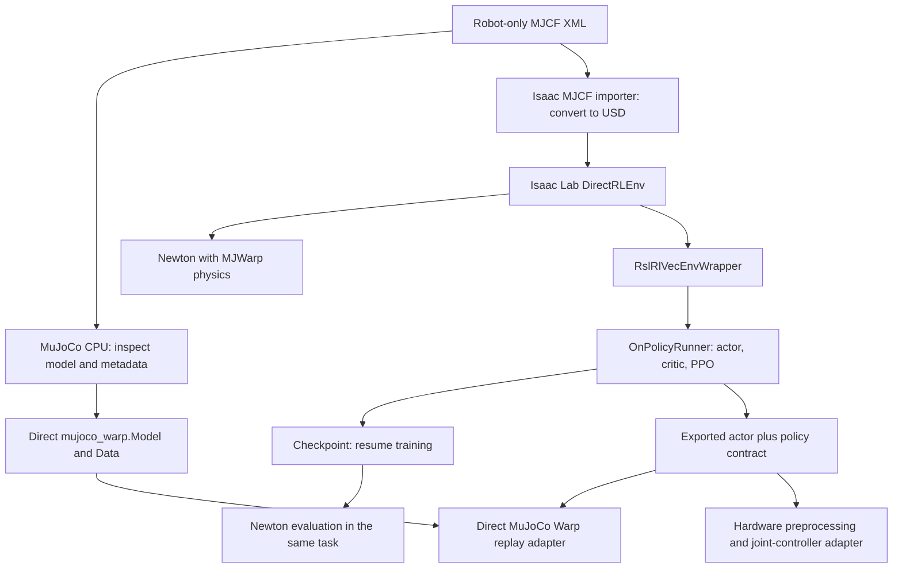

# Quadruped RSL-RL workflow: API reference, examples, and practice

Prepared for Jiaxi on **2026-10-23**. This is a new companion to `MUJOCO_ISAACLAB_RL_API_GUIDE.md`, with more attention to tensors, policy construction, RSL-RL training, checkpointing and evaluation. It leaves the earlier guide intact.

This guide covers the APIs needed to build and understand one complete rigid-body quadruped workflow. It is not an exhaustive catalogue of every function in MuJoCo, Warp, PyTorch, Newton and Isaac Lab. Each numbered API entry includes an example and a practice question; grouped answer hints follow each chapter. Full files are marked explicitly. Small fragments assume the surrounding objects exist.

**Contents**

1. [Workflow, conventions, and installed versions](#chapter-1)
2. [MJCF XML, MuJoCo, and MuJoCo Warp](#chapter-2)
3. [PyTorch: describe every axis before writing the operation](#chapter-3)
4. [Build an Isaac Lab DirectRLEnv using Newton and MJWarp](#chapter-4)
5. [Connect the environment to RSL-RL and train PPO](#chapter-5)
6. [Evaluate, export, replay in MuJoCo Warp, and prepare deployment](#chapter-6)
7. [Run the workflow, test understanding, and check evidence](#chapter-7)

**Suggested starting point:** read the [policy contract](#section-1-3), then the [tensor lab](#section-3-7), [complete environment](#section-4-5), [runner configuration](#section-5-4), and [training script](#section-5-6). Use the [complete-file map and extraction instructions](#section-7-1) when ready to run the examples.


<a id="chapter-1"></a>

## 1. Workflow, conventions, and installed versions

<a id="section-1-1"></a>

### 1.1 The two simulation routes



**MuJoCo** defines a physical model and CPU reference simulation. **Warp** provides GPU arrays and kernels. **MuJoCo Warp** implements batched MuJoCo physics on Warp. **Newton** is another simulation framework with a MuJoCo Warp solver. **Isaac Lab** supplies scenes, task hooks, sensors, controllers, resets and RL integration. **RSL-RL** implements the learning algorithm. **PyTorch** supplies tensors and neural-network operations.

These layers have different objects. `mujoco.MjData`, `mujoco_warp.Data` and `self.robot.data` are not interchangeable. An Isaac articulation represents batches of linked bodies; it is not a raw MuJoCo model. The same physical intent must be translated through each interface.

The **DirectRLEnv route** is the main training workflow here. The **native MJWarp route** is a second simulator/adapter exercise and a policy-transfer test. It does not automatically become an Isaac environment by inheriting from `DirectRLEnv` and calling `mjw.step` inside a hook.

<a id="section-1-2"></a>

### 1.2 Verified version snapshot and interpreter

The installed package metadata and Isaac Lab source were checked while preparing this guide:

| Component | Verified value |
|---|---|
| Python used for these integration examples | `C:\Users\jiaxi\IsaacLab\.venv\Scripts\python.exe`, Python 3.12.15 |
| Isaac Lab repository `VERSION` | `3.0.0` |
| Isaac Lab distribution metadata | `isaaclab 40.0.1`, `isaaclab-newton 10.0.0`, `isaaclab-rl 5.2.2` |
| RSL-RL | `rsl-rl-lib 5.5.1` |
| PyTorch | `2.11.0+cu130` |
| MuJoCo / MuJoCo Warp | `3.15.0` / `3.15.0` |
| NVIDIA Warp | `1.17.0` |
| Newton | `1.8.0.dev0` |
| Isolated MJCF importers | `isaacsim-asset-isolated 6.2.0.0` |
| USD provider used by the Isaac environment | `usd-exchange 3.0.1` |

Package metadata and repository release labels differ in this checkout. The actual installed implementation determined the examples. Later releases may rename fields or change behavior; check the linked reference and installed signature together.

Older tutorials often use an `ActorCritic` policy configuration, WXYZ Isaac quaternions, direct tensor data properties, or old `write_*_to_sim` methods. This guide uses **separate actor and critic configurations**, **XYZW Isaac quaternions**, **`.torch` accessors**, and explicit **index/mask writes**. See the [Isaac Lab 3.0 migration guide](https://isaac-sim.github.io/IsaacLab/v3.0.0/source/isaaclab/migrating.html) and [RSL-RL configuration reference](https://leggedrobotics.github.io/rsl_rl/guide/configuration.html).

Use the Isaac Lab interpreter explicitly for this guide's complete workflow:

```powershell
& 'C:\Users\jiaxi\IsaacLab\.venv\Scripts\python.exe' your_script.py
```

The learning repository's `.venv` is a separate environment. Installing a package in one does not install it in the other. Avoid independently upgrading Torch, USD, MuJoCo or Warp inside an Isaac Lab environment that already has a coordinated dependency set. The current installation uses the Isaac Lab repository's pinned dependencies and `importers` extra; full Isaac Sim/Kit is not required for the Newton GL path shown here.

**API V01 — inspect your running interpreter and packages**

```python
import sys
from importlib.metadata import version
print(sys.executable)
for package in ("torch", "mujoco", "mujoco-warp", "warp-lang", "rsl-rl-lib"):
    print(package, version(package))
```

**Practice V01:** Two terminals show different Torch versions. Which value tells you the executable actually running your script? Does an editor's selected interpreter necessarily match a separately opened terminal?

<a id="section-1-3"></a>

### 1.3 A consistent teaching robot and policy contract

The examples use the **joint names found in your C++ repository's simulation configuration**, in this explicit order:

```python
JOINT_NAMES = [
    f"{leg}_{joint}"
    for leg in ("Front_Left", "Front_Right", "Rear_Left", "Rear_Right")
    for joint in ("Hip", "Thigh", "Shank")
]
```

This is an educational primitive-shape robot, **not a replacement for your CAD model, four-bar transmission, measured actuator dynamics, or existing trained network**. Your existing `Simulation/New Robot Sim/robot_config.py` includes an 83-observation/36-action prototype, and `New Robot RL/environment.py` contains additional task contracts. Those checkpoints cannot be loaded into the new 45/12 teaching policy merely because they control the same twelve physical joints.

| Teaching quantity | Convention |
|---|---|
| Number of controlled hinge joints | 12, in `JOINT_NAMES` order |
| Nominal joint position `q0` | `[0, 0.5, -1.0] * 4` rad; illustrative stance |
| Robot-only XML | `quadruped_robot.xml`; root body `trunk` at XML origin, no floor |
| Standalone scene XML | `quadruped_scene.xml`; includes robot, floor and `home` keyframe |
| Isaac root default / native `home` | z = 0.45 m; initial drop/settling is expected for this simple geometry |
| Physics period | 0.002 s = 500 Hz |
| Policy period | 10 physics steps = 0.02 s = 50 Hz |
| Raw policy action | `(N,12)`, dimensionless; clamp to `[-1,1]` |
| Controller input | `q_target = q0 + 0.25 * action`, radians |
| PD gains / effort cap | Kp 20, Kd 0.5, 15 N·m; teaching values, not hardware tuning |
| Task | Stand first; add command-tracking exercises later |

The actor receives this **45-column** observation, in exactly this order:

| Columns | Quantity | Raw units/frame | Fixed preprocessing |
|---|---|---|---|
| `0:3` | Trunk gyro/angular velocity | rad/s, trunk frame | multiply by 0.25 |
| `3:6` | Projected gravity direction | unit vector, trunk frame | no additional scale |
| `6:9` | Desired forward/lateral/yaw velocity | m/s, m/s, rad/s | scale 1 in this teaching task |
| `9:21` | `q - q0` | rad, named joint order | scale 1 |
| `21:33` | Joint velocity | rad/s, same order | multiply by 0.05 |
| `33:45` | Last applied normalized action | dimensionless, same order | already clipped |

RSL-RL may additionally learn an empirical observation normalizer. The fixed physical preprocessing above is still required; a learned normalizer does not discover a joint permutation or repair a unit mismatch. Exported actors in this guide include their learned normalizer; apply it **once**.

The critic initially receives the same `policy` group. A later exercise introduces a `privileged` group for body velocity or contact information available during simulation. The real actor should use measurements or estimates that the actual robot can supply; deriving body linear velocity from a noisy accelerometer by naive double integration is not a reliable substitute for a validated estimator.

**Practice C01:** Compute `3+3+3+12+12+12`. Which observation columns change if the twelve motor feedback channels arrive in a different order?

**Practice C02:** A network outputs twelve values, all zero. What joint positions are requested? Does the PD controller necessarily produce zero torque?

**Practice C03:** A standing robot yaws by 90 degrees but remains level. Which projected-gravity components should change substantially? Why is this preferable to rewarding a fixed world-yaw quaternion for general walking?

<a id="section-1-4"></a>

### 1.4 Shapes, units and frames to write on paper before coding

```text
N = parallel environments
J = controlled joints (12)
O = observation features (45)
A = action features (12)
T = rollout steps per environment

observations: (N,O)       actions: (N,A)
joint data:   (N,J)       reward/done: (N,)
rollout:      (T,N,O)     root poses: (N,7)
```

Tensor axes have **no built-in page/row/environment meaning**. Your program assigns that meaning. `[N,J]` is a useful convention because one policy forward pass processes many environments together. Native MuJoCo's generalized position `qpos` for this floating-base model has 19 entries: 7 for the base and 12 hinges. `qvel` has 18: 6 base velocities and 12 hinge velocities.

Angles and angular velocity are radians and rad/s at runtime. XML's `compiler angle` controls the interpretation of angle-valued **inputs**, not the runtime unit of hinge `qpos`. A body origin, its COM, and the combined robot COM are different quantities. Native MuJoCo quaternions are WXYZ; Isaac Lab 3.0 task quaternions are XYZW. A quaternion is `[cos(theta/2), axis*sin(theta/2)]` in WXYZ order, not `[cos(theta), sin(theta), sin(theta), sin(theta)]`.

**Practice C04:** For a +90-degree Y rotation, write the unit quaternion in both WXYZ and XYZW. What rotation does negating all four components produce?

<a id="section-1-5"></a>

### 1.5 How to use this guide without copying a whole training system blindly

1. Read chapter 2 and compile the XML on CPU. Check joint names, axes, limits, actuator type and initial contacts.
2. Run the CPU tensor lab from chapter 3. Predict each shape before printing it.
3. Read the six DirectRLEnv hooks in chapter 4 and trace one action through them.
4. Construct the environment with four worlds, step zero actions, and test a partial reset.
5. Read the runner configuration in chapter 5. Run one short PPO update before increasing iteration counts.
6. Load a checkpoint and evaluate it in the same Newton task with fixed episode seeds.
7. Export the actor and replay it in native MuJoCo Warp using the same observation/action contract.
8. Study the hardware adapter and contract exercises in chapter 6. Calibrate signs, zeros, gearing, frames and timing before connecting a real controller.

**API V02 — discover signatures and documentation**

```python
import inspect
from rsl_rl.runners import OnPolicyRunner
print(inspect.signature(OnPolicyRunner.learn))
print(inspect.getfile(OnPolicyRunner))
help(OnPolicyRunner.load)
```

For a running Isaac object, `help(type(robot).write_root_pose_to_sim_index)` shows the installed method rather than an older web example. Read the class's data object for measurement properties and the articulation class for write/command methods. The [official API index](https://isaac-sim.github.io/IsaacLab/v3.0.0/source/api/index.html) and installed source are complementary: versioned docs explain the public contract, while local source resolves the implementation actually running.

**Practice V02:** Locate the installed definition of `OnPolicyRunner.save`. Which line writes the file? Which dictionary field records the learning-iteration label?

<a id="section-1-6"></a>

### 1.6 Answers for the orientation exercises

- **V01:** `sys.executable`; editor selection and a terminal environment can differ.
- **C01:** 45; all joint-position, joint-velocity and previous-action columns must preserve the same name order.
- **C02:** The nominal stance `q0`; PD torque depends on measured position/velocity and gravity/contact loads.
- **C03:** A level yaw rotation leaves projected gravity approximately `[0,0,-1]`; walking need not preserve one world heading.
- **C04:** WXYZ `[sqrt(.5),0,sqrt(.5),0]`; XYZW `[0,sqrt(.5),0,sqrt(.5)]`; negation represents the same rotation.
- **V02:** In RSL 5.5.1, runner `save()` calls `torch.save` and adds the `iter` field; inspect the installed source for exact line numbers.

<a id="chapter-2"></a>

## 2. MJCF XML, MuJoCo, and MuJoCo Warp

This chapter follows the installed MuJoCo **3.15.0**, MuJoCo Warp **3.15.0**, and Warp **1.17.0** APIs checked on 2026-10-23. MuJoCo Warp is imported as `mujoco_warp`; Warp is imported as `warp`. Warp provides device arrays, kernels, streams, and graph capture. MuJoCo Warp implements MuJoCo simulation using Warp. Newton can use MuJoCo Warp as its solver, but a Newton `Model` or Isaac Lab `Articulation` is not a `mujoco_warp.Model`; their APIs are different.

The examples use twelve educational joints in the order below. These names follow your robot naming convention. Geometry, inertia, signs, ranges, gains, and torque limits in the example are teaching values, **not measured or validated specifications for your physical quadruped**.

```python
LEG_NAMES = ("Front_Left", "Front_Right", "Rear_Left", "Rear_Right")
JOINT_NAMES = [f"{leg}_{joint}" for leg in LEG_NAMES
               for joint in ("Hip", "Thigh", "Shank")]
# Front_Left_Hip, Front_Left_Thigh, Front_Left_Shank, ...
Q0 = [0.0, 0.5, -1.0] * 4  # rad; educational nominal stance
```

The catalogue has **60 numbered API entries**, `MJ01` through `MJ60`. Each entry has a small example and a practice question. Catalogue fragments illustrate one API at a time; imports and variables from a preceding fragment are assumed. The complete XML and GPU programs later in this chapter connect them.

<a id="section-2-1"></a>

### 2.1 XML: a tree of bodies, joints, geometry, actuators, and sensors

MJCF describes the physical model. It does not describe PPO or the neural network. A `body` owns a local coordinate frame. A joint attached to that body allows that body's subtree to move relative to its parent. Bodies without joints are welded to their parent. World coordinates follow from the complete chain of body transforms and joint positions.

The official [modeling chapter](https://mujoco.readthedocs.io/en/3.15.0/modeling.html) explains the coordinate conventions. The [MJCF XML reference](https://mujoco.readthedocs.io/en/3.15.0/XMLreference.html) is the searchable attribute reference. The concrete examples below were checked against the installed compiler; copying an attractive feature from newer documentation does not establish MuJoCo Warp support.

#### MJ01 — `<compiler angle="radian" autolimits="true"/>`

Choose the XML angle unit explicitly. `autolimits` allows a specified range to imply a limit. Compiled MuJoCo joint angles and angular velocities use radians and radians per second regardless of the XML input angle unit.

```xml
<compiler angle="radian" autolimits="true"/>
```

**Practice:** What value represents a 90-degree joint angle in this XML? What unit will `data.qpos` use?

#### MJ02 — `<option timestep gravity integrator>`

Set the physical integration interval and gravity. `timestep` is simulated seconds per physics step, not a demand that your computer finish the step in that much wall time.

```xml
<option timestep="0.002" gravity="0 0 -9.81" integrator="implicitfast"/>
```

**Practice:** With action decimation 10, how many policy decisions occur per simulated second?

#### MJ03 — `<default>` and `class`

Give related elements shared defaults instead of repeating every attribute. A named class can define collision geometry defaults separately from visual geometry defaults.

```xml
<default>
  <joint damping="0.2" armature="0.01"/>
  <default class="visual"><geom contype="0" conaffinity="0" mass="0"/></default>
</default>
```

**Practice:** If one shank needs different damping, where would you override it?

#### MJ04 — `<body name pos quat>` and parent-child transforms

A body's `pos` and orientation are relative to its parent. A joint anchor or geom inside that body is expressed in the body's local frame. Changing a joint anchor does not relocate the body's entire frame.

```xml
<body name="trunk" pos="0 0 0">
  <body name="Front_Left_hip_link" pos="0.18 0.12 0">
    <!-- This hip frame is relative to the trunk frame. -->
  </body>
</body>
```

**Practice:** If the trunk translates 1 m in world X, does this hip stay at world X = 0.18 m?

#### MJ05 — `<freejoint>`

Give the floating trunk six physical degrees of freedom. Its generalized position has seven coordinates: world XYZ plus a unit quaternion. Its generalized velocity has six components. A free joint belongs on the top-level moving robot body.

```xml
<body name="trunk" pos="0 0 0">
  <freejoint name="floating_base"/>
  <geom type="box" size="0.22 0.10 0.06" mass="5"/>
</body>
```

**Practice:** For this free joint plus twelve hinges, predict `nq` and `nv`.

#### MJ06 — `<joint type="hinge" axis pos>`

Define a hinge's rotation axis and anchor in the containing body's frame. `axis="0 1 0"` means local Y; when the parent rotates, this axis rotates in world coordinates too.

```xml
<joint name="Front_Left_Thigh" type="hinge" axis="0 1 0" pos="0 0 0"/>
```

**Practice:** Which coordinate frame must you use to interpret that Y axis?

#### MJ07 — joint `range`, `damping`, and `armature`

`range` sets position bounds. Damping creates a velocity-dependent opposing joint force. Armature adds effective joint inertia. These values affect both stability and learned behavior; they are not substitutes for identifying the real drivetrain.

```xml
<joint name="Front_Left_Hip" type="hinge" axis="1 0 0"
       range="-0.7 0.7" damping="0.2" armature="0.01"/>
```

**Practice:** Which parameter directly resists velocity? Which represents added inertia?

#### MJ08 — geom `type`, `size`, and `fromto`

Use primitives first. Box `size` gives half-lengths. A sphere has one radius. A capsule can use endpoints plus radius, which makes leg-link geometry easy to inspect.

```xml
<geom type="capsule" fromto="0 0 0 0 0 -0.20" size="0.018" mass="0.4"/>
```

**Practice:** What would the full width of `<geom type="box" size="0.22 0.10 0.06"/>` be in Y?

#### MJ09 — geom `mass` and body `<inertial>`

For a primitive learning model, MuJoCo can derive body inertia from positive-mass geoms. For a calibrated model, supply a consistent explicit inertial description from CAD or measurements. Do not duplicate mass when you duplicate collision and visual geometry.

```xml
<!-- Alternative to deriving this body's inertia from geoms: -->
<inertial pos="0 0 0" mass="5" diaginertia="0.03 0.09 0.10"/>
```

**Practice:** A visual duplicate uses the same mass as its collision geom. What accidental physical change can that make?

#### MJ10 — collision `contype`, `conaffinity`, and `group`

Collision filtering uses bit masks. Both masks zero makes a visual geom non-colliding. `group` is useful for display and selection; it is not the collision filter itself.

```xml
<geom name="foot_collision" type="sphere" size="0.025"
      contype="1" conaffinity="1" group="3" mass="0.05"/>
```

**Practice:** Does changing only `group="3"` to `group="2"` remove contact forces?

#### MJ11 — separate visual geoms with `rgba`, zero masks, and zero mass

Provide explicit visuals for the complete robot shape. In your earlier wheel example, white visual marks were visible while the collision-only red cylinder was hidden by the Newton viewer. A complete visual duplicate makes the intended appearance independent of collider display settings. Zero mass avoids changing the body inertia.

```xml
<geom name="foot_visual" type="sphere" size="0.025" group="2"
      rgba="0.2 0.4 0.8 1" contype="0" conaffinity="0" mass="0"/>
```

**Practice:** Which geom should keep physical mass when you have separate collision and visual copies?

#### MJ12 — contact `friction` and `condim`

The three friction coefficients describe sliding, torsional, and rolling friction. They are **not XYZ coefficients**. `condim="3"` enables the normal plus two tangential contact dimensions; it does not activate every friction mode just because three coefficients exist.

```xml
<geom type="plane" size="5 5 0.1" friction="0.8 0.01 0.001" condim="3"/>
```

**Practice:** Which coefficient most directly affects a foot sliding sideways on a flat floor?

#### MJ13 — `<position joint kp kv gear>`

A position actuator produces force from target error and velocity feedback. For a hinge with `gear="1"`, the simple behavior is approximately `tau = kp * (q_target - q) - kv * qvel`, subject to limits and the rest of the actuator model. This is one PD actuator per joint; you do not need separate position and damping actuators for this example.

```xml
<position name="Front_Left_Thigh_motor" joint="Front_Left_Thigh"
          kp="20" kv="0.5" gear="1"/>
```

**Practice:** If target and actual angle match but the joint is moving, can this actuator still produce torque?

#### MJ14 — actuator `ctrlrange` versus `forcerange`

`ctrlrange` limits the control input; with this position actuator and unit gear that means angle targets. `forcerange` limits actuator force; for this unit-gear hinge it corresponds to joint torque. These are different limits. Explicit `ctrllimited` and `forcelimited` make the intent visible.

```xml
<position joint="Front_Left_Thigh" kp="20" kv="0.5" gear="1"
          ctrllimited="true" ctrlrange="-2.5 2.5"
          forcelimited="true" forcerange="-15 15"/>
```

**Practice:** Which range would you change to restrict motor effort without shrinking the target angle interval?

#### MJ15 — `<motor>` and `<velocity>` alternatives

A unit-gear hinge `motor` accepts an effort command, while a velocity actuator accepts a speed target and generates effort from speed error. The MuJoCo control slider's meaning therefore follows the actuator definition, not the fact that it is called a slider.

```xml
<!-- Alternative actuators, not extra drives to add beside the position drive: -->
<motor name="hip_torque" joint="Front_Left_Hip" gear="1"/>
<velocity name="knee_speed" joint="Front_Right_Shank" gear="1" kv="0.5"/>
```

**Practice:** What units do these two controls have with unit-gear hinge transmissions?

#### MJ16 — `<site>`

A site supplies an attachment frame for an IMU, a foot marker, or another sensor. It has no independent rigid-body dynamics. Position and quaternion are relative to its body; raw MuJoCo quaternions use **WXYZ**.

```xml
<site name="imu_site" pos="0 0 0" quat="1 0 0 0" size="0.01"/>
```

**Practice:** If you mount the IMU rotated relative to the trunk, should its gyro components equal trunk-frame components without a frame conversion?

#### MJ17 — `<gyro>`, `<accelerometer>`, `<framequat>`, `<framelinvel>`

Declare the measurements you need. Gyro is measured in the site frame. Accelerometer reports proper acceleration: a stationary supported, level sensor typically reads approximately +9.81 along its upward Z, while free fall gives approximately zero. Frame quaternion and velocity sensors expose state in explicitly chosen frames; with no reference object, these frame sensors use world as the reference. For frame sensors, `objtype="xbody"` selects the body frame origin/orientation; `objtype="body"` selects the inertial COM frame. We choose `xbody` to match trunk-frame rotation and origin velocity explicitly.

```xml
<sensor>
  <gyro name="imu_gyro" site="imu_site"/>
  <accelerometer name="imu_accel" site="imu_site"/>
  <framequat name="base_quat" objtype="xbody" objname="trunk"/>
  <framelinvel name="base_linear_velocity_w" objtype="xbody" objname="trunk"/>
</sensor>
```

**Practice:** Does a nearly zero accelerometer reading prove the robot is standing still? Why is `accel_z < gravity` alone an unreliable falling detector?

#### MJ18 — `<keyframe><key qpos ctrl>`

Store a complete useful reset pose, not just twelve joint angles. In this model, `qpos` needs 19 entries: floating-base XYZ, WXYZ, then 12 hinges. `ctrl` needs 12 position targets. A keyframe's quaternion must be a valid unit quaternion; all zeros is invalid.

```xml
<keyframe>
  <key name="home"
       qpos="0 0 0.45 1 0 0 0  0 .5 -1  0 .5 -1  0 .5 -1  0 .5 -1"
       ctrl="0 .5 -1  0 .5 -1  0 .5 -1  0 .5 -1"/>
</keyframe>
```

**Practice:** Why is a twelve-number `qpos` keyframe insufficient for this floating-base robot?

#### MJ19 — `<include file>` and robot-only versus scene XML

Keep a robot-only file for Isaac Lab conversion. Add floor, lights, and standalone reset keyframe in a separate scene wrapper. An include file's outer element is removed and its children are inserted; paths resolve relative to the including file. Do not import a floor inside every robot and also spawn an Isaac Lab ground plane.

```xml
<mujoco model="quadruped_scene">
  <include file="quadruped_robot.xml"/>
  <worldbody><geom name="floor" type="plane" size="5 5 0.1"/></worldbody>
</mujoco>
```

**Practice:** Which file should `MjcfFileCfg(asset_path=...)` convert when Isaac Lab creates the floor separately?

<a id="section-2-2"></a>

### 2.2 The regular MuJoCo CPU API

`MjModel` is the compiled robot description: topology, masses, actuator definitions, address tables, and options. `MjData` is the mutable state and numerical workspace for **one simulation** of that model. It is a struct-like Python object containing many arrays, not one large array. A second `MjData(model)` creates another independent state using the same model.

The [Python bindings guide](https://mujoco.readthedocs.io/en/3.15.0/python.html), [data types](https://mujoco.readthedocs.io/en/3.15.0/APIreference/APItypes.html), and [simulation functions](https://mujoco.readthedocs.io/en/3.15.0/APIreference/APIfunctions.html) explain the C/Python interfaces. The dimensions and examples below also match live CPU checks using the complete XML in section 2.4.

#### MJ20 — `mujoco.MjModel.from_xml_path()` and `.from_xml_string()`

Compile XML into a model. Compilation catches unknown attributes, missing referenced names, invalid inertias, and inconsistent keyframe lengths. File-based compilation naturally supports the relative `<include>` paths in our two-file example.

```python
from pathlib import Path
import mujoco
import numpy as np
model = mujoco.MjModel.from_xml_path(str(Path("quadruped_scene.xml").resolve()))
```

**Practice:** Why can a robot compile in ordinary MuJoCo but still fail during `mjw.put_model()`?

#### MJ21 — `mujoco.MjData(model)`

Allocate one mutable state and workspace. This does not launch a viewer or begin stepping time.

```python
data = mujoco.MjData(model)
another_trial = mujoco.MjData(model)
```

**Practice:** If you change `data.qpos`, does that necessarily change `another_trial.qpos`?

#### MJ22 — `model.nq`, `model.nv`, `model.nu`, `model.nbody`

Inspect sizes rather than guessing. This example has `nq=19`, `nv=18`, `nu=12`; `nbody` also includes MuJoCo's world body. `qpos` is a generalized-coordinate vector, **not a list of every rigid body's COM positions**.

```python
print(model.nq, model.nv, model.nu, model.nbody)
assert (model.nq, model.nv, model.nu) == (19, 18, 12)
```

**Practice:** Why do the free base's quaternion coordinates not require four independent angular velocity values?

#### MJ23 — `model.joint(name)`, `.id`, `.qposadr`, `.dofadr`

Resolve a joint name to model metadata. `qposadr[0]` is that joint's first element index in `qpos`; `dofadr[0]` is its first index in `qvel`. These are array offsets, not hexadecimal RAM pointers. The `[0]` extracts a scalar from MuJoCo's one-element metadata array.

```python
j = model.joint("Front_Left_Thigh")
qi = int(j.qposadr[0])
vi = int(j.dofadr[0])
angle, speed = data.qpos[qi], data.qvel[vi]
```

**Practice:** For the first hinge after a free joint, why are its qpos and qvel starting indices different?

#### MJ24 — `data.qpos`, `data.qvel`, and named joint views

A hinge contributes one position and one velocity. Named views are convenient on CPU. An ordinary basic slice is usually a view; copy values when you need a history snapshot that must not change on the next physics step.

```python
angle_view = data.joint("Front_Left_Thigh").qpos  # shape (1,)
angle_snapshot = angle_view.copy()
speed = float(data.joint("Front_Left_Thigh").qvel[0])
```

**Practice:** Which of these three variables keeps an independent one-element array snapshot?

#### MJ25 — `data.ctrl` and `data.actuator(name).ctrl`

Write actuator controls, not joint controls. A joint may have zero, one, or several actuators. The meaning and units come from the actuator definition.

```python
data.actuator("Front_Left_Thigh_motor").ctrl[:] = 0.6
# Equivalently:
aid = model.actuator("Front_Left_Thigh_motor").id
data.ctrl[aid] = 0.6
```

**Practice:** Why does `data.joint("Front_Left_Thigh").ctrl` fail?

#### MJ26 — `mujoco.mj_step(model, data)`

Advance physics by `model.opt.timestep`, using the current controls. Updating `ctrl` without stepping does not move the robot. For action decimation, hold the same target for several physics steps.

```python
for _ in range(10):
    mujoco.mj_step(model, data)  # 10 * 0.002 = 0.02 simulated seconds
```

**Practice:** Does ten steps always take 0.02 seconds of wall time?

#### MJ27 — `mujoco.mj_forward(model, data)`

Recompute derived quantities from the current state without integrating time. Use it after manually writing qpos/qvel and before reading updated Cartesian poses or relevant derived data. After a step, the integrator has advanced qpos; an explicit forward call gives derived data consistently at that final state.

```python
data.qpos[2] = 0.50
mujoco.mj_forward(model, data)
print(data.body("trunk").xpos)
```

**Practice:** Which call changes `data.time`: `mj_step` or `mj_forward`?

#### MJ28 — `mujoco.mj_resetData(model, data)`

Reset state and workspaces to model defaults. This does not mean “restore my desired stance” unless the model defaults encode that stance. Our robot-only root is at zero height, so a useful physical reset is the home keyframe or an explicit full root/joint reset.

```python
mujoco.mj_resetData(model, data)
# For this model, follow with the home-key reset before running contacts.
```

**Practice:** Why can blindly resetting a floating robot to zeros place it inside the floor?

#### MJ29 — `mujoco.mj_resetDataKeyframe(model, data, key)`

Restore the named keyframe, including position, velocity defaults, controls, and other keyframe state. Then forward the state before inspecting derived quantities.

```python
home_id = model.key("home").id
mujoco.mj_resetDataKeyframe(model, data, home_id)
mujoco.mj_forward(model, data)
```

**Practice:** Why should home controls match the twelve nominal joint positions for position actuators?

#### MJ30 — `data.body(name).xpos`, `.xipos`, `.xquat`, and `.xmat`

`xpos` is the body frame origin in world coordinates; `xipos` is that body's inertial COM position. `xquat` is body orientation in WXYZ order. `xmat` is the body-to-world rotation matrix, exposed as nine row-major values on CPU. The body origin and COM can differ.

```python
b = data.body("trunk")
p_origin, p_com = b.xpos.copy(), b.xipos.copy()
q_wxyz = b.xquat.copy()
R_wb = b.xmat.reshape(3, 3).copy()
gravity_in_body = R_wb.T @ np.array([0.0, 0.0, -1.0])
```

**Practice:** Why does transposing the body-to-world matrix help express world gravity in the body frame?

#### MJ31 — `mujoco.mj_objectVelocity()`

Ask MuJoCo to compute a six-element velocity at an object-centered frame. The buffer order is **angular first, linear second**. `flg_local=0` uses world-oriented components; `1` uses object-local orientation. For `mjOBJ_BODY`, the measured center is the body's inertial frame/COM; use `mjOBJ_XBODY` when you specifically need the body-frame origin. This distinction matters when the COM offset is nonzero.

```python
velocity = np.zeros(6, dtype=np.float64)
bid = model.body("trunk").id
mujoco.mj_objectVelocity(model, data, mujoco.mjtObj.mjOBJ_BODY, bid, velocity, 0)
omega_w = velocity[:3].copy()  # rad/s
v_com_w = velocity[3:].copy()  # m/s
```

Do not treat `data.cvel[bid, 3:]` as a universally interchangeable COM velocity getter. `cvel` uses MuJoCo's internal COM-based spatial frame, whose origin is tied to a subtree COM; shifting the measurement point adds the angular-velocity cross-offset term. Use the object function, a frame sensor, or an explicitly derived point-velocity transform.

**Practice:** Can two points on the same rotating trunk have the same angular velocity but different linear velocities?

#### MJ32 — `data.sensor(name).data`, `model.sensor(name).adr`, and `.dim`

Named CPU access returns just that sensor's measurements. Sensor metadata lets you locate the same measurement inside packed GPU `sensordata` later. A quaternion sensor's result is in `.data`, not `.xquat`.

```python
gyro = data.sensor("imu_gyro").data.copy()
s = model.sensor("imu_gyro")
start, width = int(s.adr[0]), int(s.dim[0])
assert width == 3
```

**Practice:** Why is `data.sensor("base_quat").xquat` the wrong accessor?

#### MJ33 — `mujoco.mj_name2id()` and `mujoco.mj_id2name()`

Convert object names and IDs explicitly when writing reusable tooling. Check for a missing name (`-1`) rather than accidentally using negative indexing. Cache IDs before the inner loop.

```python
bid = mujoco.mj_name2id(model, mujoco.mjtObj.mjOBJ_BODY, "trunk")
if bid < 0:
    raise ValueError("Missing trunk body")
assert mujoco.mj_id2name(model, mujoco.mjtObj.mjOBJ_BODY, bid) == "trunk"
```

**Practice:** What could go wrong if you use ID `-1` as a NumPy index?

#### MJ34 — `mujoco.mj_integratePos()`

Integrate generalized positions using a velocity vector. This handles quaternion geometry correctly; `qpos += dt * qvel` is dimensionally and mathematically wrong for a free joint because `nq != nv`.

```python
predicted_qpos = data.qpos.copy()
mujoco.mj_integratePos(model, predicted_qpos, data.qvel, 0.01)
```

**Practice:** Why is directly adding three angular velocity components to four quaternion elements invalid?

#### MJ35 — `model.opt.timestep` and `data.time`

Read the physical interval and simulated clock explicitly. Rewards, episode duration, command schedules, and policy rate should use simulated time. Wall time measures computer performance or paces a viewer.

```python
physics_dt = float(model.opt.timestep)
simulated_time = float(data.time)
policy_dt = 10 * physics_dt
```

**Practice:** If a 20-second episode takes 40 wall seconds to compute, how long was the physical episode?

#### MJ36 — `mujoco.viewer.launch_passive()`, `.lock()`, `.sync()`, `.is_running()`

A passive viewer displays state while your loop drives the simulation. The `with` statement manages viewer lifetime; `lock()` coordinates shared viewer/model/data access; `sync()` transfers changes to and from the viewer. A lock does not compute physics or synchronize CUDA for you.

```python
import mujoco.viewer
with mujoco.viewer.launch_passive(model, data) as viewer:
    while viewer.is_running():
        with viewer.lock():
            mujoco.mj_step(model, data)
        viewer.sync()
```

**Practice:** What is the difference between releasing the viewer lock and calling `mj_forward`?

<a id="section-2-3"></a>

### 2.3 Warp and MuJoCo Warp API catalogue

The versioned [MuJoCo Warp API](https://mujoco.readthedocs.io/en/3.15.0/mjwarp/api.html) documents the backend surface. The installed `mujoco_warp/_src/io.py` additionally verifies signatures and mask semantics used below. Warp's [1.17 runtime guide](https://nvidia.github.io/warp/v1.17/user_guide/runtime.html) and [PyTorch interoperability guide](https://nvidia.github.io/warp/v1.17/user_guide/interoperability/pytorch.html) cover device operations. Avoid silently borrowing newer graph or interop features from `latest` documentation.

#### MJ37 — `wp.init()`

Initialize Warp and discover devices. Initialization and the first JIT compilation are setup costs; exclude them from steady-state simulation throughput measurements.

```python
import warp as wp
import mujoco_warp as mjw
import torch
wp.init()
```

**Practice:** Why can the first run feel much slower than later iterations of the same loop?

#### MJ38 — `wp.ScopedDevice()`

Choose the device for allocations and launches in a block. A Torch tensor must use a compatible device when sharing data with Warp. A CUDA scope alone does not turn an ordinary `mujoco.mj_step` call into GPU simulation.

```python
with wp.ScopedDevice("cuda:0"):
    gpu_model = mjw.put_model(model)
```

**Practice:** Which function must change if you want to advance MuJoCo Warp physics instead of ordinary MuJoCo physics?

#### MJ39 — `mjw.put_model(cpu_model, batch_sizes=None)`

Convert the CPU model to the backend's device representation. This is an important compatibility check. Successful CPU compilation does not guarantee every model feature, plugin, integrator, collision pair, or sensor is supported by this backend.

```python
with wp.ScopedDevice("cuda:0"):
    gpu_model = mjw.put_model(model)  # may reject unsupported features
```

For installed 3.15, the conversion code explicitly rejects body, actuator, and sensor plugins, among other unsupported combinations. Start with rigid primitives and the actuators/sensors you actually need; test the exact model rather than relying on an outdated blanket supported-features list.

**Practice:** What two separate validation stages must an MJCF pass before GPU stepping?

#### MJ40 — `mjw.make_data(cpu_model, nworld=...)`

Allocate batched state from model defaults. Worlds share topology but have separate state rows. They do not become sixteen cars interacting on one floor: they are independent simulated worlds. This also does not automatically display all worlds in a viewer.

```python
gpu_data = mjw.make_data(model, nworld=256)
assert gpu_data.qpos.shape == (256, model.nq)
```

**Practice:** What shape should `qvel` have for 256 copies of our robot?

#### MJ41 — `mjw.put_data(cpu_model, cpu_data, nworld=...)`

Copy an initialized CPU state into every GPU world. This is useful when you have already set a valid keyframe or pose on CPU. It differs from `make_data`, which uses model defaults.

```python
mujoco.mj_resetDataKeyframe(model, data, model.key("home").id)
mujoco.mj_forward(model, data)
gpu_data = mjw.put_data(model, data, nworld=256)
```

**Practice:** Why is this safer than immediately stepping `make_data` for a robot-only XML whose root is at height zero?

#### MJ42 — `mjw.Model` and `mjw.Data`

These are backend data containers, not CPU `MjModel`/`MjData` with an extra GPU flag. Most GPU state fields are batched Warp arrays. Keep the CPU model for names and address metadata; use those indices to access GPU arrays.

```python
hip_qi = int(model.joint("Front_Left_Hip").qposadr[0])
# gpu_data.joint("Front_Left_Hip") is not the CPU named-access API.
all_qpos = wp.to_torch(gpu_data.qpos)
all_hip_angles = all_qpos[:, hip_qi:hip_qi + 1]
```

**Practice:** Why does the final slice retain shape `(num_envs, 1)` rather than `(num_envs,)`?

#### MJ43 — `mjw.step(gpu_model, gpu_data)`

Advance every world by one physics interval. The call queues device work; it does not inherently wait for a Python print, viewer, or wall clock.

```python
for _ in range(10):
    mjw.step(gpu_model, gpu_data)  # one policy action held for 10 physics steps
```

**Practice:** How much simulated time passes per world in this loop with `dt=0.002`?

#### MJ44 — `mjw.forward(gpu_model, gpu_data)`

Refresh derived quantities without integrating. After resetting or directly editing qpos/qvel, forward before reading fresh Cartesian body frames or sensor values. In simple educational code it is reasonable to forward at the final integrated state before constructing observations; profile redundant work after correctness is established.

```python
mjw.reset_data_keyframe(gpu_model, gpu_data, model.key("home").id)
mjw.forward(gpu_model, gpu_data)
```

**Practice:** Why might a cached body position be stale after directly modifying qpos?

#### MJ45 — `mjw.reset_data(gpu_model, gpu_data, reset=mask)`

The installed API accepts a Warp bool or integer array of shape `(nworld,)`; nonzero entries select worlds to reset. Omitting the mask resets every world. It clears state/workspaces to defaults, not an arbitrary user-designed stance. Never reset only observations while leaving the physical robot fallen.

```python
mask = wp.array([True, False, True, False], dtype=wp.bool, device="cuda:0")
# Here gpu_data must contain exactly four worlds.
mjw.reset_data(gpu_model, gpu_data, reset=mask)
```

**Practice:** After this default reset in our robot-only model, what pose initialization must occur before stepping?

#### MJ46 — `mjw.reset_data_keyframe(gpu_model, gpu_data, key)`

Use an integer key ID to reset all worlds to that keyframe. For selective reset, use one integer per world: valid IDs reset that world, and out-of-range IDs such as `-1` leave it untouched. Follow with forward. This handles more state than overwriting qpos alone.

```python
keys = wp.array([home_id, -1, home_id, -1], dtype=wp.int32, device="cuda:0")
mjw.reset_data_keyframe(gpu_model, gpu_data, keys)
mjw.forward(gpu_model, gpu_data)
```

**Practice:** How would you reset only world 3 in a four-world batch?

#### MJ47 — `wp.to_torch(warp_array)`

Expose a zero-copy Torch view on the same device. It does not reorder axes or invent an environment axis. `(N, nq)` comes from how MuJoCo Warp allocated qpos. Changes through a writable view change shared state; `.clone()` makes an independent snapshot. Neither zero-copy interop nor a simulator automatically makes PPO differentiate through contact physics.

```python
qpos = wp.to_torch(gpu_data.qpos)
old_qpos = qpos.clone()       # history snapshot
qpos[:, hip_qi] += 0.01       # directly edits simulator state; forward afterward
```

**Practice:** If you save `old_qpos = qpos` without cloning, will it preserve the previous state?

#### MJ48 — `wp.from_torch(tensor)`

Wrap a compatible Torch tensor as a Warp array without a host round trip. Preserve ownership and lifetime of shared buffers. Match float32/device/contiguity for our simulator control arrays. Cross-library stream ordering still matters.

```python
targets = torch.zeros((256, model.nu), dtype=torch.float32, device="cuda:0")
targets_wp = wp.from_torch(targets)
```

**Practice:** Why is a CPU float64 target tensor a poor direct match for a CUDA float32 control array?

#### MJ49 — `wp.copy(dest, src)`

Copy compatible array contents into an already allocated destination; destination is first. For a steady loop, reuse buffers instead of constructing a new Warp array from NumPy every step.

```python
wp.copy(gpu_data.ctrl, targets_wp)
```

**Practice:** Why is `wp.copy(targets_wp, gpu_data.ctrl)` the opposite operation?

#### MJ50 — Warp array `.fill_()` and `.zero_()`

Initialize an entire buffer in place. Be careful about semantics: zero controls mean zero-angle targets for a position actuator, not necessarily “disable the motor.” Zeroing a quaternion makes it invalid.

```python
gpu_data.qvel.zero_()
# Demonstration only: target angle zero on every actuator.
gpu_data.ctrl.fill_(0.0)
```

**Practice:** Why could this control fill pull a robot out of its bent-leg nominal stance?

#### MJ51 — `wp.synchronize_device()`

Wait for queued device work when you need completed results or honest wall-time measurements. Synchronizing after every physics step removes useful overlap. Host copies and printing also introduce synchronization costs.

```python
import time
wp.synchronize_device("cuda:0")
t0 = time.perf_counter()
for _ in range(100):
    mjw.step(gpu_model, gpu_data)
wp.synchronize_device("cuda:0")
seconds = time.perf_counter() - t0
```

**Practice:** Why can timing an asynchronous launch without a final synchronize underreport simulation time?

#### MJ52 — `wp.ScopedCapture()`

Record repeated device work in a CUDA graph after warmup. Python loops are executed while capturing to define the graph structure; arbitrary Python decisions are not dynamically rerun by the captured graph. Keep referenced buffers and shapes fixed.

```python
for _ in range(3):
    mjw.step(gpu_model, gpu_data)  # compile/warm up before capture
wp.synchronize_device("cuda:0")
with wp.ScopedCapture() as capture:
    for _ in range(10):
        mjw.step(gpu_model, gpu_data)
```

**Practice:** If you capture ten physics steps, how many run on each replay?

#### MJ53 — `wp.capture_launch(graph)`

Replay recorded operations with the current contents of the same device buffers. Update controls in place before launch. Replacing the Python variable with a newly allocated array does not make an existing graph use a different address.

```python
ctrl_view = wp.to_torch(gpu_data.ctrl)
ctrl_view.copy_(new_targets)        # same allocation, new contents
wp.capture_launch(capture.graph)
```

**Practice:** Why is stable memory more important for graph replay than reusing a variable name?

#### MJ54 — `mjw.get_data_into(cpu_data, cpu_model, gpu_data, world_id=...)`

Copy a chosen world's state and outputs into an existing CPU `MjData`, for inspection or a CPU MuJoCo viewer. It does not display every world or step the CPU simulation. In the installed implementation, several packed arrays are copied to host internally before selecting the requested world, so this is a debugging/display path, not a cheap operation to put inside every batched training step.

```python
mjw.get_data_into(data, model, gpu_data, world_id=0)
mujoco.mj_forward(model, data)
print(data.time, data.body("trunk").xpos)
```

**Practice:** Does calling this function make future `mj_step(model, data)` advance the GPU batch?

#### MJ55 — `wp.stream_from_torch()` and `wp.ScopedStream()`

When composing Torch control/observation operations with Warp physics, use a shared CUDA stream or explicit synchronization. The complete stepping example below uses the current Torch stream via Warp, so target writes, stepping, and later Torch reads have an explicit ordering relationship.

```python
stream = wp.stream_from_torch(torch.cuda.current_stream("cuda:0"))
with wp.ScopedStream(stream):
    ctrl_view.copy_(new_targets)
    mjw.step(gpu_model, gpu_data)
```

**Practice:** Why is zero-copy memory sharing alone insufficient to guarantee that another CUDA stream has finished writing?

#### MJ56 — `@wp.kernel`, `wp.tid()`, and `wp.launch()`

Write a device-parallel kernel when Torch operations or public simulator APIs do not express your operation conveniently. A two-dimensional launch can assign one task to each environment and actuator. Do not replace the public reset API with a qpos-only custom reset unless you also handle every other required physical state.

```python
@wp.kernel
def position_targets(action: wp.array2d[float], nominal: wp.array[float],
                     ctrl: wp.array2d[float]):
    env, joint = wp.tid()
    ctrl[env, joint] = nominal[joint] + 0.25 * wp.clamp(action[env, joint], -1.0, 1.0)

# Assumes actuator column order has been validated against JOINT_NAMES.
wp.launch(position_targets, dim=(num_envs, 12),
          inputs=[actions_wp, q0_wp], outputs=[gpu_data.ctrl])
```

**Practice:** What do the two indices returned by `wp.tid()` represent in this launch?

#### MJ57 — GPU `qpos`, `qvel`, `ctrl`: batch dimensions and gathered order

Build CPU address lists once, then use device indices to gather the twelve joints in your policy order. A free-base model's raw qpos includes the base; never assume `qpos[:, :12]` means twelve actuated joints. Address metadata and actuator IDs are different maps.

```python
q_ids = torch.tensor([int(model.joint(n).qposadr[0]) for n in JOINT_NAMES],
                     device="cuda:0", dtype=torch.long)
v_ids = torch.tensor([int(model.joint(n).dofadr[0]) for n in JOINT_NAMES],
                     device="cuda:0", dtype=torch.long)
q = wp.to_torch(gpu_data.qpos)[:, q_ids]    # (N, 12), a gathered tensor
dq = wp.to_torch(gpu_data.qvel)[:, v_ids]   # (N, 12)
```

**Practice:** Why should you rebuild `q` after stepping rather than assuming a previous advanced-index gather is a live view?

#### MJ58 — GPU `xpos`, `xipos`, `xmat`, and `xquat`

Read derived Cartesian data after forward. A Warp `mat33` field becomes a Torch tensor with two trailing matrix axes. Use the trunk rotation to create projected gravity without quaternion sign ambiguity. Raw MuJoCo/MuJoCo Warp data keeps MuJoCo's WXYZ convention; Isaac Lab 3's Newton-facing quaternion API uses XYZW. A Warp dtype named `quat` is not permission to reinterpret MuJoCo quaternion elements as a generic Warp XYZW quaternion.

```python
bid = model.body("trunk").id
R_wb = wp.to_torch(gpu_data.xmat)[:, bid]    # (N, 3, 3)
g_w = torch.tensor([0., 0., -1.], device="cuda:0").expand(num_envs, 3)
g_b = torch.bmm(R_wb.transpose(1, 2), g_w.unsqueeze(-1)).squeeze(-1)
# If explicitly converting raw MuJoCo quaternion convention:
q_wxyz = wp.to_torch(gpu_data.xquat)[:, bid]
q_xyzw = q_wxyz[:, [1, 2, 3, 0]]
```

**Practice:** What should projected gravity be when the trunk is level, with body Z pointing upward?

#### MJ59 — GPU `sensordata` with CPU sensor address metadata

Select packed sensor columns using the CPU model. This keeps per-world measurements on GPU. Do not call `.numpy()` every step just to build the actor observation. XML sensors in raw MuJoCo Warp are not automatically Isaac Lab sensors after MJCF-to-USD conversion; create the corresponding Isaac sensor/data connection separately.

```python
sensor_meta = model.sensor("imu_gyro")
adr, dim = int(sensor_meta.adr[0]), int(sensor_meta.dim[0])
gyro_b = wp.to_torch(gpu_data.sensordata)[:, adr:adr + dim]  # (N, 3)
```

**Practice:** Which device does `gyro_b` live on if `gpu_data` lives on CUDA?

#### MJ60 — `make_data`/`put_data` capacities: `nconmax`, `naconmax`, `njmax`

Contact and constraint arrays need enough capacity. `nconmax` budgets contacts per world into a global contact pool; `naconmax` explicitly sets the total pool and overrides that contact budgeting. `njmax` is a per-world constraint capacity. An overflow is a simulation correctness issue, not just a slow frame. Begin with defaults, inspect diagnostics, then size from measured worst cases and memory limits.

```python
# Illustrative budget, NOT a guarantee of enough capacity for your robot:
gpu_data = mjw.make_data(model, nworld=256, nconmax=64, njmax=256)
```

**Practice:** Why might a batch need more contact memory after adding rough terrain or robot self-collisions?

<a id="section-2-4"></a>

### 2.4 Complete educational quadruped XML

Save the next two blocks beside one another. `quadruped_robot.xml` contains the robot only and has its root at local Z = 0. Isaac Lab sets the robot's actual root height with its initial state. `quadruped_scene.xml` adds one floor and a standalone home keyframe. For ordinary MuJoCo or raw MuJoCo Warp, load the **scene** and reset to `home` before stepping. For Isaac Lab, convert the **robot** file and create the floor through the scene configuration.

The nominal stance uses `[0, 0.5, -1]` radians per leg. With two 0.20 m links and a 0.025 m foot radius, a 0.45 m initial trunk origin leaves each foot bottom approximately 0.074 m above the plane; a small settling drop is intentional. The model is a simplified serial three-hinge leg, not a reconstruction of your linkage, CAD, motor directions, or closed-chain constraints.

**`quadruped_robot.xml`**

<!-- file: quadruped_robot.xml -->
```xml
<mujoco model="educational_quadruped">
  <compiler angle="radian" autolimits="true" />
  <option timestep="0.002" gravity="0 0 -9.81" integrator="implicitfast" />
  <default>
    <joint limited="true" damping="0.2" armature="0.01" range="-2.5 2.5" />
    <default class="collision">
      <geom group="3" contype="1" conaffinity="1" friction="0.8 0.01 0.001" condim="3" rgba="0.4 0.4 0.4 1" />
    </default>
    <default class="visual">
      <geom group="2" contype="0" conaffinity="0" mass="0" rgba="0.2 0.4 0.8 1" />
    </default>
  </default>
  <worldbody>
    <body name="trunk" pos="0 0 0">
      <freejoint name="floating_base" />
      <geom name="base_collision" type="box" size="0.22 0.10 0.06" mass="5" class="collision" />
      <geom name="base_visual" type="box" size="0.22 0.10 0.06" class="visual" />
      <site name="imu_site" pos="0 0 0" size="0.01" rgba="1 1 0 1" />
      <body name="Front_Left_hip_link" pos="0.18 0.12 0">
        <joint name="Front_Left_Hip" type="hinge" axis="1 0 0" range="-0.7 0.7" />
        <geom name="Front_Left_hip_collision" type="sphere" size="0.035" class="collision" mass="0.15" />
        <geom name="Front_Left_hip_visual" type="sphere" size="0.035" class="visual" />
        <body name="Front_Left_thigh_link">
          <joint name="Front_Left_Thigh" type="hinge" axis="0 1 0" />
          <geom name="Front_Left_thigh_collision" type="capsule" size="0.018" fromto="0 0 0 0 0 -0.20" class="collision" mass="0.4" />
          <geom name="Front_Left_thigh_visual" type="capsule" size="0.018" fromto="0 0 0 0 0 -0.20" class="visual" />
          <body name="Front_Left_shank_link" pos="0 0 -0.20">
            <joint name="Front_Left_Shank" type="hinge" axis="0 1 0" />
            <geom name="Front_Left_shank_collision" type="capsule" size="0.016" fromto="0 0 0 0 0 -0.20" class="collision" mass="0.25" />
            <geom name="Front_Left_shank_visual" type="capsule" size="0.016" fromto="0 0 0 0 0 -0.20" class="visual" />
            <geom name="Front_Left_foot_collision" type="sphere" pos="0 0 -0.20" size="0.025" class="collision" mass="0.05" />
            <geom name="Front_Left_foot_visual" type="sphere" pos="0 0 -0.20" size="0.025" class="visual" />
          </body>
        </body>
      </body>
      <body name="Front_Right_hip_link" pos="0.18 -0.12 0">
        <joint name="Front_Right_Hip" type="hinge" axis="1 0 0" range="-0.7 0.7" />
        <geom name="Front_Right_hip_collision" type="sphere" size="0.035" class="collision" mass="0.15" />
        <geom name="Front_Right_hip_visual" type="sphere" size="0.035" class="visual" />
        <body name="Front_Right_thigh_link">
          <joint name="Front_Right_Thigh" type="hinge" axis="0 1 0" />
          <geom name="Front_Right_thigh_collision" type="capsule" size="0.018" fromto="0 0 0 0 0 -0.20" class="collision" mass="0.4" />
          <geom name="Front_Right_thigh_visual" type="capsule" size="0.018" fromto="0 0 0 0 0 -0.20" class="visual" />
          <body name="Front_Right_shank_link" pos="0 0 -0.20">
            <joint name="Front_Right_Shank" type="hinge" axis="0 1 0" />
            <geom name="Front_Right_shank_collision" type="capsule" size="0.016" fromto="0 0 0 0 0 -0.20" class="collision" mass="0.25" />
            <geom name="Front_Right_shank_visual" type="capsule" size="0.016" fromto="0 0 0 0 0 -0.20" class="visual" />
            <geom name="Front_Right_foot_collision" type="sphere" pos="0 0 -0.20" size="0.025" class="collision" mass="0.05" />
            <geom name="Front_Right_foot_visual" type="sphere" pos="0 0 -0.20" size="0.025" class="visual" />
          </body>
        </body>
      </body>
      <body name="Rear_Left_hip_link" pos="-0.18 0.12 0">
        <joint name="Rear_Left_Hip" type="hinge" axis="1 0 0" range="-0.7 0.7" />
        <geom name="Rear_Left_hip_collision" type="sphere" size="0.035" class="collision" mass="0.15" />
        <geom name="Rear_Left_hip_visual" type="sphere" size="0.035" class="visual" />
        <body name="Rear_Left_thigh_link">
          <joint name="Rear_Left_Thigh" type="hinge" axis="0 1 0" />
          <geom name="Rear_Left_thigh_collision" type="capsule" size="0.018" fromto="0 0 0 0 0 -0.20" class="collision" mass="0.4" />
          <geom name="Rear_Left_thigh_visual" type="capsule" size="0.018" fromto="0 0 0 0 0 -0.20" class="visual" />
          <body name="Rear_Left_shank_link" pos="0 0 -0.20">
            <joint name="Rear_Left_Shank" type="hinge" axis="0 1 0" />
            <geom name="Rear_Left_shank_collision" type="capsule" size="0.016" fromto="0 0 0 0 0 -0.20" class="collision" mass="0.25" />
            <geom name="Rear_Left_shank_visual" type="capsule" size="0.016" fromto="0 0 0 0 0 -0.20" class="visual" />
            <geom name="Rear_Left_foot_collision" type="sphere" pos="0 0 -0.20" size="0.025" class="collision" mass="0.05" />
            <geom name="Rear_Left_foot_visual" type="sphere" pos="0 0 -0.20" size="0.025" class="visual" />
          </body>
        </body>
      </body>
      <body name="Rear_Right_hip_link" pos="-0.18 -0.12 0">
        <joint name="Rear_Right_Hip" type="hinge" axis="1 0 0" range="-0.7 0.7" />
        <geom name="Rear_Right_hip_collision" type="sphere" size="0.035" class="collision" mass="0.15" />
        <geom name="Rear_Right_hip_visual" type="sphere" size="0.035" class="visual" />
        <body name="Rear_Right_thigh_link">
          <joint name="Rear_Right_Thigh" type="hinge" axis="0 1 0" />
          <geom name="Rear_Right_thigh_collision" type="capsule" size="0.018" fromto="0 0 0 0 0 -0.20" class="collision" mass="0.4" />
          <geom name="Rear_Right_thigh_visual" type="capsule" size="0.018" fromto="0 0 0 0 0 -0.20" class="visual" />
          <body name="Rear_Right_shank_link" pos="0 0 -0.20">
            <joint name="Rear_Right_Shank" type="hinge" axis="0 1 0" />
            <geom name="Rear_Right_shank_collision" type="capsule" size="0.016" fromto="0 0 0 0 0 -0.20" class="collision" mass="0.25" />
            <geom name="Rear_Right_shank_visual" type="capsule" size="0.016" fromto="0 0 0 0 0 -0.20" class="visual" />
            <geom name="Rear_Right_foot_collision" type="sphere" pos="0 0 -0.20" size="0.025" class="collision" mass="0.05" />
            <geom name="Rear_Right_foot_visual" type="sphere" pos="0 0 -0.20" size="0.025" class="visual" />
          </body>
        </body>
      </body>
    </body>
  </worldbody>
  <actuator>
    <position name="Front_Left_Hip_motor" joint="Front_Left_Hip" kp="20" kv="0.5" gear="1" ctrllimited="true" ctrlrange="-2.5 2.5" forcelimited="true" forcerange="-15 15" />
    <position name="Front_Left_Thigh_motor" joint="Front_Left_Thigh" kp="20" kv="0.5" gear="1" ctrllimited="true" ctrlrange="-2.5 2.5" forcelimited="true" forcerange="-15 15" />
    <position name="Front_Left_Shank_motor" joint="Front_Left_Shank" kp="20" kv="0.5" gear="1" ctrllimited="true" ctrlrange="-2.5 2.5" forcelimited="true" forcerange="-15 15" />
    <position name="Front_Right_Hip_motor" joint="Front_Right_Hip" kp="20" kv="0.5" gear="1" ctrllimited="true" ctrlrange="-2.5 2.5" forcelimited="true" forcerange="-15 15" />
    <position name="Front_Right_Thigh_motor" joint="Front_Right_Thigh" kp="20" kv="0.5" gear="1" ctrllimited="true" ctrlrange="-2.5 2.5" forcelimited="true" forcerange="-15 15" />
    <position name="Front_Right_Shank_motor" joint="Front_Right_Shank" kp="20" kv="0.5" gear="1" ctrllimited="true" ctrlrange="-2.5 2.5" forcelimited="true" forcerange="-15 15" />
    <position name="Rear_Left_Hip_motor" joint="Rear_Left_Hip" kp="20" kv="0.5" gear="1" ctrllimited="true" ctrlrange="-2.5 2.5" forcelimited="true" forcerange="-15 15" />
    <position name="Rear_Left_Thigh_motor" joint="Rear_Left_Thigh" kp="20" kv="0.5" gear="1" ctrllimited="true" ctrlrange="-2.5 2.5" forcelimited="true" forcerange="-15 15" />
    <position name="Rear_Left_Shank_motor" joint="Rear_Left_Shank" kp="20" kv="0.5" gear="1" ctrllimited="true" ctrlrange="-2.5 2.5" forcelimited="true" forcerange="-15 15" />
    <position name="Rear_Right_Hip_motor" joint="Rear_Right_Hip" kp="20" kv="0.5" gear="1" ctrllimited="true" ctrlrange="-2.5 2.5" forcelimited="true" forcerange="-15 15" />
    <position name="Rear_Right_Thigh_motor" joint="Rear_Right_Thigh" kp="20" kv="0.5" gear="1" ctrllimited="true" ctrlrange="-2.5 2.5" forcelimited="true" forcerange="-15 15" />
    <position name="Rear_Right_Shank_motor" joint="Rear_Right_Shank" kp="20" kv="0.5" gear="1" ctrllimited="true" ctrlrange="-2.5 2.5" forcelimited="true" forcerange="-15 15" />
  </actuator>
  <sensor>
    <gyro name="imu_gyro" site="imu_site" />
    <accelerometer name="imu_accel" site="imu_site" />
    <framequat name="base_quat" objtype="xbody" objname="trunk" />
    <framelinvel name="base_linear_velocity_w" objtype="xbody" objname="trunk" />
  </sensor>
</mujoco>
```

**`quadruped_scene.xml`**

<!-- file: quadruped_scene.xml -->
```xml
<mujoco model="educational_quadruped_scene">
  <include file="quadruped_robot.xml" />
  <worldbody>
    <light pos="0 0 3" dir="0 0 -1" />
    <geom name="floor" type="plane" size="5 5 0.1" rgba="0.2 0.3 0.4 1" friction="0.8 0.01 0.001" />
  </worldbody>
  <keyframe>
    <key name="home" qpos="0 0 0.45 1 0 0 0 0 0.5 -1 0 0.5 -1 0 0.5 -1 0 0.5 -1" ctrl="0 0.5 -1 0 0.5 -1 0 0.5 -1 0 0.5 -1" />
  </keyframe>
</mujoco>
```

**CPU validation program:** run this before attempting conversion or GPU training. It verifies names and dimensions as well as parsing; it does not prove that the model matches your hardware.

```python
from pathlib import Path
import mujoco
import numpy as np

folder = Path(__file__).resolve().parent
m = mujoco.MjModel.from_xml_path(str(folder / "quadruped_scene.xml"))
d = mujoco.MjData(m)
mujoco.mj_resetDataKeyframe(m, d, m.key("home").id)
mujoco.mj_forward(m, d)
assert (m.nq, m.nv, m.nu) == (19, 18, 12)
assert np.isclose(d.body("trunk").xpos[2], 0.45)
for leg in ("Front_Left", "Front_Right", "Rear_Left", "Rear_Right"):
    for joint in ("Hip", "Thigh", "Shank"):
        name = f"{leg}_{joint}"
        assert m.joint(name).id >= 0
        assert m.actuator(name + "_motor").id >= 0
for _ in range(10):
    mujoco.mj_step(m, d)
assert np.isfinite(d.qpos).all() and np.isfinite(d.qvel).all()
print("Model compiled; sizes, names, home height, and 10 CPU steps checked.")
```

**Practice lab:** Raise only the rear feet' visual colors without changing any mass or collision masks. Recompile. Explain why an appearance change should not change the physical mass. Then intentionally misspell one actuator's joint name and observe which validation stage catches it. Restore the name afterward.

<a id="section-2-5"></a>

### 2.5 Complete batched MuJoCo Warp stepping and selective reset

This is a GPU **physics and indexing exercise**, not PPO training. It creates 16 independent robots, holds nominal PD targets, applies a small sinusoidal offset to one thigh, and selectively resets world 0. Resetting restores physical data; printing copied CPU state is outside the performance-critical portion.

```python
from pathlib import Path
import numpy as np
import torch
import mujoco
import mujoco_warp as mjw
import warp as wp

wp.init()
NUM_ENVS, DECIMATION = 16, 10
LEGS = ("Front_Left", "Front_Right", "Rear_Left", "Rear_Right")
NAMES = [f"{leg}_{part}" for leg in LEGS for part in ("Hip", "Thigh", "Shank")]

xml_path = Path(__file__).resolve().parent / "quadruped_scene.xml"
m = mujoco.MjModel.from_xml_path(str(xml_path))
d = mujoco.MjData(m)
home = m.key("home").id
mujoco.mj_resetDataKeyframe(m, d, home)
mujoco.mj_forward(m, d)

device = "cuda:0"
with wp.ScopedDevice(device):
    gm = mjw.put_model(m)
    gd = mjw.put_data(m, d, nworld=NUM_ENVS)
    q_ids = torch.tensor([int(m.joint(n).qposadr[0]) for n in NAMES],
                         device=device, dtype=torch.long)
    v_ids = torch.tensor([int(m.joint(n).dofadr[0]) for n in NAMES],
                         device=device, dtype=torch.long)
    a_ids = torch.tensor([m.actuator(n + "_motor").id for n in NAMES],
                         device=device, dtype=torch.long)
    q0 = torch.tensor([0.0, 0.5, -1.0] * 4, device=device)
    qpos = wp.to_torch(gd.qpos)   # live shared arrays
    qvel = wp.to_torch(gd.qvel)
    ctrl = wp.to_torch(gd.ctrl)
    actions = torch.zeros((NUM_ENVS, 12), dtype=torch.float32, device=device)
    # Fixed allocation reused for selective resets. -1 means untouched.
    reset_keys = torch.full((NUM_ENVS,), -1, device=device, dtype=torch.int32)
    reset_keys_wp = wp.from_torch(reset_keys)
    stream = wp.stream_from_torch(torch.cuda.current_stream(device))

    with wp.ScopedStream(stream):
        for policy_step in range(100):
            simulated_t = policy_step * DECIMATION * float(m.opt.timestep)
            actions.zero_()
            actions[:, 1] = 0.2 * np.sin(2.0 * np.pi * simulated_t)
            targets = q0 + 0.25 * actions.clamp(-1.0, 1.0)
            ctrl[:, a_ids] = targets
            for _ in range(DECIMATION):
                mjw.step(gm, gd)
            mjw.forward(gm, gd)  # refresh final-state poses/sensors

            if policy_step == 49:
                reset_keys.fill_(-1)
                reset_keys[0] = home
                mjw.reset_data_keyframe(gm, gd, reset_keys_wp)
                mjw.forward(gm, gd)
                actions[0] = 0.0  # reset matching controller history too

        final_joint_positions = qpos[:, q_ids].clone()
        final_joint_velocities = qvel[:, v_ids].clone()
    wp.synchronize_device(device)
    # Host copy ONLY for this final report; do not build training obs this way.
    print("angles:", final_joint_positions.cpu().numpy())
    print("speeds:", final_joint_velocities.cpu().numpy())
```

The policy uses joint order `NAMES`. The actuator mapping `a_ids` is explicit, even though this XML happens to list actuators in the same order. You should keep that mapping when moving to a real quadruped XML, where topology order and actuator order may differ.

**Practice lab:** Reset environments 0, 3, and 7 after 50 policy decisions. Leave the other worlds' clocks and motion untouched. Check that `gd.time` differs across reset and non-reset worlds. Then explain why your RL wrapper must reset action history, episode length, and command state for exactly the same environment IDs.

<a id="section-2-6"></a>

### 2.6 Fixed-buffer graph capture

Capture **physics** first. Keep policy inference outside capture until the simpler path works. Warm up the model, then restore `home` so compilation steps do not count as experiment time. Do not capture viewer access, `.numpy()`, printing, or dynamically sized Python lists.

```python
# Continue after m, gm, gd, home, ctrl, q0, a_ids, stream are initialized.
with wp.ScopedDevice("cuda:0"), wp.ScopedStream(stream):
    for _ in range(3):
        mjw.step(gm, gd)
    wp.synchronize_device("cuda:0")
    mjw.reset_data_keyframe(gm, gd, home)
    mjw.forward(gm, gd)
    wp.synchronize_device("cuda:0")

    with wp.ScopedCapture() as captured:
        for _ in range(10):
            mjw.step(gm, gd)
        mjw.forward(gm, gd)

    # Captured graph references gd's existing buffers.
    for policy_step in range(100):
        action = torch.zeros((gd.nworld, 12), device="cuda:0")
        ctrl[:, a_ids] = q0 + 0.25 * action.clamp(-1, 1)
        wp.capture_launch(captured.graph)
wp.synchronize_device("cuda:0")
```

For this illustrative example, the action tensor is newly allocated outside graph capture on each policy step; the graph references only the persistent simulator buffers. A faster final implementation would also reuse its action/target allocations. If you capture target computation too, **all** captured inputs must keep stable storage addresses.

**Practice lab:** Compare warmed, headless throughput with and without graph capture for 1, 16, and 256 worlds. Use synchronization before and after timing. Report both wall seconds and aggregate transitions/s; do not conclude that GPU is faster merely because it is a GPU. Check matched simulated duration and state sanity before comparing speed.

<a id="section-2-7"></a>

### 2.7 Display one GPU world with the regular MuJoCo viewer

The viewer does not make GPU physics run on CPU. It needs a CPU representation of the selected world's state for rendering. Copying that state frequently can dominate a small simulation's wall time. Render at a lower rate than physics and keep headless training separate from visual evaluation.

```python
# Continue after m, gm, gd, home, ctrl, q0, a_ids are initialized.
import time
import mujoco.viewer

display_data = mujoco.MjData(m)
policy_dt = 10 * float(m.opt.timestep)
with mujoco.viewer.launch_passive(m, display_data) as viewer:
    while viewer.is_running():
        frame_start = time.perf_counter()
        with wp.ScopedDevice("cuda:0"), wp.ScopedStream(stream):
            ctrl[:, a_ids] = q0  # replace with loaded policy's scaled targets
            for _ in range(10):
                mjw.step(gm, gd)
            mjw.forward(gm, gd)
        wp.synchronize_device("cuda:0")
        with viewer.lock():
            mjw.get_data_into(display_data, m, gd, world_id=0)
            mujoco.mj_forward(m, display_data)
        viewer.sync()
        remaining = policy_dt - (time.perf_counter() - frame_start)
        if remaining > 0:
            time.sleep(remaining)
```

This advances 0.02 simulated seconds per displayed frame for `dt=0.002`; wall-time pacing is optional for viewing and should be removed from training. `frame_start` is recreated every iteration. Mixing `time.time()` with a `time.perf_counter()` start value, or using the program's original start value for every sleep calculation, breaks pacing.

**Practice lab:** Change `world_id` to 3. Explain why you still see one robot. Then remove pacing and measure simulation speed headlessly; explain why the learned task uses simulated dt even if the computer runs slower than real time.

<a id="section-2-8"></a>

### 2.8 Raw MuJoCo Warp observations must match the policy contract

The shared educational actor contract in this guide has **45 values** per environment:

| Columns | Meaning | Shape |
|---|---|---|
| 0:3 | trunk gyro in body axes, rad/s, multiplied by 0.25 | `(N, 3)` |
| 3:6 | normalized projected gravity in body axes | `(N, 3)` |
| 6:9 | commanded forward speed, lateral speed, yaw rate | `(N, 3)` |
| 9:21 | joint position minus nominal position, policy joint order | `(N, 12)` |
| 21:33 | joint velocity, same order, multiplied by 0.05 | `(N, 12)` |
| 33:45 | previous clipped policy action | `(N, 12)` |

Position-offset actions use `q_target = q0 + 0.25 * clamp(action, -1, 1)`. The factor has units of radians per normalized action. A trained policy that expects another observation order, scale, history, command convention, or nominal pose cannot be safely evaluated by merely matching the total vector width.

```python
def build_raw_mjw_observation(m, gd, q_ids, v_ids, q0,
                              velocity_command, previous_action):
    """No CPU state copies; call after forward on a properly ordered stream."""
    state = wp.to_torch(gd.sensordata)
    sensor = m.sensor("imu_gyro")
    start, width = int(sensor.adr[0]), int(sensor.dim[0])
    gyro_b = state[:, start:start + width]
    trunk_id = m.body("trunk").id
    R_wb = wp.to_torch(gd.xmat)[:, trunk_id]
    g_w = torch.tensor([0.0, 0.0, -1.0], device=q0.device).expand(gd.nworld, 3)
    gravity_b = torch.bmm(R_wb.transpose(1, 2), g_w.unsqueeze(-1)).squeeze(-1)
    q = wp.to_torch(gd.qpos)[:, q_ids]
    dq = wp.to_torch(gd.qvel)[:, v_ids]
    obs = torch.cat((0.25 * gyro_b, gravity_b, velocity_command,
                     q - q0, 0.05 * dq, previous_action), dim=1)
    assert obs.shape == (gd.nworld, 45)
    return obs
```

For the later loaded-policy evaluator, build this observation, run inference, clip the returned action, apply its offset targets for the same number of physics substeps used in training, and retain that clipped action as the next `previous_action`. Reset policy history only for reset worlds. If the deployed policy includes normalization, retain the training normalizer or exported wrapper; do not normalize twice.

For critic-only reward or diagnostics, you may need base linear velocity. The `base_linear_velocity_w` frame sensor supplies world velocity at the body frame origin in our example. Rotate it with `R_wb.transpose(1, 2)` when a body-frame tracking reward requires that frame. If you need COM velocity specifically, use an inertial-frame sensor or the correct point transform rather than confusing origin velocity with COM velocity. The educational trunk's COM happens to be at its origin, but a real robot's often is not.

**Practice lab:** Permute the front-left and rear-right joint columns while leaving all dimensions unchanged. Explain why the observation shape assertion passes but policy behavior can fail. Then write a second assertion that compares all joint names against the saved training metadata.

<a id="section-2-9"></a>

### 2.9 Compatibility checks, frames, and diagnosis order

| Stage | What it verifies | What it does not establish |
|---|---|---|
| XML parse/`MjModel.from_xml_path` | legal MJCF, names, inertia, coordinate sizes | GPU feature support or correct hardware geometry |
| `mjw.put_model` | installed backend accepts model features | enough runtime contact memory in worst cases |
| home reset + forward | valid initial state and derived frames | stable long-term contacts or successful policy |
| a few headless steps | finite state and basic physical interaction | agreement with Newton import or real hardware |
| matched CPU/GPU comparison | a useful numerical sanity check | bitwise identical trajectories over long contacts |
| converted Isaac asset inspection | links/joints/colliders/drive import | preservation of every MJCF sensor, texture, or actuator feature |
| policy observation/action audit | dimensions, names, scaling, frames, timing | learned success under disturbances |

Keep the simulator's coordinate conventions separate:

| Quantity | Raw MuJoCo/MuJoCo Warp convention | Isaac Lab 3 Newton-facing convention used later |
|---|---|---|
| quaternion elements | WXYZ | XYZW |
| `qpos` free joint | XYZ plus WXYZ; position of body frame origin | exposed root pose API, XYZ plus XYZW |
| body orientation | `xquat` or `xmat` | articulation pose/orientation data |
| body gyro | site frame if using gyro sensor | IMU sensor body frame with mounting configuration |
| world layout | independent raw batch worlds may share numeric XYZ | Isaac scene uses environment-origin offsets |

Do not add Isaac `env_origins` to an already world-space live pose. Do not add a nonzero root height in the robot XML and again in the spawn/reset configuration without understanding how the importer composes those transforms. This guide deliberately uses root XML Z = 0, Isaac initial Z = 0.45, and a standalone keyframe Z = 0.45.

<a id="section-2-10"></a>

### 2.10 Exercise answer hints

Try the questions before using these hints. These are checks of API meaning, not recommended hardware settings.

| Entries | Hints |
|---|---|
| MJ01–MJ03 | 90 degrees is pi/2 rad; `qpos` stays rad. `1/(0.002*10)=50` decisions/s. Override the individual joint attribute or create a different default class. |
| MJ04–MJ06 | The hip follows its parent; local X offset does not remain a fixed world coordinate. Free joint plus 12 hinges gives 19 positions and 18 velocities. Hinge axis belongs to the containing body frame. |
| MJ07–MJ09 | Damping resists velocity; armature adds effective inertia. Box Y width is 0.20 m. A positive-mass visual duplicate can double-count mass/inertia. |
| MJ10–MJ12 | Display group is not a contact filter. Keep physical mass in collision/inertial representation, visual mass zero. The first friction coefficient describes sliding. |
| MJ13–MJ15 | A moving joint can receive damping torque even at zero position error. Change `forcerange` for effort limits. Unit-gear hinge motor uses torque; velocity drive uses rad/s. |
| MJ16–MJ19 | Rotate measurements between sensor and trunk frames when mounting differs. Free fall can read near zero proper acceleration. The free base needs 7 qpos entries in addition to 12 hinges. Convert robot-only XML when Isaac adds terrain. |
| MJ20–MJ23 | MuJoCo CPU and MuJoCo Warp accept different feature sets. Separate MjData objects hold independent states. A quaternion has 4 coordinates but 3 rotational degrees of freedom. First hinge addresses follow 7 qpos versus 6 qvel base entries. |
| MJ24–MJ27 | `.copy()` is the independent CPU array. Controls belong to actuators. Ten 0.002-second steps advance 0.02 simulated seconds; wall time varies. Forward does not integrate time. |
| MJ28–MJ30 | Default root height can be zero and default joint posture can differ from a useful stance. Matching home controls avoids an immediate PD command jump. Inverse rotation maps a world vector into body axes. |
| MJ31–MJ33 | `v_point = v_reference + omega cross offset`. Sensor measurements use `.data`; quaternions do not create an `.xquat` field on a sensor view. Negative NumPy index selects from the array end rather than signaling a missing name. |
| MJ34–MJ36 | Quaternion integration is not elementwise Euler addition. The physical episode lasted 20 simulated seconds. A lock coordinates access; forward recomputes quantities. |
| MJ37–MJ40 | JIT/initialization costs are setup. Use `mjw.step` for MJWarp objects. First compile CPU XML, then convert/check backend features. Batch qvel has shape `(256,18)`. |
| MJ41–MJ44 | Copying a home-initialized CPU state avoids a zero-height root default. A slice `i:i+1` preserves a one-column axis. Ten steps advance .02 s per world. Derived poses require refresh after state edits. |
| MJ45–MJ48 | Restore a valid root, joints, quaternion, and controls; the home key is convenient. Keys `[-1,-1,-1,home]` reset only world 3. Assignment aliases; `.clone()` copies. Devices/dtypes must agree for interop. |
| MJ49–MJ52 | `wp.copy` writes its first argument. Zero position targets are active commands. Timing must wait for completion. Each captured replay contains ten steps. |
| MJ53–MJ56 | A graph stores references to allocations, not Python variable names. Host viewer data is separate from GPU state. Shared memory does not order independent CUDA streams. Kernel indices mean environment and joint. |
| MJ57–MJ60 | Advanced-index gathers produce separate tensors; gather fresh values after stepping. Level projected gravity is `[0,0,-1]`. Sensor tensor stays on CUDA. More collision candidates/contacts/constraint rows require more capacity. |

<a id="section-2-11"></a>

### 2.11 Sources and validation limits for this chapter

Primary online references:

- [MuJoCo 3.15 MJCF XML reference](https://mujoco.readthedocs.io/en/3.15.0/XMLreference.html): legal model elements and attributes.
- [MuJoCo 3.15 modeling](https://mujoco.readthedocs.io/en/3.15.0/modeling.html): frame hierarchy, inertial modeling, and actuator concepts.
- [MuJoCo 3.15 Python](https://mujoco.readthedocs.io/en/3.15.0/python.html): named access and passive viewer.
- [MuJoCo 3.15 API types](https://mujoco.readthedocs.io/en/3.15.0/APIreference/APItypes.html): model/data layout and generalized coordinates.
- [MuJoCo 3.15 API functions](https://mujoco.readthedocs.io/en/3.15.0/APIreference/APIfunctions.html): step, forward, reset, object velocity, and position integration.
- [MuJoCo Warp 3.15 API](https://mujoco.readthedocs.io/en/3.15.0/mjwarp/api.html): device model/data and simulation calls.
- [Warp 1.17 runtime](https://nvidia.github.io/warp/v1.17/user_guide/runtime.html): allocation, kernels, graph capture, and device coordination.
- [Warp 1.17 Torch interoperability](https://nvidia.github.io/warp/v1.17/user_guide/interoperability/pytorch.html): shared arrays and streams.

Installed source checked: `C:\Users\jiaxi\IsaacLab\.venv\Lib\site-packages\mujoco_warp\_src\io.py`, `_src\forward.py`, `_src\types.py`, public `mujoco_warp\__init__.py`, and runtime Python signatures/docstrings for Warp and MuJoCo. Installed-source checks are especially important when newer online docs have added fields or overloads.

The complete XML was compiled with installed CPU MuJoCo, reset to `home`, forwarded, and stepped for ten CPU steps. Verified: `nq=19`, `nv=18`, `nu=12`, four sensors packing 13 values, trunk height 0.45 m, four initial foot bottoms approximately 0.07397 m above the plane, and finite state after those steps.

The central GPU integration was also exercised: the complete Isaac Lab/Newton/MJWarp task ran four worlds with finite `(4,45)` observations and `(4,12)` actions; ten zero-action environment steps produced no early termination, a partial reset preserved the other worlds, one PPO update completed, and the exported TorchScript actor matched the inference policy. The exported actor then replayed in native MuJoCo Warp for four worlds and eight policy decisions, reaching 0.16 simulated seconds per world.

These short headless checks establish basic environment/runner/export/replay connections. The separate catalogue fragments, fixed-buffer graph-capture demonstration, capacity-tuning exercise, and CPU-viewer bridge were not each executed as independent programs. They remain source-checked teaching examples; see the guide's final validation section for the consolidated test record. No viewer-performance benchmark, long training success, model identification, or safe physical-hardware gains are claimed.

<a id="chapter-3"></a>

## 3. PyTorch: describe every axis before writing the operation

This chapter was checked against the Isaac Lab interpreter's **PyTorch 2.11.0+cu130**. The runnable lab uses **CPU tensors only**. Tensor examples use radians, rad/s, meters, seconds, and body/world frame names explicitly. A correctly shaped tensor can still contain the wrong physical quantity.

We use a new **teaching contract**: four legs, three actuated joints per leg, twelve actions, and 45 actor observations. Leg order is `Front_Left`, `Front_Right`, `Rear_Left`, `Rear_Right`; within each leg use `Hip`, `Thigh`, `Shank`. This order must match the simulator and controller. Your existing `RobotConfig` declares **83 observations and 36 actions**, and other `environment.py` modes have different layouts. The new 45/12 teaching example is not compatible with those checkpoints. All gains, dimensions, randomization ranges, and action scales here are learning examples, not validated tuning for your hardware.

Current source references: [prototype RobotConfig](</C:/Users/jiaxi/OneDrive/Documentos/GitHub/Quadruped_Robot_cpp_Control_Code/Simulation/New Robot Sim/robot_config.py:30>) and [mode-dependent environment interfaces](</C:/Users/jiaxi/OneDrive/Documentos/GitHub/Quadruped_Robot_cpp_Control_Code/Simulation/New Robot RL/environment.py:97>).

<a id="section-3-1"></a>

### 3.1 Shapes are labels you choose, not pages/rows/columns built into Torch

| Shape | Meaning in this guide | Example access |
|---|---|---|
| `(N, 12)` | environments, actuated joints | `q[5, 2]`: joint 2 in environment 5 |
| `(N, 4, 3)` | environments, legs, joints per leg | `q_leg[:, 0, :]`: front-left leg in every environment |
| `(N, 3)` | environments, XYZ components | `gyro_b[:, 2]`: body-Z angular velocity |
| `(T, N, 45)` | rollout time, environments, observation features | `rollout[t, env_id]`: one observation |
| `(N, 45)` | environments, actor observation features | `obs[:, 9:21]`: twelve position offsets |

Torch uses ordered axes. It does not assign “page” or “environment” meaning to any axis. An integer size such as `3` describes how many entries that axis has, not what those entries mean. In C++, `std::array<float, 12>` is a useful analogy for one robot's twelve values; a batched tensor adds shape, device information, vectorized operations, and optional automatic differentiation.

Unless a fragment says otherwise, start with:

```python
import numpy as np
import torch
from torch import nn

N, J = 16, 12
device = torch.device("cpu")  # Change deliberately when running the simulator.
q = torch.zeros((N, J), device=device, dtype=torch.float32)
q0 = torch.zeros((J,), device=device, dtype=torch.float32)
```

<a id="section-3-2"></a>

### 3.2 Create data and choose its device/type: T01–T10

**T01 — `torch.tensor(data, dtype=..., device=...)`: construct an owned tensor from values.** This copies input data. Use it for small constants such as a nominal twelve-joint posture; `torch.array` is not the constructor used here.

```python
front_left_nominal = torch.tensor([0.0, 0.5, -1.0], dtype=torch.float32)
```

Practice: create the three angles for the rear-right leg. What is the shape: `(3,)` or `(1, 3)`?

**T02 — `torch.zeros`, `torch.ones`, `torch.full`: initialize a buffer.** Pass shape as separate integer sizes or as a tuple. `torch.zeros(1, 2)` is a valid Torch shape call; NumPy's corresponding tuple form is `np.zeros((1, 2))`.

```python
previous_actions = torch.zeros((N, J), device=device)
contact_weights = torch.ones((N, 4), device=device)
nominal_height = torch.full((N,), 0.35, device=device)
```

Practice: initialize a `(N, 3)` command buffer with every entry `0.1`. Why is that not necessarily a useful walking command?

**T03 — `torch.as_tensor` and `torch.from_numpy`: reuse existing data when possible.** `from_numpy` shares CPU memory with a supported NumPy array. `as_tensor` may return the original tensor or share an array, but device/type conversion can require a copy. Use `torch.tensor` or `.clone()` when independent ownership is required.

```python
encoder_np = np.zeros((N, J), dtype=np.float32)
encoder_tensor = torch.from_numpy(encoder_np)
encoder_np[0, 0] = 0.2  # encoder_tensor[0, 0] changes too.
same_tensor = torch.as_tensor(encoder_tensor)
```

Practice: if a serial reader overwrites `encoder_np`, will your old `encoder_tensor` preserve the previous measurement?

**T04 — `torch.arange(start, stop, step)`: create ordered indices.** The stop is excluded; index tensors normally use `torch.long`.

```python
all_env_ids = torch.arange(N, device=device, dtype=torch.long)
front_left_ids = torch.arange(0, 3, device=device, dtype=torch.long)
```

Practice: select the rear-right leg's three columns in the stated joint order.

**T05 — `torch.eye(n)`: create an identity matrix.** It is useful for a reference rotation matrix or a test transform; it does not create a quaternion.

```python
R_world_from_body = torch.eye(3, device=device)
```

Practice: what does multiplying this matrix by a three-component foot vector change?

**T06 — `torch.rand`, `torch.randn`, `torch.rand_like`: sample random values.** `rand` is uniform on `[0, 1)`; `randn` is standard normal, with unbounded tails. `rand_like` inherits the reference shape/device/type unless overridden.

```python
reset_jitter = 0.1 * (2.0 * torch.rand_like(q) - 1.0)  # [-0.1, 0.1) rad
gyro_noise = 0.01 * torch.randn((N, 3), device=device)
random_commands = torch.rand((N, 3), device=device)
```

Practice: generate a uniform thigh-angle offset in `[-0.05, 0.05)` radians for every environment.

**T07 — `torch.manual_seed(seed)`: seed Torch's random generators.** This helps repeat a small tensor experiment. It does not by itself guarantee identical physics, NumPy randomness, or a complete GPU training run.

```python
torch.manual_seed(7)
first = torch.rand((N, 1))
torch.manual_seed(7)
second = torch.rand((N, 1))  # Same Torch draw in this experiment.
```

Practice: how would you test that these two draws are equal without printing every entry?

**T08 — `torch.device` and `torch.cuda.is_available()`: choose where tensors live.** A GPU simulation and a GPU policy generally exchange device-resident tensors. Availability does not prove that every simulator/backend supports that device.

```python
policy_device = torch.device("cuda:0" if torch.cuda.is_available() else "cpu")
```

Practice: why can a CPU tensor and a CUDA tensor not always be added directly?

**T09 — `dtype`, `torch.float32`, `torch.long`, `torch.bool`, and `Tensor.to`: choose representation.** Use floating point for measurements/actions, integer indices for environment/joint selection, and Boolean values for termination masks. `.to(...)` returns a converted tensor; assign the result. If nothing changes, it can return the same tensor, so it is not a guaranteed copy.

```python
q = q.to(device=device, dtype=torch.float32)
env_ids = torch.tensor([0, 3], device=device, dtype=torch.long)
terminated = torch.zeros(N, device=device, dtype=torch.bool)
```

Practice: does `q.to(torch.float64)` without assignment guarantee that `q.dtype` changes?

**T10 — `.shape`, `.ndim`, `.numel()`: inspect dimensions before calculating.** `.shape` is a `torch.Size`, `.ndim` is the number of axes, and `.numel()` counts all entries.

```python
assert q.shape == (N, 12)
assert q.ndim == 2
assert q.numel() == N * 12
```

Practice: for `(24, 16, 45)`, which number counts environments? How many entries are stored?

References: [Tensor constructors](https://docs.pytorch.org/docs/2.11/torch.html#creation-ops), [`as_tensor`](https://docs.pytorch.org/docs/2.11/generated/torch.as_tensor.html), [`from_numpy`](https://docs.pytorch.org/docs/2.11/generated/torch.from_numpy.html), [`Tensor.to`](https://docs.pytorch.org/docs/2.11/generated/torch.Tensor.to.html), [Tensor attributes](https://docs.pytorch.org/docs/2.11/tensor_attributes.html), and [reproducibility](https://docs.pytorch.org/docs/2.11/notes/randomness.html).

<a id="section-3-3"></a>

### 3.3 Select, arrange, and copy: T11–T25

**T11 — integer indexing and `.item()`: one tensor entry versus a Python number.** `q[0, 2]` is a zero-dimensional tensor; `.item()` converts a one-entry tensor to a Python scalar. On CUDA, reading that scalar on the CPU can wait for GPU work. Keep per-environment reward calculations as tensors instead of calling `.item()` in a Python loop.

```python
one_shank_angle = q[0, 2]          # Tensor with shape ().
angle_for_debug = one_shank_angle.item()  # Python float.
```

Practice: compare the shapes of `q[0]`, `q[0:1]`, `q[:, 2]`, and `q[:, 2:3]`.

**T12 — `start:stop:step` slices: the stop is excluded.** Basic slices usually share storage with the original tensor.

```python
front_left = q[:, :3]     # All environments, joint columns 0, 1, 2; (N, 3).
one_column = q[:, 2:3]    # Retains the feature axis; (N, 1).
```

Practice: in a pose `[x, y, z, qx, qy, qz, qw]`, what does `pose[:, :3]` select? Does `pose[:, 2]` retain a size-one feature axis?

**T13 — advanced indexing / `index_select`: select arbitrary rows or columns.** `q[env_ids]` is a gathered copy. `q[env_ids, joint_ids]` pairs matching index entries; it does not create every environment-joint combination. For a rectangular selection, use `q[env_ids[:, None], joint_ids[None, :]]`, or sequential `index_select` calls when only reading.

```python
joint_ids = torch.tensor([0, 3], device=device, dtype=torch.long)
selected = q.index_select(0, env_ids).index_select(1, joint_ids)  # (2, 2)
paired = q[env_ids, joint_ids]  # (2,), two pairs: (0, 0), (3, 3).
```

Practice: select the four hip columns `[0, 3, 6, 9]` in every environment. What shape should result?

**T14 — Boolean masks and `.nonzero(as_tuple=False)`: select failed environments.** A one-dimensional mask selects rows. A full `(N, J)` mask selects individual entries and normally flattens the selected values.

```python
base_height = torch.full((N,), 0.35, device=device)
fallen = base_height < 0.15
fallen_env_ids = fallen.nonzero(as_tuple=False).flatten()  # (number_fallen,)
fallen_angles = q[fallen]                                 # (number_fallen, 12)
```

Practice: why does `q[q > 0.5]` not preserve one row per environment?

**T15 — indexed assignment: write into the original, not a temporary selection.** The left-hand side `q[env_ids] = value` writes back. In contrast, `q[env_ids].zero_()` modifies a temporary gathered tensor and does not reset `q`. This is an important reset bug.

```python
q[env_ids] = q0                       # Reset these environments.
q[env_ids[:, None], joint_ids[None, :]] = 0.1  # Rectangular write.
# Avoid: q[env_ids][:, joint_ids] = 0.1  # Writes into a temporary copy.
```

Practice: repair `previous_actions[env_ids].zero_()` so it clears the selected original rows.

**T16 — `torch.cat(sequence, dim)`: join along an existing axis.** For `(N, features)` data, `dim=1` joins feature columns. Each input must agree on the other dimensions.

```python
gyro_b = torch.zeros((N, 3), device=device)
joint_vel = torch.zeros_like(q)
small_obs = torch.cat((gyro_b, q, joint_vel), dim=1)  # (N, 27)
```

Practice: why does concatenating these buffers with `dim=0` fail when their feature widths differ?

**T17 — `torch.stack(sequence, dim)`: insert a new axis.** Inputs have matching shapes. Stack three `(N, 45)` observations at `dim=0` to create `(3, N, 45)` history. Stacking a 3-wide gyro and 12-wide joint positions fails; that job belongs to `cat`.

```python
q_history = torch.stack((q.clone(), q.clone()), dim=0)  # (2, N, 12)
```

Practice: what shape results from stacking the same two buffers with `dim=1`?

**T18 — `.reshape`, `.view`, `.contiguous`: reinterpret shape without inventing data.** `.reshape` returns a view when possible and a copy when needed. `.view` requires compatible strides and may fail after a transpose. `.contiguous()` makes a contiguous tensor if necessary. None of these reorder your leg semantics automatically.

```python
q_leg = q.reshape(N, 4, 3)           # (environment, leg, joint_in_leg)
flat_again = q_leg.reshape(N, 12)
transposed_flat = q.T.contiguous().view(-1)
```

Practice: can 192 values be reshaped into `(16, 4, 3)`? Into `(16, 4, 4)`?

**T19 — `.unsqueeze(dim)` / `.squeeze(dim)`: add/remove size-one axes.** Prefer an explicit axis to preserve your environment dimension when `N=1`. A bare `.squeeze()` can turn `(1, 12)` into `(12,)`, breaking a batched policy.

```python
height = base_height.unsqueeze(1)  # (N,) -> (N, 1)
height_again = height.squeeze(1)  # (N, 1) -> (N,)
```

Practice: turn one 45-value observation into the `(1, 45)` input expected by a batched actor.

**T20 — `.transpose` / `.permute`: change axis order.** These are usually views with different strides. Use them when converting `(time, env, feature)` to `(env, time, feature)`, not to reinterpret quaternion component order.

```python
history = torch.zeros((8, N, 45), device=device)
env_first = history.permute(1, 0, 2)  # (N, 8, 45)
```

Practice: bring `(N, 4, 3)` leg vectors to `(4, N, 3)`. Does this rotate a foot vector physically?

**T21 — `.expand` versus `.repeat`: shared repeated view versus copied repetition.** Expanding a size-one axis creates a view, so multiple logical entries may refer to the same data. Use expanded tensors for reading; clone before independent per-environment writes.

```python
nominal_all = q0.unsqueeze(0).expand(N, -1)  # (N, 12), shared view.
reset_targets = nominal_all.clone()         # Independent editable entries.
copied_nominal = q0.unsqueeze(0).repeat(N, 1)
```

Practice: which would you use for a read-only posture subtraction? Which for randomized reset targets?

**T22 — `.clone()`: preserve a snapshot in independent storage.** `old = q` only creates another Python reference to the same tensor. Cloning separates storage; it does not automatically remove an autograd connection.

```python
same_buffer = q
q_before_step = q.clone()
```

Practice: after `q.zero_()`, which of these names still contains the old joint angles?

**T23 — `.detach()`: stop gradient tracking, not memory sharing.** A detached tensor shares storage. Use `.detach().clone()` when you need a frozen numerical copy with no gradient connection.

```python
network_output = torch.randn((N, J), requires_grad=True)
constant_snapshot = network_output.detach().clone()
```

Practice: will modifying `network_output.detach()` change `network_output`'s values?

**T24 — `.copy_(source)` / `.zero_()`: update a preallocated tensor in place.** A trailing underscore convention usually signals mutation. Reusing a buffer keeps its identity stable. `self.actions = actions` rebinds a Python name; `self.actions.copy_(actions)` writes values into the existing buffer. Do not perform unguarded in-place updates to trainable parameters while autograd needs their old values.

```python
previous_actions.copy_(torch.zeros_like(previous_actions))
previous_actions.zero_()  # Same zero result, simpler.
```

Practice: why may rebinding a name fail to update an external simulator that still holds the old buffer?

**T25 — `wp.to_torch(array)` and Isaac Lab `ProxyArray.torch`: access shared simulation data.** These APIs expose Torch views of existing Warp storage; they do not create a separate simulator or historical copy. Cache IDs using model metadata, but understand whether a state view remains current or needs to be reacquired after the framework swaps buffers. Read framework state through its supported getters; use supported simulator write methods for resets.

```python
# Raw MuJoCo Warp; gpu_data already exists.
qpos_view = wp.to_torch(gpu_data.qpos)
qpos_snapshot = qpos_view.clone()

# Isaac Lab 3 / Newton; robot is an initialized Articulation.
joint_pos_view = robot.data.joint_pos.torch
joint_pos_snapshot = joint_pos_view.clone()
```

Practice: if the simulator modifies the shared array, which variable retains the previous step's numbers? Does changing a Torch state view automatically run all simulator reset/derived-state updates?

References: [Tensor indexing and views](https://docs.pytorch.org/docs/2.11/tensor_view.html), [`cat`](https://docs.pytorch.org/docs/2.11/generated/torch.cat.html), [`stack`](https://docs.pytorch.org/docs/2.11/generated/torch.stack.html), [`reshape`](https://docs.pytorch.org/docs/2.11/generated/torch.reshape.html), [`expand`](https://docs.pytorch.org/docs/2.11/generated/torch.Tensor.expand.html), [`detach`](https://docs.pytorch.org/docs/2.11/generated/torch.Tensor.detach.html), [Warp/Torch interoperability](https://nvidia.github.io/warp/modules/interoperability.html#pytorch), and [Isaac Lab ProxyArray guide](https://isaac-sim.github.io/IsaacLab/release/3.0.0/source/how-to/proxy_array.html).

<a id="section-3-4"></a>

### 3.4 Calculate observations, rewards, and termination masks: T26–T35

**T26 — broadcasting: align dimensions from the right.** Corresponding sizes must match, or one must be 1. A `(12,)` posture can be subtracted from `(N, 12)`. A `(N,)` factor does not mean “one per environment” automatically: use `(N, 1)` when scaling `(N, 12)`.

```python
position_error = q - q0                       # (N, 12).
per_env_scale = torch.ones((N, 1), device=device)
scaled_error = per_env_scale * position_error # (N, 12).
```

Practice: why can `(N, 1) + (N,)` unexpectedly produce `(N, N)`?

**T27 — elementwise arithmetic: `+`, `-`, `*`, `/`, `.square()`.** `*` multiplies matching/broadcast entries, not matrices. Convert measurements to consistent units before combining them; summing degrees and radians is a physical error, even if Torch accepts it.

```python
joint_speed_cost_terms = joint_vel.square()  # Each term has units (rad/s)^2.
command_error = torch.zeros((N, 3), device=device) - gyro_b
```

Practice: what operation would compute squared joint-position errors without summing joints yet?

**T28 — `.sum(dim=...)`, `.mean(dim=...)`, `keepdim=True`: reduce selected axes.** Summing twelve joint costs produces one cost per environment. Averaging over every dimension accidentally mixes environments.

```python
speed_cost = joint_vel.square().sum(dim=1)           # (N,).
row_mean = joint_vel.mean(dim=1, keepdim=True)       # (N, 1).
training_log_mean = speed_cost.mean()               # Scalar, for a log.
```

Practice: for foot forces `(N, 4, 3)`, which axis contains XYZ? How can you retain a size-one XYZ reduction axis?

**T29 — `torch.linalg.vector_norm(x, dim=...)`: calculate vector magnitude.** Use a specified axis so each environment receives its own speed. `torch.linalg.norm` is also available, but `vector_norm` makes this intent explicit.

```python
linear_velocity_w = torch.zeros((N, 3), device=device)
speed = torch.linalg.vector_norm(linear_velocity_w, dim=1)  # (N,), m/s.
```

Practice: does a speed of `1 m/s` tell you the robot's travel direction?

**T30 — `torch.clamp(x, min, max)` / `.clamp_min`: bound values.** Clipping normalized actions is part of a documented action mapping, not a replacement for correct joint limits or actuator limits.

```python
raw_actions = torch.randn((N, J), device=device)
actions = torch.clamp(raw_actions, -1.0, 1.0)
target_q = q0 + 0.25 * actions  # Offset scale in radians in this example.
```

Practice: if an action is `2`, what target offset reaches the simulator? What if the action is `-0.5`?

**T31 — `torch.where(condition, true_value, false_value)`: choose elementwise.** Conditions and values can broadcast. This is not a Python `if` that lazily skips calculation: both input expressions have already been evaluated, so do not rely on it to hide invalid division.

```python
height_bonus = torch.where(base_height > 0.25, 1.0, 0.0)  # (N,).
```

Practice: choose a penalty of `-5.0` for fallen environments and zero otherwise.

**T32 — comparisons, `&`, `|`, `~`, `.any`, `.all`: combine tensor conditions.** Use parentheses around comparisons. Python `and`/`or` do not perform elementwise operations on a batch.

```python
bad_height = base_height < 0.15
bad_speed = joint_vel.abs().gt(30.0).any(dim=1)
terminated = bad_height | bad_speed
healthy = (~terminated) & (base_height < 0.8)
```

Practice: end an episode if height is too low OR any actuator speed exceeds a threshold. Should the result be `(N,)` or `(N, 12)`?

**T33 — `torch.isfinite` and `torch.nan_to_num`: detect invalid values and handle explicit missing data.** Check for NaN/infinity before feeding the policy. During environment debugging, stop with a useful error rather than silently hiding a broken simulator/reward calculation. Sanitization is appropriate only where replacement has a defined meaning, such as a deliberately modeled missing sensor reading.

```python
assert torch.isfinite(q).all(), "Non-finite joint measurement"
raw_optional_sensor = torch.tensor([float("nan"), 0.2])
filled_optional_sensor = torch.nan_to_num(raw_optional_sensor, nan=0.0)
```

Practice: how can you identify which environment rows contain a non-finite observation?

**T34 — normalize vectors with `vector_norm(..., keepdim=True)` and check conventions.** For quaternions the norm must be nonzero; zero quaternion is invalid. Normalization cannot repair wrong component order or a wrong physical rotation. This Isaac Lab 3 / Newton setup uses `xyzw`; raw MuJoCo free-joint/sensor quaternions use `wxyz`. Reorder explicitly at the boundary.

```python
quat_xyzw = torch.tensor([[0.0, 0.0, 0.0, 1.0]])
length = torch.linalg.vector_norm(quat_xyzw, dim=1, keepdim=True)
assert (length > 1e-8).all(), "Invalid zero quaternion"
quat_xyzw = quat_xyzw / length
quat_wxyz = quat_xyzw[:, [3, 0, 1, 2]]
```

Practice: is `[0, 1, 1, 1]` the quaternion for “90 degrees upright”? Why does normalizing it not answer which axis the robot rotates around?

**T35 — `@` / `torch.matmul`: matrix multiplication.** A rotation matrix must have a declared mapping, such as body vectors to world vectors. Transposing tensor axes is not the same operation as rotating physical vectors.

```python
R_wb = torch.eye(3).expand(N, 3, 3)  # Identity body-to-world rotations.
foot_b = torch.zeros((N, 3))
foot_w_relative = (R_wb @ foot_b.unsqueeze(-1)).squeeze(-1)  # (N, 3).
```

Practice: why add the body's world position after rotating a relative foot position, but not after rotating a velocity vector measured at the same point?

References: [Broadcasting rules](https://docs.pytorch.org/docs/2.11/notes/broadcasting.html), [`sum`](https://docs.pytorch.org/docs/2.11/generated/torch.sum.html), [`vector_norm`](https://docs.pytorch.org/docs/2.11/generated/torch.linalg.vector_norm.html), [`clamp`](https://docs.pytorch.org/docs/2.11/generated/torch.clamp.html), [`where`](https://docs.pytorch.org/docs/2.11/generated/torch.where.html), [`isfinite`](https://docs.pytorch.org/docs/2.11/generated/torch.isfinite.html), and [`matmul`](https://docs.pytorch.org/docs/2.11/generated/torch.matmul.html).

<a id="section-3-5"></a>

### 3.5 What the policy network and optimizer do: T36–T44

An **MLP** is a sequence of learned affine transformations and nonlinear functions. In a `45 -> 128 -> 128 -> 12` actor, each environment supplies 45 numbers; two hidden layers build intermediate features; the output has twelve action values. This size does not prescribe a particular gait.

An **actor** chooses an action or parameters of an action distribution. A **critic** estimates expected return for training, often as one scalar per environment. The environment supplies transitions and rewards; it does not update neural-network weights. PPO and its optimizer do that. Normal rollout collection in RSL-RL does not require backpropagating through the simulator.

**T36 — `nn.Module`, `super().__init__`, `forward`, and `module(obs)`: define a trainable component.** The base initializer sets up parameter/submodule registration. Call `actor(obs)`, allowing Module hooks and normal call behavior, rather than manually calling `actor.forward(obs)`.

```python
class QuadrupedActor(nn.Module):
    def __init__(self):
        super().__init__()
        self.net = nn.Sequential(nn.Linear(45, 12))

    def forward(self, obs):
        return self.net(obs)
```

Practice: what shape must `actor(torch.zeros((16, 45)))` return? Does defining `forward` perform any learning by itself?

**T37 — `nn.Linear(in_features, out_features)`: learn an affine map.** For each sample it calculates `x @ weight.T + bias`. `nn.Linear(45, 128)` has weight shape `(128, 45)` and optional bias shape `(128,)`.

```python
first_layer = nn.Linear(45, 128)
hidden = first_layer(torch.zeros((N, 45)))  # (N, 128).
```

Practice: how many trainable numbers does this layer have with bias enabled?

**T38 — `nn.Sequential` and `nn.ELU`: assemble an MLP.** `Sequential` sends one layer's output into the next. ELU adds nonlinearity; otherwise a chain of affine maps remains affine. RSL-RL constructs its own actor/critic from configuration; this standalone actor only illustrates what those layers mean.

```python
actor = nn.Sequential(
    nn.Linear(45, 128), nn.ELU(),
    nn.Linear(128, 128), nn.ELU(),
    nn.Linear(128, 12),
)
critic = nn.Sequential(nn.Linear(45, 128), nn.ELU(), nn.Linear(128, 1))
```

Practice: why does the critic's one output not mean the robot has only one control input? Where would action clipping belong in our action contract?

**T39 — `.parameters()` / `.named_parameters()`: access trainable weights.** A Tensor of sensor values is not automatically a learned parameter. The optimizer receives network parameters, not the simulator's joint state.

```python
parameter_count = sum(p.numel() for p in actor.parameters())
for name, parameter in actor.named_parameters():
    print(name, tuple(parameter.shape))
```

Practice: should joint encoder measurements be passed to `Adam` as the weights it changes?

**T40 — `torch.optim.Adam(parameters, lr=...)`: own the update rule and optimizer state.** `lr` controls update scale, not physical simulation timestep. Changing it does not change how many seconds one simulation step represents.

```python
optimizer = torch.optim.Adam(actor.parameters(), lr=3e-4)
```

Practice: what is different between this learning rate and `sim.dt=1/120`?

**T41 — `optimizer.zero_grad`, `loss.backward`, `optimizer.step`: perform a gradient update.** The toy target below demonstrates supervised regression, not PPO. In RSL-RL, its algorithm calculates PPO/critic losses and performs this update sequence for you.

```python
training_obs = torch.randn((N, 45))
toy_target_actions = torch.zeros((N, 12))
optimizer.zero_grad(set_to_none=True)
loss = (actor(training_obs) - toy_target_actions).square().mean()
loss.backward()
optimizer.step()
```

Practice: which line calculates derivatives, and which line actually changes parameters? Why would repeatedly fitting all-zero actions not teach walking?

**T42 — `torch.no_grad()`: skip recording a backward graph.** Useful for calculations whose result should not be differentiated. It does not set the network to evaluation mode or promise that no code will mutate parameters.

```python
with torch.no_grad():
    preview_actions = actor(torch.zeros((N, 45)))
```

Practice: would calling `optimizer.step()` inside `no_grad()` mean the weights cannot change?

**T43 — `torch.inference_mode()`: a stricter inference context.** It avoids additional autograd bookkeeping. Tensors created inside it have restrictions if later used by differentiable training code. Use it for an evaluation loop; use normal training mode where gradients are needed.

```python
with torch.inference_mode():
    actions = actor(torch.zeros((1, 45)))  # One robot, batched input.
```

Practice: does this start training? Does it automatically switch Dropout/BatchNorm into evaluation behavior?

**T44 — `.eval()` and `.train()`: select module behavior, not whether gradients exist.** Modules such as Dropout/BatchNorm respond to this flag. Linear/ELU alone may produce the same output in both modes, but use the correct lifecycle anyway. RSL-RL's inference-policy helper prepares its model for inference; do not assume the returned callable itself exposes `.eval()`.

```python
actor.eval()
with torch.inference_mode():
    evaluation_action = actor(torch.zeros((1, 45)))
actor.train()  # For a later learning stage.
```

Practice: why are `actor.eval()` and `torch.inference_mode()` two separate instructions?

References: [`nn.Module`](https://docs.pytorch.org/docs/2.11/generated/torch.nn.Module.html), [`nn.Linear`](https://docs.pytorch.org/docs/2.11/generated/torch.nn.Linear.html), [`nn.Sequential`](https://docs.pytorch.org/docs/2.11/generated/torch.nn.Sequential.html), [`nn.ELU`](https://docs.pytorch.org/docs/2.11/generated/torch.nn.ELU.html), [`Adam`](https://docs.pytorch.org/docs/2.11/generated/torch.optim.Adam.html), [autograd mechanics](https://docs.pytorch.org/docs/2.11/notes/autograd.html), [`no_grad`](https://docs.pytorch.org/docs/2.11/generated/torch.no_grad.html), and [`inference_mode`](https://docs.pytorch.org/docs/2.11/generated/torch.autograd.grad_mode.inference_mode.html).

<a id="section-3-6"></a>

### 3.6 Save, export, and preserve the observation/action contract: T45–T50

**T45 — `.state_dict()` / `.load_state_dict(...)`: save and restore named network values.** A state dictionary includes parameters and persistent buffers. It does not describe your observation units, robot geometry, action order, or complete training state. Its returned entries refer to the model's underlying values; clone entries if keeping a best-model snapshot in memory while training continues.

```python
best_weights = {name: value.detach().clone()
                for name, value in actor.state_dict().items()}
actor.load_state_dict(best_weights)
```

Practice: would a matching `(45, 12)` input/output size guarantee compatibility if you swapped gyro and gravity observation columns?

**T46 — `torch.save` / `torch.load(..., map_location=..., weights_only=True)`: serialize values.** This simple example is a standalone actor weight file, not an RSL-RL training checkpoint. Use `runner.save`/`runner.load` for the latter so the expected policy, critic, optimizer, normalizer, and iteration state are managed together. Only load files from a source you trust; do not disable weight-only restrictions to bypass unexplained errors.

```python
torch.save(actor.state_dict(), "toy_quadruped_actor_weights.pt")
weights = torch.load("toy_quadruped_actor_weights.pt",
                     map_location="cpu", weights_only=True)
actor.load_state_dict(weights)
```

Practice: does this actor-only file contain the PPO optimizer's running moments or the environment reset state?

**T47 — `.detach().cpu().numpy()`: cross from Torch into a CPU array.** Useful for plotting or sending a final action to a CPU MuJoCo viewer/controller. `.cpu()` transfers a CUDA tensor and may wait for device work. A NumPy view of a CPU tensor can share storage; add `.copy()` if the receiver needs independent ownership. Avoid this round trip inside every GPU simulation operation.

```python
action_numpy = evaluation_action.detach().cpu().numpy().copy()
```

Practice: why is copying all environments to NumPy every physics step wasteful when the simulator and policy already use CUDA?

**T48 — `torch.jit.load(path, map_location=...)`: load an exported TorchScript policy.** It cannot load an ordinary RSL-RL checkpoint directly. The file must have been exported in that format. TorchScript is deprecated in current PyTorch guidance in favor of newer export tools, but remains relevant when an installed RL exporter produces a TorchScript artifact.

```python
# Requires a previously exported policy, not model_15500.pt.
policy = torch.jit.load("policy.pt", map_location="cpu")
policy.eval()
with torch.inference_mode():
    action = policy(torch.zeros((1, 45)))
```

Practice: why can the filename extension `.pt` not tell you whether the file is a checkpoint, state dictionary, or executable exported policy?

**T49 — `torch.onnx.export`: export a graph with a defined input/output contract.** This API creates an ONNX representation; it does not train or execute the robot. The current API supports the `dynamo=True` exporter. For an RSL-RL policy, prefer its installed exporter because observation normalization and recurrent state may need inclusion. The toy example below only exports the plain MLP and requires ONNX exporter dependencies; it was not part of the CPU lab.

```python
# Optional export concept: not required to run the tensor lab.
torch.onnx.export(actor.eval(), (torch.zeros((1, 45)),),
                  "toy_actor.onnx", dynamo=True,
                  input_names=["obs"], output_names=["actions"])
```

Practice: if your trained policy normalizes observations, what would be missing from exporting only its raw final MLP?

**T50 — assemble one explicit observation/action contract.** This is an application of the APIs above, not a special Torch class. Concatenate features in the exact order used for training. The integrated example scales gyro by `0.25` and joint velocity by `0.05` before feeding the policy; preserve these factors during replay. Quantities with the same units can still have different frames: a world-frame gyro is not interchangeable with a body-frame gyro. Projected gravity is the world gravity direction expressed in the body frame; its level-body value in this convention is `[0, 0, -1]`, not a quaternion or accelerometer measurement.

```python
# Shapes: gyro_b/gravity_b/command_b=(N, 3); all other inputs=(N, 12).
obs = torch.cat((0.25 * gyro_b, gravity_b, command_b,
                 q - q0, 0.05 * joint_vel, previous_actions), dim=1)
assert obs.shape == (N, 45)
assert torch.isfinite(obs).all()

# q0 is ordered like the twelve policy joint actions.
q_target = q0 + 0.25 * torch.clamp(raw_actions, -1.0, 1.0)
```

| Feature range | Meaning | Physical input units | Preprocessing multiplier |
|---|---|---|---|
| `0:3` | Body angular velocity | rad/s | `0.25` |
| `3:6` | Projected gravity direction in body coordinates | dimensionless | `1.0` |
| `6:9` | Desired body-X/body-Y velocity and yaw rate | m/s, m/s, rad/s | `1.0` |
| `9:21` | Joint position minus nominal posture | rad | `1.0` |
| `21:33` | Joint velocity | rad/s | `0.05` |
| `33:45` | Previous normalized twelve-action vector | dimensionless | `1.0` |

Practice: build this observation for `N=1` and for `N=16`. Which axis should remain present in both cases? Why should previous actions reflect the action actually used by the control mapping?

References: [state-dictionary tutorial](https://docs.pytorch.org/tutorials/beginner/saving_loading_models.html), [`torch.load`](https://docs.pytorch.org/docs/2.11/generated/torch.load.html), [`Tensor.numpy`](https://docs.pytorch.org/docs/2.11/generated/torch.Tensor.numpy.html), [`torch.jit.load`](https://docs.pytorch.org/docs/2.11/generated/torch.jit.load.html), [TorchScript status](https://docs.pytorch.org/docs/2.11/jit.html), and [ONNX exporter](https://docs.pytorch.org/docs/2.11/onnx.html).

<a id="section-3-7"></a>

### 3.7 Runnable CPU tensor lab

Save the following block as `tensor_lab.py` and run it using the interpreter containing Torch. It uses no robot hardware, viewer, simulator, checkpoint, or CUDA tensors. The final update is deliberately a tiny supervised MLP demonstration, not a replacement for PPO. The assertions check behavior that commonly causes bugs in batched robot environments.

<!-- file: tensor_lab.py -->
```python
import io
import numpy as np
import torch
from torch import nn


def main():
    torch.manual_seed(7)
    device = torch.device("cpu")
    N, J = 4, 12
    q = torch.arange(N * J, dtype=torch.float32, device=device).reshape(N, J)
    q0 = torch.zeros(J, device=device)
    env_ids = torch.tensor([1, 3], dtype=torch.long, device=device)
    hip_ids = torch.tensor([0, 3, 6, 9], dtype=torch.long, device=device)

    # 1. Integer indexing removes an axis; a slice preserves it.
    assert q[0].shape == (12,)
    assert q[0:1].shape == (1, 12)
    assert q[:, 2].shape == (N,)
    assert q[:, 2:3].shape == (N, 1)
    assert q[:, :3].shape == (N, 3)
    assert q.reshape(N, 4, 3)[:, 0].shape == (N, 3)

    # 2. Reading with advanced indexing produces independent gathered data.
    gathered = q[env_ids]
    gathered.zero_()
    assert q[1, 0].item() == 12.0
    rectangular = q[env_ids[:, None], hip_ids[None, :]]
    assert rectangular.shape == (2, 4)
    paired = q[env_ids, torch.tensor([0, 3])]
    assert paired.shape == (2,)

    # 3. Assignment writes selected original entries; chained selection does not.
    assigned = q.clone()
    assigned[env_ids] = 0.0
    assert torch.count_nonzero(assigned[env_ids]).item() == 0
    assert torch.equal(assigned[0], q[0])
    trap = q.clone()
    trap[env_ids].zero_()
    assert torch.equal(trap, q)

    # 4. Basic slices and aliases share storage; cloning preserves a snapshot.
    source = torch.ones((N, J))
    alias = source
    basic_view = source[:, :3]
    snapshot = source.clone()
    basic_view.zero_()
    assert torch.count_nonzero(alias[:, :3]).item() == 0
    assert torch.equal(snapshot, torch.ones_like(snapshot))
    numpy_source = np.zeros(3, dtype=np.float32)
    numpy_view = torch.from_numpy(numpy_source)
    numpy_source[0] = 2.0
    assert numpy_view[0].item() == 2.0

    # 5. Construct the 45-feature teaching observation in one batch.
    gyro_b = torch.full((N, 3), 4.0)
    gravity_b = torch.tensor([0.0, 0.0, -1.0]).expand(N, -1)
    command_b = torch.zeros((N, 3))
    joint_vel = torch.full((N, J), 20.0)
    previous_actions = torch.zeros((N, J))
    obs = torch.cat((0.25 * gyro_b, gravity_b, command_b,
                     q - q0, 0.05 * joint_vel, previous_actions), dim=1)
    assert obs.shape == (N, 45)
    assert torch.equal(obs[:, :3], torch.ones((N, 3)))
    assert torch.equal(obs[:, 9:21], q)
    assert torch.equal(obs[:, 21:33], torch.ones((N, J)))
    history = torch.stack((obs, obs + 1.0), dim=0)
    assert history.shape == (2, N, 45)
    assert history.permute(1, 0, 2).shape == (N, 2, 45)
    assert obs[0].unsqueeze(0).shape == (1, 45)

    # 6. Broadcasting, reductions, masks, and bounded actions.
    assert (q - q0).shape == (N, J)
    per_env_scale = torch.ones((N, 1))
    assert (q * per_env_scale).shape == (N, J)
    assert (torch.zeros((N, 1)) + torch.zeros(N)).shape == (N, N)
    speed_cost = joint_vel.square().sum(dim=1)
    assert speed_cost.shape == (N,)
    heights = torch.tensor([0.4, 0.1, 0.3, 0.05])
    fallen = heights < 0.15
    assert fallen.dtype == torch.bool
    assert torch.equal(fallen.nonzero(as_tuple=False).flatten(), env_ids)
    penalties = torch.where(fallen, -5.0, 0.0)
    assert penalties.shape == (N,)
    previous_actions[fallen] = 0.0
    raw_actions = torch.full((N, J), 2.0)
    clipped_actions = torch.clamp(raw_actions, -1.0, 1.0)
    targets = q0 + 0.25 * clipped_actions
    assert torch.allclose(targets, torch.full((N, J), 0.25))
    previous_actions.copy_(clipped_actions)
    assert torch.equal(previous_actions, clipped_actions)
    assert torch.isfinite(obs).all()

    # 7. Vector norm, quaternion component order, and reshape after transpose.
    velocity = torch.tensor([[3.0, 4.0, 0.0]])
    assert torch.allclose(torch.linalg.vector_norm(velocity, dim=1),
                          torch.tensor([5.0]))
    quat_xyzw = torch.tensor([[0.0, 0.0, 0.0, 2.0]])
    quat_xyzw = quat_xyzw / torch.linalg.vector_norm(
        quat_xyzw, dim=1, keepdim=True)
    assert torch.equal(quat_xyzw[:, [3, 0, 1, 2]],
                       torch.tensor([[1.0, 0.0, 0.0, 0.0]]))
    assert q.T.contiguous().view(-1).numel() == N * J
    assert q.T.reshape(-1).numel() == N * J

    # 8. One real gradient update changes weights; inference alone does not.
    actor = nn.Sequential(nn.Linear(45, 128), nn.ELU(),
                          nn.Linear(128, 128), nn.ELU(),
                          nn.Linear(128, 12))
    optimizer = torch.optim.Adam(actor.parameters(), lr=3e-4)
    before = [p.detach().clone() for p in actor.parameters()]
    training_obs = torch.randn((N, 45))
    optimizer.zero_grad(set_to_none=True)
    loss = actor(training_obs).square().mean()
    loss.backward()
    assert any(p.grad is not None and p.grad.abs().sum().item() > 0
               for p in actor.parameters())
    optimizer.step()
    assert any(not torch.equal(old, new)
               for old, new in zip(before, actor.parameters()))
    after_update = [p.detach().clone() for p in actor.parameters()]
    actor.eval()
    with torch.inference_mode():
        actions = actor(torch.zeros((1, 45)))
    assert actions.shape == (1, 12)
    assert not actions.requires_grad
    assert all(torch.equal(old, new)
               for old, new in zip(after_update, actor.parameters()))

    # 9. Round-trip the standalone state dict in memory, with no disk artifact.
    saved = io.BytesIO()
    torch.save(actor.state_dict(), saved)
    saved.seek(0)
    restored = torch.load(saved, map_location="cpu", weights_only=True)
    actor.load_state_dict(restored)
    assert all(t.device.type == "cpu" for t in restored.values())
    print("PASS: shapes, aliases, masks, observation contract, MLP update, save/load")


if __name__ == "__main__":
    main()
```

Cross-API practice:

1. Change `N=4` to `N=1`. Replace the hard-coded environment selections and height array appropriately. Keep every policy observation `(1, 45)` and every action `(1, 12)`.
2. Create a `(N, 4, 3)` foot-velocity tensor. Compute one speed per foot `(N, 4)` and then one maximum speed per environment `(N,)`.
3. Reset only environments with invalid observations. Clear their previous actions without changing healthy rows; report the invalid environment IDs before replacing values.
4. Record ten observation snapshots while overwriting the source buffer each step. Explain why appending the same tensor reference ten times is wrong.
5. Deliberately swap position and velocity observation blocks. Explain why shape assertions still pass and a trained controller can fail.

<a id="section-3-8"></a>

### 3.8 Short answer hints

- **T01–T10:** A three-value list gives `(3,)`; use an extra outer list for `(1, 3)`. Rear-right indices are `9:12`. An identity rotation leaves a vector unchanged. Use `torch.equal` or `torch.allclose` for equality. Indices, masks, and physical floating-point values have different roles. `(24, 16, 45)` stores 17,280 entries; its environment axis is the middle one because we defined it that way.
- **T11–T15:** Shapes are `(12,)`, `(1, 12)`, `(N,)`, `(N, 1)` respectively. `:3` excludes index 3. Boolean selection of individual values loses the rectangular environment/joint layout. Use `previous_actions[env_ids] = 0.0` for reset assignment. Four hip columns produce `(N, 4)`.
- **T16–T21:** Cat joins an axis; stack adds one. Stacking two `(N, 12)` arrays at `dim=1` gives `(N, 2, 12)`. Reshape requires the same total entry count. Use `obs.unsqueeze(0)` for one unbatched observation. Permuting axes changes layout, not coordinate frame. Expand is suitable for a read-only shared reference; clone for independently edited targets.
- **T22–T25:** The alias changes with its source; the clone preserves old numbers. Detach still shares storage. A shared simulation view is not a complete simulator reset operation. Use the backend's write/reset APIs to keep simulator bookkeeping consistent.
- **T26–T35:** Trailing-axis broadcasting makes `(N, 1)+(N,)` into `(N, N)`. Sum joint costs at `dim=1`; retain axes deliberately with `keepdim=True`. A norm discards direction. Offsets after clipping are `+0.25 rad` and `-0.125 rad` in the example. Find invalid rows with `~torch.isfinite(obs).all(dim=1)`. A quaternion encodes half-angle and one rotation axis; normalization alone does not select that axis. A relative point needs translation after rotation; a vector does not.
- **T36–T44:** Actor output is `(16, 12)`. A `45 -> 128` layer has `45*128+128=5,888` learned numbers. The critic predicts return, not a motor command. `.backward()` calculates derivatives; `.step()` updates parameters. `no_grad` and `inference_mode` govern autograd, while `.eval()` governs module behavior.
- **T45–T50:** Matching shapes do not prove matching meaning. A bare actor state dictionary omits the full RL workflow state. `.pt` is just a file extension. Normalization can be part of the deployed policy. Keep the batch axis even for one real robot, and preserve observation ordering, units, frames, joint order, scaling, clipping, and control rate across training/evaluation/deployment.
- **Cross-API:** Foot speed is `torch.linalg.vector_norm(foot_vel, dim=2)`; maximum per environment can be obtained with `.amax(dim=1)`. Snapshot history with `.clone()`. Test physical semantics with known poses and velocities, not only tensor dimensions.

<a id="chapter-4"></a>

## 4. Build an Isaac Lab DirectRLEnv using Newton and MJWarp

This chapter uses the **Isaac Lab 3.0 source installed on this computer**. Isaac Lab owns the scene, data views, controllers, physics stepping, automatic resets, and renderer. Newton uses its MJWarp solver. Direct `mujoco_warp.Data` arrays from chapter 2 are a different interface from `self.robot.data` here.

The task is a small educational **standing quadruped**, followed by exercises for velocity commands. It establishes a working environment contract; it does not promise a trained walking gait. Use the twelve names and 45-feature contract from chapter 1. All gains, masses, limits and reward weights in these teaching files are illustrative.

Primary references: [DirectRLEnv and its configuration](https://isaac-sim.github.io/IsaacLab/v3.0.0/source/api/lab/isaaclab.envs.html), [Newton articulation/data API](https://isaac-sim.github.io/IsaacLab/v3.0.0/source/api/lab_newton/isaaclab_newton.assets.html), [ProxyArray access](https://isaac-sim.github.io/IsaacLab/release/3.0.0/source/how-to/proxy_array.html). The installed `direct_rl_env.py`, Newton `articulation.py`, and `articulation_data.py` determined the exact examples below.

<a id="section-4-1"></a>

### 4.1 Configuration and scene APIs

#### I01 — `@configclass`: declare settings independently from runtime state

Isaac Lab uses this decorator for configuration classes. Configurations describe what to construct; the instantiated robot and its changing measurements live elsewhere.

```python
from isaaclab.utils import configclass

@configclass
class MySettings:
    action_scale: float = 0.25

settings = MySettings()
settings.action_scale = 0.15
```

**Practice I01:** Which changes every physics step: `action_scale` or the measured joint angle? Why keep the first in a configuration?

#### I02 — `DirectRLEnvCfg`: the task's dimensions, timing and episode settings

These are single-environment dimensions; Isaac Lab adds the batch dimension at runtime. Setting an observation dimension does not generate observations.

```python
@configclass
class QuadrupedEnvCfg(DirectRLEnvCfg):
    action_space = 12
    observation_space = 45
    state_space = 0
    decimation = 10
    episode_length_s = 10.0
```

`state_space=0` means this example does not declare a separate privileged state space. Both actor and critic will use `policy`. `episode_length_s` limits each episode, while the runner decides how many learning iterations to execute.

**Practice I02:** With 256 worlds, what are the shapes of actions and policy observations? If physics is 0.002 s and decimation is 10, how many policy steps are in ten seconds?

#### I03 — `SimulationCfg`, `NewtonCfg`, `MJWarpSolverCfg`: choose the engine and timestep

```python
from isaaclab.sim import SimulationCfg
from isaaclab_newton.physics import NewtonCfg, MJWarpSolverCfg

sim_cfg = SimulationCfg(
    dt=0.002, render_interval=10,
    physics=NewtonCfg(solver_cfg=MJWarpSolverCfg()),
)
sim_cfg.device = "cuda:0"
```

The **policy period** is `dt * decimation = 0.02 s`. `render_interval=10` requests one rendering opportunity every ten physics steps. The viewer and physics backend are separate choices. A headless run keeps computing physics without an open window.

**Practice I03:** You want 500 Hz physics and 100 Hz policy inference. Choose `dt` and `decimation`. Does `render_interval=20` change the action period?

#### I04 — `InteractiveSceneCfg(num_envs, env_spacing)`: describe parallel worlds

```python
from isaaclab.scene import InteractiveSceneCfg

@configclass
class QuadrupedSceneCfg(InteractiveSceneCfg):
    pass  # Add the ground and robot fields shown below.

scene_cfg = QuadrupedSceneCfg(num_envs=16, env_spacing=3.0)
```

`env_spacing` is a placement distance in meters. Each instance gets its own reference origin. Start with 4–16 worlds to debug, then measure throughput as you increase the batch.

**Practice I04:** Why can putting 256 robot copies at exactly the same world position be a problem? Why can a larger batch help GPU throughput without improving an incorrect reward?

#### I05 — `AssetBaseCfg` and `GroundPlaneCfg`: create the common floor

```python
from isaaclab.assets import AssetBaseCfg
import isaaclab.sim as sim_utils

ground = AssetBaseCfg(
    prim_path="/World/ground",
    spawn=sim_utils.GroundPlaneCfg(),
)
```

The complete Isaac task imports `quadruped_robot.xml`, which has **no floor**. The standalone MuJoCo scene file adds one. This prevents importing a floor with every robot and also adding another floor through Isaac Lab. `GroundPlaneCfg` normally references an NVIDIA ground asset; its first use may need network access or a cached local copy.

**Practice I05:** If a floor is inside an imported robot asset and you translate the entire asset upward, what happens to that floor?

#### I06 — `MjcfFileCfg`: convert an MJCF asset for the Isaac scene

```python
robot_spawn = sim_utils.MjcfFileCfg(
    asset_path=str(Path(__file__).resolve().parent / "quadruped_robot.xml"),
    fix_base=False,
)
```

`asset_path` points to MJCF; Isaac Lab converts it to USD. `fix_base=False` permits the floating trunk to move. This conversion is part of the Isaac route; direct MJWarp loads MJCF through MuJoCo instead.

The installed converter warns that XML sensors are not transferred through this route. Add Isaac sensors with `ImuCfg` if needed, or read articulation state for the ground-truth teaching observations. A sensor supported by **native MJWarp** is not automatically a sensor instantiated by the **MJCF-to-USD importer**.

**Practice I06:** Why can `<gyro>` work in native MuJoCo while an Isaac task still needs an `ImuCfg`?

#### I07 — `MjcfConverterCfg`, `MjcfConverter`, `.usd_path`: inspect conversion before RL

```python
# Fragment: deliberately use the robot-only XML and a writable output directory.
from isaaclab.sim.converters import MjcfConverter, MjcfConverterCfg

converter = MjcfConverter(MjcfConverterCfg(
    asset_path="quadruped_robot.xml", usd_dir="converted_robot",
    fix_base=False, force_usd_conversion=True,
))
print(converter.usd_path)
```

`force_usd_conversion=True` rebuilds the asset instead of accepting an existing conversion cache. The path must resolve from the working directory here; the complete files use `Path(__file__)` to avoid that dependency. Inspect the generated USD hierarchy to find rigid-body paths for sensors.

**Practice I07:** You changed a mesh file but the viewer still shows the old shape. What option can force a new conversion? What should you inspect before blaming PPO?

#### I08 — `ArticulationCfg`: define a robot with linked rigid bodies and joints

```python
from isaaclab.assets import ArticulationCfg

robot_cfg = ArticulationCfg(
    prim_path="{ENV_REGEX_NS}/Robot",
    spawn=robot_spawn,
    actuators={"legs": leg_actuator_cfg},  # I10
)
```

`{ENV_REGEX_NS}` is expanded to the parallel environments' namespace. A typical first instance is `/World/envs/env_0/Robot`. This configuration creates an articulation object; it is not a MuJoCo `MjModel` and does not expose raw `qpos` metadata the same way.

**Practice I08:** Which field names the scene object: the Python scene attribute `robot`, the prim path `Robot`, or both? What happens if your code asks `self.scene["car"]` when the scene attribute is `robot`?

#### I09 — `ArticulationCfg.InitialStateCfg`: define the reset pose and joint defaults

```python
initial = ArticulationCfg.InitialStateCfg(
    pos=(0.0, 0.0, 0.45),
    rot=(0.0, 0.0, 0.0, 1.0),  # Isaac Lab 3.0 XYZW identity
    joint_pos={".*_Hip": 0.0, ".*_Thigh": 0.5, ".*_Shank": -1.0},
    joint_vel={".*": 0.0},
)
```

These values populate default state buffers. They also affect asset placement at spawn. For this guide, the XML root is at zero and has no floor, so a 0.45 m configuration height is applied once. Your earlier car XML had a nested chassis already at 0.5 m: simply adding another outer 0.5 m transform would have produced a different spawn height. Distinguish **asset placement**, **nested body transforms**, and **the physical root pose written during reset**.

**Practice I09:** A robot's XML root is at z=0.3 and its outer USD asset is translated by z=0.4. What is the authored root height? Why might a later absolute root-pose write give a different answer?

#### I10 — `ImplicitActuatorCfg`: model position/velocity feedback at the joints

```python
from isaaclab.actuators import ImplicitActuatorCfg

leg_actuator_cfg = ImplicitActuatorCfg(
    joint_names_expr=[".*"], stiffness=20.0, damping=0.5,
    actuator_effort_limit=15.0, joint_effort_limit=15.0,
)
```

Here `stiffness` and `damping` describe PD gains, approximately `tau = Kp*(q_target-q) + Kd*(qd_target-qd)`. The solver implements the implicit actuator dynamics. `actuator_effort_limit` is the actuator-model limit; `joint_effort_limit` requests a solver effort cap. They are distinct concepts. In this checkout, `effort_limit_sim` and `velocity_limit_sim` are deprecated aliases; use the newer documented names.

These are **joint-side simulation quantities**. The real motor's gear ratio and torque constant are a separate mapping, covered in chapter 6. `actuator_velocity_limit` describes an actuator rating; `joint_velocity_limit` requests a solver limit with backend-dependent enforcement. Do not infer a hard velocity clamp merely from the rating.

**Practice I10:** With `Kp=20`, target 0.6 rad, measured angle 0.5 rad and zero velocity error, what torque does the ideal PD formula request? If the joint effort cap is 1 N·m, can it apply the full request?

<a id="section-4-2"></a>

### 4.2 Runtime objects and read APIs

#### I11 — `DirectRLEnv.__init__`, `super().__init__`, `**kwargs`

```python
class QuadrupedEnv(DirectRLEnv):
    def __init__(self, cfg, render_mode=None, **kwargs):
        super().__init__(cfg, render_mode, **kwargs)
        self.robot = self.scene["robot"]
```

The base class constructs simulation/scene machinery. The subclass adds task buffers. `**kwargs` collects additional named arguments into a dictionary and `**kwargs` in the base call forwards them. It is ordinary Python syntax, not an RL algorithm. A C++ analogy is initializing the base class before setting derived-class members.

**Practice I11:** If someone calls `QuadrupedEnv(cfg, custom_flag=True)`, where does `custom_flag` go? Does accepting `**kwargs` guarantee the base class supports that option?

#### I12 — `self.scene["robot"]`, `.num_envs`, `.device`, `.step_dt`

```python
robot = self.scene["robot"]
actions = torch.zeros((self.num_envs, 12), device=self.device)
policy_dt = self.step_dt
```

One articulation object manages all copies of this robot. `num_envs` is the number of rows. `device` keeps task buffers on the same device as physics. `step_dt` is the period of one environment action, including decimation.

**Practice I12:** What shape should a `(vx, vy, yaw_rate)` command buffer have for 128 environments? Why is a default CPU tensor inconvenient when physics is on CUDA?

#### I13 — `find_joints(..., preserve_order=True)`

```python
joint_ids, found_names = self.robot.find_joints(JOINT_NAMES, preserve_order=True)
self.joint_ids = torch.tensor(joint_ids, dtype=torch.long, device=self.device)
assert list(found_names) == JOINT_NAMES
```

Use names to establish the policy's joint order; do not assume the backend's traversal order matches your C++ array. These indices select articulation joint/DOF columns. They are different from native MuJoCo `qposadr` addresses, which include the floating base.

**Practice I13:** A checkpoint expects FL, FR, RL, RR, but a new importer yields FR, FL, RR, RL. Is matching shape `(N,12)` sufficient? How can a name-based map fix it?

#### I14 — `joint_pos.torch`, `joint_vel.torch`, `default_joint_pos.torch`

```python
q = self.robot.data.joint_pos.torch[:, self.joint_ids]
qd = self.robot.data.joint_vel.torch[:, self.joint_ids]
q0 = self.robot.data.default_joint_pos.torch[0, self.joint_ids].clone()
joint_error = q - q0  # (N,12) minus (12,) uses broadcasting
```

Revolute joint position is in radians and velocity in rad/s. Default joint positions describe the nominal/reset pose; current positions change during simulation. `.torch` is a shared view through `ProxyArray`; use `.clone()` when an independent snapshot is needed. Re-access views after a hard simulation reset rather than retaining a stale pointer.

**Practice I14:** Why does `q[:,0:1]` keep shape `(N,1)` while `q[:,0]` gives `(N,)`? Which default data should you subtract to make a relative-angle observation?

#### I15 — `root_link_pose_w.torch`, `root_link_pos_w.torch`, `root_link_quat_w.torch`

```python
pose_w = self.robot.data.root_link_pose_w.torch       # (N,7)
position_w = self.robot.data.root_link_pos_w.torch    # (N,3)
quaternion_xyzw = self.robot.data.root_link_quat_w.torch  # (N,4)
```

The root link is `trunk` in this example. `_w` denotes world frame. A link/actor origin and its center of mass can differ: these properties use the link frame. The quaternion is **XYZW in Isaac Lab 3.0**, unlike native MuJoCo's WXYZ arrays.

**Practice I15:** Which three columns of `pose_w` contain position? If you want an orientation snapshot to compare after 50 steps, what extra operation is needed?

#### I16 — `root_com_pos_w.torch`, `body_link_pos_w.torch`

```python
com_w = self.robot.data.root_com_pos_w.torch          # (N,3)
all_body_origins_w = self.robot.data.body_link_pos_w.torch  # (N,B,3)
```

`B` is the number of rigid bodies per robot. A quadruped's root COM differs from the **whole robot's** combined COM. The latter requires mass-weighting all bodies, not just reading the trunk COM.

**Practice I16:** Why is the trunk COM insufficient for a whole-robot balance calculation when the legs swing? Write the mass-weighted COM formula.

#### I17 — `root_link_lin_vel_b.torch`, `root_link_ang_vel_b.torch`

```python
v_b = self.robot.data.root_link_lin_vel_b.torch  # (N,3), m/s
w_b = self.robot.data.root_link_ang_vel_b.torch  # (N,3), rad/s
speed = torch.linalg.vector_norm(v_b, dim=1)    # (N,)
```

`_b` means body coordinates. The same physical forward motion has different world XYZ components after yawing. The teaching reward uses body-frame velocity commands and compares them with body-frame measurements. Angular velocity is not an Euler-angle derivative in general.

**Practice I17:** The robot turns 90 degrees in yaw and drives forward. Can a world-X velocity reward still mean "forward"? Which frame should match the command definition?

#### I18 — `projected_gravity_b.torch`: observe tilt without a target quaternion

```python
g_b = self.robot.data.projected_gravity_b.torch  # unit gravity direction, (N,3)
upright_score = -g_b[:, 2]                     # +1 when body Z points up
fallen = g_b[:, 2] > -0.5                     # roughly beyond 60 degrees of tilt
```

This rotates the normalized world gravity direction into the body frame. It indicates roll/pitch tilt while leaving yaw unconstrained, which is useful for a quadruped that may face different directions. It is not the accelerometer measurement. An accelerometer measures proper acceleration; in free fall it reads approximately zero while this gravity direction remains defined.

**Practice I18:** What are the gravity vector and upright score when level? Why can this observation avoid confusing `q` and `-q`, which represent the same orientation?

#### I19 — `scene.env_origins`: place per-environment local states in the world

```python
pose = self.robot.data.default_root_pose.torch[env_ids].clone()
pose[:, :3] += self.scene.env_origins[env_ids]
```

`env_origins` has shape `(N,3)`. `pose[:, :3]` selects all selected rows and position columns 0,1,2; the stopping index 3 is excluded. Add origins to **default local poses** when placing robot copies. A current `root_link_pose_w` already uses world coordinates, so adding origins again would double the placement offset.

**Practice I19:** Local root `[0,0,.45]` and environment origin `[3,-6,0]`: find the world position. What goes wrong if a repeated reset modifies the shared default buffer in place instead of making a copy?

#### I20 — `ImuCfg`, `offset`, `ang_vel_b.torch`, `lin_acc_b.torch`

```python
# Fragment: add this field to QuadrupedSceneCfg if using a physical-style IMU.
from isaaclab.sensors import ImuCfg
imu = ImuCfg(
    prim_path="{ENV_REGEX_NS}/Robot/Geometry/trunk",
    update_period=0.0,
    offset=ImuCfg.OffsetCfg(pos=(0.,0.,0.), rot=(0.,0.,0.,1.)),
)
# Inside the environment, after construction:
sensor = self.scene["imu"]
gyro = sensor.data.ang_vel_b.torch
proper_acceleration = sensor.data.lin_acc_b.torch
```

Use a path verified in the **converted USD**, not an assumed XML path. Identity mounting makes the IMU axes coincide with trunk axes. This version's `Imu` provides gyro and accelerometer data; get ground-truth quaternion from articulation state, or add a real attitude estimator for hardware. A level stationary sensor typically measures about +9.81 m/s² on upward Z; when rotated, the body components change.

**Practice I20:** The IMU is rotated 90 degrees relative to the trunk. Can you substitute its three gyro values directly into an observation trained on trunk-frame angular velocity? What transform is required?

#### I21 — `ContactSensorCfg` and `net_forces_w.torch` (optional quadruped extension)

```python
from isaaclab.sensors import ContactSensorCfg

# Fragment: match actual rigid-body prims in your converted model.
contacts = ContactSensorCfg(
    prim_path="{ENV_REGEX_NS}/Robot/Geometry/trunk/.*_hip_link/.*_thigh_link/.*_shank_link",
    update_period=0.0, history_length=3,
)
# After adding the sensor field to the scene and constructing the environment:
forces = self.scene["contacts"].data.net_forces_w.torch
loaded = torch.linalg.vector_norm(forces, dim=-1) > 1.0
```

The teaching XML has foot **geoms on shank bodies**, not separate foot bodies. This body contact sensor aggregates contacts for each shank, including its other geoms; it is not automatically a foot-only force sensor. For a precise stance detector, design separate foot bodies/sites and verify which contacts the backend reports. Sensor shapes and filtering support depend on the backend; inspect a small contact test before inserting a contact reward. This optional fragment is source-checked, not included in the complete task's tested 45-feature observation.

**Practice I21:** Why can a shank-body force threshold incorrectly count a fallen shin touching the floor as successful foot stance?

<a id="section-4-3"></a>

### 4.3 Task hooks and physical writes

#### I22 — `_pre_physics_step(actions)`: receive one policy action

```python
def _pre_physics_step(self, actions):
    self.previous_actions.copy_(self.actions)
    self.actions.copy_(actions.clamp(-1.0, 1.0))
```

This runs once per environment step. The input is `(N,12)`. Store or scale it here; action dimensions and controller interpretation belong to the environment, not to PPO. Copy the old action before replacing it if a smoothness penalty uses action differences.

**Practice I22:** With decimation 10, is `_pre_physics_step` called ten times for one policy decision? Why should a new position target normally remain fixed during those substeps?

#### I23 — `_apply_action()` and `target_command.set_position_index(...)`

```python
def _apply_action(self):
    q_target = self.q0.unsqueeze(0) + 0.25 * self.actions
    self.robot.actuators.target_command.set_position_index(
        value=q_target, joint_ids=self.joint_ids,
    )
```

Position targets are radians for hinge joints. The policy produces dimensionless offsets, and the PD actuator converts target errors into joint forces/torques. Do not call `mjw.step` inside this hook: the base environment already owns physics stepping and decimation.

**Practice I23:** For nominal knee angle -1 rad and normalized action +0.8, compute the target. Does writing that target instantly teleport the knee?

#### I24 — `set_velocity_index(...)`, `set_effort_index(...)`: additional command channels

```python
command = self.robot.actuators.target_command
command.set_velocity_index(value=torch.zeros_like(q_target), joint_ids=self.joint_ids)
command.set_effort_index(value=tau_ff, joint_ids=self.joint_ids)
```

These command channels only make sense with a compatible actuator configuration. With an implicit PD actuator, the combination represents a position/velocity reference and a feedforward effort. A torque-only policy should use a torque-capable configuration without unintended position stiffness. Sending three kinds of references does not require three independent neural networks or necessarily three action values per joint: fixed/derived references are also possible.

**Practice I24:** Design a twelve-action policy that outputs position offsets while velocity targets stay zero. Then design a 36-action interface containing position, velocity and torque references. What must change in the contract and network output shape?

#### I25 — `_get_observations()`: return a named observation dictionary

```python
def _get_observations(self):
    q = self.robot.data.joint_pos.torch[:, self.joint_ids]
    qd = self.robot.data.joint_vel.torch[:, self.joint_ids]
    obs = torch.cat((0.25 * self.robot.data.root_link_ang_vel_b.torch,
                     self.robot.data.projected_gravity_b.torch, self.commands,
                     q - self.q0, 0.05 * qd, self.actions), dim=1)
    return {"policy": obs}  # (N,45), not just a type annotation
```

The 45 columns must retain the same order and scales in training, evaluation, and hardware preprocessing. At the observation returned after a step, `self.actions` is the most recently applied action: it is the previous action relative to the **next** policy decision. The separate `self.previous_actions` buffer is used only to compute the action-change penalty.

**Practice I25:** The function is annotated `-> dict` but has no `return`. What does Python return, and why does RSL-RL report that observation `policy` is missing?

#### I26 — `_get_rewards()`: return one scalar per environment

```python
v_b = self.robot.data.root_link_lin_vel_b.torch
error_sq = ((v_b[:, :2] - self.commands[:, :2]) ** 2).sum(dim=1)
tracking_rate = torch.exp(-error_sq / 0.25)
reward = tracking_rate * self.step_dt  # (N,)
```

Read fresh state here. The base class computes done and reward **before** computing the next observation, so updating a cache only in `_get_observations` is insufficient. Reward terms using private simulator state are permitted even if that state is unavailable to the actor; deployment only needs the actor's observations. Reward scaling by `step_dt` approximates a time integral; it makes weights easier to compare across policy rates. It is a design choice, not an automatic library operation.

Start by rewarding standing upright, then add command tracking. Penalize excessive joint speed, action changes, power or torque only after verifying their units and effects. A reward can be exploited: long episodes alone do not establish useful gait or safe hardware behavior.

**Practice I26:** If a reward rate is constantly 2 units/s, what return should five simulated seconds produce at 50 Hz? How would omitting `step_dt` change the answer at 100 Hz?

#### I27 — `_get_dones()`, `episode_length_buf`, `max_episode_length`

```python
g_b = self.robot.data.projected_gravity_b.torch
height = self.robot.data.root_link_pos_w.torch[:, 2] - self.scene.env_origins[:, 2]
terminated = (g_b[:, 2] > -0.5) | (height < 0.15)
truncated = self.episode_length_buf >= self.max_episode_length
return terminated, truncated
```

Both outputs are boolean `(N,)` tensors. `terminated` means a task failure/end state; `truncated` marks an external episode limit. The base class increments the episode step buffer before this hook. The runner wrapper combines the flags and preserves timeout information for bootstrapping.

**Practice I27:** Can one world terminate while the others continue? Why should a time limit remain distinguishable from a fall?

#### I28 — `_reset_idx(env_ids)` and `super()._reset_idx(env_ids)`

```python
def _reset_idx(self, env_ids):
    super()._reset_idx(env_ids)
    self.actions[env_ids] = 0.0
    self.previous_actions[env_ids] = 0.0
    # Write physical root/joint states using I29–I31.
```

The base reset handles scene/actuator reset, episode counters, events, and optional noise models. It does not choose your desired physical pose and restore every task-specific state automatically. Reset only selected rows; allocating a new `(N,...)` buffer on each partial reset destroys the history of worlds that are still running.

**Practice I28:** Environments `[1,7]` fell. Why is `self.actions = torch.zeros((N,12))` a bug here, even though the shape is correct?

#### I29 — `default_root_pose`, `write_root_pose_to_sim_index(...)`

```python
pose = self.robot.data.default_root_pose.torch[env_ids].clone()
pose[:, :3] += self.scene.env_origins[env_ids]
self.robot.write_root_pose_to_sim_index(root_pose=pose, env_ids=env_ids)
```

Editing `pose` prepares a tensor; the write API applies it to physics. Data must contain the selected rows `(len(env_ids),7)`. In this teaching asset, configuration sets default root height 0.45 m. The pose quaternion is XYZW. Position and orientation writes are for reset/teleport operations, not the normal way to drive the robot.

**Practice I29:** A wheel radius is 0.5 m. Why did resetting its center to z=0 produce a large contact impulse? How does matching the root default to the intended stance prevent that particular error?

#### I30 — `default_root_vel`, `write_root_velocity_to_sim_index(...)`

```python
velocity = self.robot.data.default_root_vel.torch[env_ids].clone()
self.robot.write_root_velocity_to_sim_index(root_velocity=velocity, env_ids=env_ids)
```

The six components are **linear XYZ, then angular XYZ**, in world coordinates, for the root COM. This ordering is different from MuJoCo's six-element `mj_objectVelocity` output, which places angular components first. Restoring position without restoring velocity can leave a new episode moving at the old episode's speed.

**Practice I30:** The robot is falling at -3 m/s before reset. If you restore its height but keep that velocity, what happens immediately afterward?

#### I31 — `write_joint_state_to_sim_index(position, velocity, ...)`

```python
q = self.robot.data.default_joint_pos.torch[env_ids].clone()
qd = self.robot.data.default_joint_vel.torch[env_ids].clone()
self.robot.write_joint_state_to_sim_index(position=q, velocity=qd, env_ids=env_ids)
```

This sets physical joint positions and velocities together. When `joint_ids` is omitted, the columns must follow the articulation's full joint order. If you pass selected `joint_ids`, provide only those columns in that specified order. Restore the actuator targets too, so the controller does not immediately pull toward the previous episode's reference.

**Practice I31:** Why is clearing your observation buffer `self.q = torch.zeros(...)` insufficient to reset a simulated joint?

#### I32 — index writes versus mask writes

```python
# Indexed: two selected worlds, partial data (2,7).
self.robot.write_root_pose_to_sim_index(root_pose=two_poses, env_ids=two_ids)

# Masked: full batch data (N,7), plus a Warp bool mask (N,).
self.robot.write_root_pose_to_sim_mask(root_pose=all_poses, env_mask=warp_reset_mask)
```

The complete beginner task uses indexed resets. The mask interface is useful for fixed-shape graph pipelines; it expects a **full batch**, not the two-row tensor from the indexed call. The installed Newton signatures explicitly accept a Warp mask. Avoid silently passing a device tensor with the wrong dtype or partial shape.

**Practice I32:** Three of 1024 worlds reset. What is the pose shape for the indexed method? What is the pose shape for the mask method?

#### I33 — `self.extras["log"]`: expose task measurements to the training logger

```python
# Fragment inside reset, before clearing the relevant terminal information.
survived = self.reset_time_outs[env_ids] & ~self.reset_terminated[env_ids]
self.extras.setdefault("log", {})["Metrics/time_limit_survival"] = survived.float().mean()
```

This is an example statistic, not proof of walking. For a locomotion task, also log command error, fall rate, contact timing and effort. Keep values as tensors during training; repeatedly calling `.item()` synchronizes GPU and CPU.

**Practice I33:** A robot survives by standing still while commanded to move. Which additional metric exposes that failure?

<a id="section-4-4"></a>

### 4.4 Launching, stepping, wrapping and viewing

#### I34 — importer registration before scene creation

```python
# Put this before constructing a USD stage in this standalone-importer setup.
from isaacsim.asset.importer.mjcf import MJCFImporter  # imported for registration
```

In the installed standalone importer, this import registers fallback PhysX schemas. USD builds its schema registry on first use; registering a required schema afterward can cause the `PhysxJointAPI` error seen in this chat. Use a new Python process after fixing the import order. This is a version/setup-specific workaround, not a reason to install a second overlapping USD provider.

**Practice I34:** Why can adding an import and rerunning only the last notebook cell fail to repair an already-initialized USD schema registry?

#### I35 — `launch_simulation(cfg)` context manager

```python
from isaaclab.app import launch_simulation

with launch_simulation(cfg):
    env = QuadrupedEnv(cfg)
    try:
        observations, info = env.reset()
    finally:
        env.close()
```

The launcher prepares the required runtimes for the configuration. The Newton/MJWarp route with Newton GL can run without the full Isaac Sim/Kit application. `with` invokes context entry and cleanup; `finally` closes the environment even when an exception occurs. Both are Python lifetime-management tools, similar in intent to C++ RAII.

**Practice I35:** Why should your environment be constructed inside this block? What cleanup still runs when Ctrl+C interrupts the loop?

#### I36 — `env.reset()`, `env.step(actions)`, and Same-Step autoreset

```python
obs, info = env.reset()
obs, reward, terminated, truncated, extras = env.step(actions)
```

Raw `DirectRLEnv` returns five step values and dictionary observations. Terminated worlds are reset inside the same step. For a finished row, the returned observation therefore belongs to the new episode. Avoid calling a full `env.reset()` every time a single row is done: that restarts the other worlds too. Terminal observations can be requested through version-specific configuration when a wrapper needs them.

**Practice I36:** Only environment 4 falls. Should you reset all 16 environments from your Python training loop? Which layer normally handles the partial reset?

#### I37 — `RslRlVecEnvWrapper`: adapt Isaac's interface for the runner

```python
from isaaclab_rl.rsl_rl import RslRlVecEnvWrapper

rsl_env = RslRlVecEnvWrapper(env, clip_actions=1.0)
obs = rsl_env.get_observations()  # TensorDict, containing obs['policy']
obs, reward, done, info = rsl_env.step(actions)
```

The wrapper merges termination flags and returns the four values expected by RSL-RL. In this installed version its constructor resets the environment, ensuring an initial observation exists before the runner is constructed. It does not change an incorrect observation layout into a correct one.

**Practice I37:** Why does unpacking five values from the wrapped environment fail? Where does the observation key `policy` originate?

#### I38 — `NewtonGLVisualizerCfg`, `WindowCfg`, `sim.visualizer_cfgs`

```python
from isaaclab_visualizers.newton import NewtonGLVisualizerCfg
from isaaclab.visualizers import WindowCfg

cfg.sim.visualizer_cfgs = [NewtonGLVisualizerCfg(
    eye=(3.0,-3.0,1.8), lookat=(0.0,0.0,0.4),
    window=WindowCfg(size=(1100,750)), streaming_view=False,
)]
```

Configure the viewer **before** constructing the environment. The model includes separate visual geoms, so normal rendering shows the quadruped. In the earlier car, white visual-only marks caused wheel colliders to be hidden by Newton; `show_collision=True` exposes such colliders for debugging. It can also display extra floor/collision geometry, so a clean visual asset is preferable for normal viewing. No viewer is created by default in this 3.0 configuration.

**Practice I38:** What would you check if the collision bodies exist but are invisible? Does turning the viewer off disable physics?

#### I39 — `sim.is_running()`, `step_dt`, and wall-clock pacing

```python
with torch.inference_mode():
    while env.sim.is_running():
        start = time.perf_counter()
        obs, reward, terminated, truncated, extras = env.step(policy_action)
        time.sleep(max(0.0, env.step_dt - (time.perf_counter() - start)))
```

This fragment shows pacing only; the complete playback file computes a new policy action each step. `is_running()` becomes false when the last active viewer closes. Sleep makes a fast simulation easier to watch; it cannot make slow computation achieve real time. Omit pacing in headless training. Simulation time, not wall-clock delay, determines episode duration and reward integration.

**Practice I39:** A physics/control step represents 0.02 s but takes 0.04 wall seconds. Is the policy necessarily unable to learn? At what fraction of real time does playback run?

#### I40 — `scene.write_data_to_sim()`, `sim.step()`, `scene.update()`, `sim.forward()`

```python
# Low-level diagnostic loop only; DirectRLEnv.step already performs its own stepping.
scene.write_data_to_sim()
sim.step(render=False)
scene.update(dt=physics_dt)
# After directly writing a reset state, a forward refresh may be needed:
sim.forward()
```

The first pushes controller/scene writes, the second advances physics, and the third refreshes scene data with the elapsed simulated duration. `forward()` refreshes derived state without asking for an additional policy action. Do not nest another physics loop inside `_get_observations` or `_apply_action`. Some Newton solver configurations handle all decimation substeps inside one manager call; the base environment accounts for that. Prefer its `step()` for RL.

**Practice I40:** If you call `sim.step()` once inside `_apply_action()` and the base class then steps physics, which timestep assumptions become wrong?

#### I41 — `_setup_scene()` and `close()`

```python
# Optional hook: this guide declares assets in the scene configuration instead.
def _setup_scene(self):
    pass

# At the owning script's end:
env.close()
```

In this 3.0 task, the configured `InteractiveScene` constructs and clones the assets. Old tutorials may manually add assets, clone environments and create a ground inside `_setup_scene`. Do not combine two scene-construction recipes and accidentally create duplicate robots/floors. `close()` releases the simulation environment's resources; use it in the owning script's `finally` block.

**Practice I41:** Why might copying an old `_setup_scene` into this configuration-driven task create a second floor?

<a id="section-4-5"></a>

### 4.5 Complete educational environment file

Save the following complete file beside `quadruped_robot.xml` and `policy_contract.py`. It deliberately uses the robot-only XML; use `quadruped_scene.xml` only for native MuJoCo/MJWarp. It implements the six task hooks, uses fresh state in each measurement-dependent hook, resets physical root/joint state, restores controller targets, and preserves other worlds during a partial reset.

**Complete file — `quadruped_env.py`**

<!-- file: quadruped_env.py -->
```python
"""Educational Isaac Lab 3.0 / Newton task; not the real robot's calibrated model."""

# The isolated importer must register its schemas before any USD scene is created.
from isaacsim.asset.importer.mjcf import MJCFImporter  # noqa: F401

from collections.abc import Sequence
from pathlib import Path
import torch

from isaaclab.actuators import ImplicitActuatorCfg
from isaaclab.assets import ArticulationCfg, AssetBaseCfg
from isaaclab.envs import DirectRLEnv, DirectRLEnvCfg
from isaaclab.scene import InteractiveSceneCfg
import isaaclab.sim as sim_utils
from isaaclab.utils import configclass
from isaaclab_newton.physics import NewtonCfg, MJWarpSolverCfg

from policy_contract import JOINT_NAMES


@configclass
class QuadrupedSceneCfg(InteractiveSceneCfg):
    ground = AssetBaseCfg(prim_path="/World/ground", spawn=sim_utils.GroundPlaneCfg())
    robot = ArticulationCfg(
        prim_path="{ENV_REGEX_NS}/Robot",
        spawn=sim_utils.MjcfFileCfg(
            asset_path=str(Path(__file__).resolve().parent / "quadruped_robot.xml"),
            fix_base=False,
        ),
        # Robot-only XML has root pos=0 and contains no floor: this is one placement.
        init_state=ArticulationCfg.InitialStateCfg(
            pos=(0.0, 0.0, 0.45), rot=(0.0, 0.0, 0.0, 1.0),
            joint_pos={".*_Hip": 0.0, ".*_Thigh": 0.5, ".*_Shank": -1.0},
            joint_vel={".*": 0.0},
        ),
        actuators={"legs": ImplicitActuatorCfg(
            joint_names_expr=[".*"], stiffness=20.0, damping=0.5,
            actuator_effort_limit=15.0, joint_effort_limit=15.0,
        )},
    )


@configclass
class QuadrupedEnvCfg(DirectRLEnvCfg):
    seed = 42
    decimation = 10
    episode_length_s = 10.0
    action_space = 12
    observation_space = 45
    state_space = 0
    action_scale = 0.25
    sim = sim_utils.SimulationCfg(
        dt=0.002, render_interval=10,
        physics=NewtonCfg(solver_cfg=MJWarpSolverCfg()),
    )
    scene = QuadrupedSceneCfg(num_envs=16, env_spacing=3.0)


class QuadrupedEnv(DirectRLEnv):
    cfg: QuadrupedEnvCfg

    def __init__(self, cfg: QuadrupedEnvCfg, render_mode: str | None = None, **kwargs):
        super().__init__(cfg, render_mode, **kwargs)
        self.robot = self.scene["robot"]
        joint_ids, joint_names = self.robot.find_joints(JOINT_NAMES, preserve_order=True)
        if list(joint_names) != JOINT_NAMES or len(joint_ids) != 12:
            raise ValueError("The teaching policy requires its exact twelve named joints.")
        self.joint_ids = torch.tensor(joint_ids, dtype=torch.long, device=self.device)
        self.q0 = self.robot.data.default_joint_pos.torch[0, self.joint_ids].clone()
        self.actions = torch.zeros((self.num_envs, 12), device=self.device)
        self.previous_actions = torch.zeros_like(self.actions)
        # Stand first; later exercises sample vx, vy and yaw-rate commands.
        self.commands = torch.zeros((self.num_envs, 3), device=self.device)

    def _pre_physics_step(self, actions: torch.Tensor) -> None:
        self.previous_actions.copy_(self.actions)
        self.actions.copy_(actions.clamp(-1.0, 1.0))

    def _apply_action(self) -> None:
        target = self.q0.unsqueeze(0) + self.cfg.action_scale * self.actions
        self.robot.actuators.target_command.set_position_index(value=target, joint_ids=self.joint_ids)

    def _get_observations(self) -> dict[str, torch.Tensor]:
        # Re-access current buffers. Do not retain a .torch view across hard resets.
        q = self.robot.data.joint_pos.torch[:, self.joint_ids]
        qd = self.robot.data.joint_vel.torch[:, self.joint_ids]
        gyro_b = self.robot.data.root_link_ang_vel_b.torch
        gravity_b = self.robot.data.projected_gravity_b.torch
        obs = torch.cat((0.25 * gyro_b, gravity_b, self.commands,
                         q - self.q0, 0.05 * qd, self.actions), dim=1)
        # self.actions is the last applied action, i.e. previous input for the next policy call.
        return {"policy": obs}

    def _get_rewards(self) -> torch.Tensor:
        # This hook runs before the next observation: read fresh state here too.
        v_b = self.robot.data.root_link_lin_vel_b.torch
        w_b = self.robot.data.root_link_ang_vel_b.torch
        g_b = self.robot.data.projected_gravity_b.torch
        q = self.robot.data.joint_pos.torch[:, self.joint_ids]
        qd = self.robot.data.joint_vel.torch[:, self.joint_ids]
        track_xy = torch.exp(-((v_b[:, :2] - self.commands[:, :2]) ** 2).sum(dim=1) / 0.25)
        track_yaw = torch.exp(-((w_b[:, 2] - self.commands[:, 2]) ** 2) / 0.25)
        upright = -g_b[:, 2]
        posture = ((q - self.q0) ** 2).mean(dim=1)
        movement = (qd ** 2).mean(dim=1)
        action_rate = ((self.actions - self.previous_actions) ** 2).mean(dim=1)
        reward_rate = track_xy + 0.5 * track_yaw + 0.5 * upright - 0.2 * posture - 0.01 * movement - 0.02 * action_rate
        return reward_rate * self.step_dt

    def _get_dones(self) -> tuple[torch.Tensor, torch.Tensor]:
        gravity = self.robot.data.projected_gravity_b.torch
        root_z = self.robot.data.root_link_pos_w.torch[:, 2] - self.scene.env_origins[:, 2]
        # Unit gravity is [0, 0, -1] when upright; terminate beyond about 60 degrees.
        fallen = (gravity[:, 2] > -0.5) | (root_z < 0.15)
        time_out = self.episode_length_buf >= self.max_episode_length
        return fallen, time_out

    def _reset_idx(self, env_ids: Sequence[int] | None):
        if env_ids is None:
            env_ids = torch.arange(self.num_envs, device=self.device)
        else:
            env_ids = torch.as_tensor(env_ids, device=self.device, dtype=torch.long)
        # Base reset handles scene/actuator buffers, episode counters and optional events.
        super()._reset_idx(env_ids)
        pose = self.robot.data.default_root_pose.torch[env_ids].clone()
        pose[:, :3] += self.scene.env_origins[env_ids]
        root_velocity = self.robot.data.default_root_vel.torch[env_ids].clone()
        q = self.robot.data.default_joint_pos.torch[env_ids].clone()
        qd = self.robot.data.default_joint_vel.torch[env_ids].clone()
        self.robot.write_root_pose_to_sim_index(root_pose=pose, env_ids=env_ids)
        self.robot.write_root_velocity_to_sim_index(root_velocity=root_velocity, env_ids=env_ids)
        self.robot.write_joint_state_to_sim_index(position=q, velocity=qd, env_ids=env_ids)
        # Reset commands only for affected rows; other worlds keep their episodes.
        self.actions[env_ids] = 0.0
        self.previous_actions[env_ids] = 0.0
        self.commands[env_ids] = 0.0
        self.robot.actuators.target_command.set_position_index(
            value=q[:, self.joint_ids], joint_ids=self.joint_ids, env_ids=env_ids)
```

**Practice I42 — trace one action:** On paper, trace `obs -> actor -> normalized action -> q_target -> implicit PD -> physics -> reward/done -> reset if needed -> next obs`. Mark each tensor's shape. Which operations change model weights? Which change only simulation state?

**Practice I43 — partial reset test:** Set the action-history buffer of environment 5 to 0.4. Reset only environments `[1,3]`. Verify environment 5 still contains 0.4 and that its physical root pose did not teleport. Explain why reassigning an entire history buffer would fail this check.

<a id="section-4-6"></a>

### 4.6 A small environment check before long training

```python
# Fragment: run after constructing raw_env inside launch_simulation.
obs, info = raw_env.reset()
assert obs["policy"].shape == (raw_env.num_envs, 45)
assert torch.isfinite(obs["policy"]).all()
for _ in range(20):
    action = torch.zeros((raw_env.num_envs, 12), device=raw_env.device)
    obs, reward, terminated, truncated, info = raw_env.step(action)
    assert reward.shape == (raw_env.num_envs,)
    assert terminated.dtype == torch.bool and truncated.dtype == torch.bool
    assert torch.isfinite(obs["policy"]).all() and torch.isfinite(reward).all()
```

A zero normalized action requests the nominal joint pose; it does not mean zero torque. Check that the robot begins above the floor, reaches contact without a large explosion, and does not terminate every step. A successful interface check is not successful locomotion training.

<a id="section-4-7"></a>

### 4.7 Short answer hints

| Exercise | Check your answer against this idea |
|---|---|
| I01–I03 | State changes each step; gains are settings. Actions `(256,12)`, observations `(256,45)`, ten seconds = 500 policy steps. 500 Hz/100 Hz gives dt .002 and decimation 5. Rendering cadence does not define control cadence. |
| I04–I07 | Keep worlds separated; inspect the asset before PPO. Moving a whole asset also moves its static contents. Native sensor support and USD-imported sensors are separate. Force conversion and inspect generated geometry/materials. |
| I08–I11 | Scene dictionary keys follow scene attributes. Nested transforms compose; .3 + .4 = .7 in the simple translation example. PD request is 2 N·m, clipped to 1 by the stated cap. Unknown forwarded keywords can still fail. |
| I12–I14 | Commands `(128,3)`. Same shape does not prove same joint order. Column slicing can preserve rank. Relative position uses the matching nominal joint pose. |
| I15–I18 | XYZ uses columns 0–2; clone independent snapshots. Whole-robot COM sums `m_i*p_i / sum(m_i)`. Match body/world frames. Level projected gravity is `[0,0,-1]`; upright score 1; quaternion sign ambiguity does not change its rotation. |
| I19–I21 | World reset position `[3,-6,.45]`. Shared defaults must not accumulate offsets. Rotate sensor-frame vectors into the trained body frame. A shin collision can trigger a shank-body contact sensor. |
| I22–I24 | Pre-step once per policy action. Knee target -0.8 rad. A target is a force-controller reference. A 36-action contract needs a 36-output network plus explicit position/velocity/torque decoding. |
| I25–I27 | Missing return produces None. A 2-units/s rate integrates to 10 over 5 s. Without dt, 50 Hz yields 500, 100 Hz yields 1000. Keep failure and time-limit information separate. |
| I28–I32 | Only selected rows reset. Default observations alone do not change physical state. Clear old velocity. Indexed shape `(3,7)`; mask shape `(1024,7)`. |
| I33–I36 | Log command tracking as well as survival. Restart the process after schema timing changes. Launcher/context cleanup is separate from task reset. Base environment handles partial autoreset. |
| I37–I41 | Raw step: 5 values; wrapped step: 4. `policy` is your returned dictionary key. Viewers are optional. At .04 wall/.02 sim, playback runs at 0.5 × real time; simulation-based learning can still work. Avoid stepping twice or constructing the scene twice. |
| I42–I43 | Runner/PPO update changes weights. Physics writes change robot state. Partial resets leave every unselected world's histories, commands and physical pose intact. |

**Where to inspect these APIs locally:** `C:/Users/jiaxi/IsaacLab/source/isaaclab/isaaclab/envs/direct_rl_env.py`, `.../scene/interactive_scene.py`, `.../actuators/actuator_collection.py`, and `C:/Users/jiaxi/IsaacLab/source/isaaclab_newton/isaaclab_newton/assets/articulation/{articulation.py,articulation_data.py}`. Use class definitions and docstrings to check shapes and units when an older tutorial uses different names.

<a id="chapter-5"></a>

## 5. Connect the environment to RSL-RL and train PPO

This chapter uses **RSL-RL 5.5.1** and the Isaac Lab 3.0 configuration classes installed in `C:\Users\jiaxi\IsaacLab`. It uses separate `actor`, `critic`, and `algorithm` configurations. Older tutorials that pass one `policy=ActorCritic(...)` configuration describe a different interface. The installed source is the authority when a rolling documentation page differs from your environment.

The example below is a **new teaching task**: 45 observations, 12 actions, and one position target for each quadruped joint. Your existing car checkpoints have a different contract. Existing quadruped policies in your repositories may have 83 or 107 observations and 36 actions; those also cannot be loaded into this network by changing filenames.

<a id="section-5-1"></a>

### 5.1 What replaces `model = PPO(...); model.learn(...)`?

The complete connection is:

```text
QuadrupedEnvCfg → launch_simulation → QuadrupedEnv
                                            ↓
                                  RslRlVecEnvWrapper
                                            ↓
QuadrupedPPORunnerCfg → to_dict → OnPolicyRunner
                                            ↓
                         runner.learn(number_of_iterations)
                                            ↓
                    checkpoint → evaluation → policy export
```

Your `QuadrupedEnv` owns simulation, measurements, rewards, termination, and reset. `RslRlVecEnvWrapper` translates that interface into the vector environment interface expected by RSL-RL. `OnPolicyRunner` owns rollout collection, PPO updates, logging, and checkpointing. The actor chooses joint commands; the critic estimates future reward during training. The critic is not required for a deployed action-only policy.

You do not manually feed each new observation into `.learn()`. The runner calls the wrapped environment repeatedly. Knowing what happens inside that loop makes its configuration much easier to understand. See the official [RSL-RL environment interface](https://leggedrobotics.github.io/rsl_rl/api/env.html) and [runner API](https://leggedrobotics.github.io/rsl_rl/api/runners.html).

<a id="section-5-2"></a>

### 5.2 The observation/action contract

The training examples in this guide always concatenate these groups in this order:

| Observation indices | Quantity | Shape for N robots | Scale applied before the network |
|---|---|---|---|
| `0:3` | Body angular velocity | `(N, 3)` | `0.25` |
| `3:6` | Unit gravity vector expressed in the body frame | `(N, 3)` | `1.0` |
| `6:9` | Desired forward/lateral velocity and yaw rate | `(N, 3)` | `1.0` |
| `9:21` | Joint position minus reference pose | `(N, 12)` | `1.0` |
| `21:33` | Joint angular velocity | `(N, 12)` | `0.05` |
| `33:45` | Previous clipped policy action | `(N, 12)` | `1.0` |

The command units are `[m/s, m/s, rad/s]`. For the introductory standing task, all three command components are zero. A walking task also needs command tracking rewards, appropriate resets, and evaluation metrics; adding nonzero commands alone does not teach walking.

The joint/action order is leg-major:

```python
joint_names = [
    f"{leg}_{joint}"
    for leg in ("Front_Left", "Front_Right", "Rear_Left", "Rear_Right")
    for joint in ("Hip", "Thigh", "Shank")
]
q0 = [0.0, 0.5, -1.0] * 4  # radians; teaching pose, not hardware calibration
q_target = q0_tensor + 0.25 * action.clamp(-1.0, 1.0)
```

Index 0 therefore commands `Front_Left_Hip`; index 11 commands `Rear_Right_Shank`. It is not enough for two programs to agree that the input has 45 numbers. They must agree on each number's meaning, order, units, frame, scaling, timing, and history.

**Practice R-A — interface audit.** Write the shapes for one robot and for 256 robots. Which observation slice contains rear-right joint velocities? If action 0 is `0.8`, what is the front-left hip target? **Hints:** `(1,45)/(256,45)` and `(1,12)/(256,12)`; rear-right is the last three joints, so velocities are `30:33`; `0 + 0.25 × 0.8 = 0.2 rad`.

<a id="section-5-3"></a>

### 5.3 Wrapper and observation APIs

| ID / API | Purpose | Short example | Practice |
|---|---|---|---|
| R01 `RslRlVecEnvWrapper(env, clip_actions=...)` | Adapts Isaac Lab to RSL-RL. Keep this the last wrapper. Its constructor resets the environment. | `env = RslRlVecEnvWrapper(raw_env, clip_actions=1.0)` | Why should the raw environment already implement a correct reset before this line? |
| R02 `env.get_observations()` | Reads the current grouped observations as a `TensorDict`. It does not advance physics. | `obs = env.get_observations(); print(obs["policy"].shape)` | For N=16, predict the result. |
| R03 `env.reset()` | Starts fresh episodes and returns `(TensorDict, extras)`. | `obs, extras = env.reset()` | Explain why `obs = env.reset()` would give the policy the wrong object. |
| R04 `env.step(actions)` | Applies `(N,12)` actions and returns observations, `(N,)` rewards, `(N,)` done flags, and extras. | `obs, reward, done, extras = env.step(action)` | Compare these four returns with the raw environment's five returns. |
| R05 `TensorDict(..., batch_size=[N])` | Associates named tensors with a batch of N environments. The wrapper builds this for you. | `TensorDict({"policy": torch.zeros(N,45)}, batch_size=[N])` | Does the dictionary add a new feature dimension? |
| R06 `obs_groups` | Routes environment groups to actor and critic models. | `{"actor": ["policy"], "critic": ["policy"]}` | How would you provide a separate `"critic"` observation group only to the critic? |
| R07 `extras["time_outs"]` | Distinguishes time limits from true task failure for PPO bootstrapping. The wrapper fills it for non-finite-horizon tasks. | `timeouts = extras.get("time_outs")` | Why is reaching 10 seconds different from falling over? |
| R08 `env.close()` | Releases the underlying simulation and viewing resources. | `finally: raw_env.close()` | Why put cleanup in `finally`? |

The wrapper merges `terminated | truncated` into `dones`. The raw environment still needs to return both flags separately. Returning `None` from `_get_observations()` is not repaired by its `-> dict` type hint.

The official [Isaac Lab RSL-RL wrapper](https://isaac-sim.github.io/IsaacLab/v3.0.0/source/api/lab_rl/isaaclab_rl.html) and installed [wrapper source](/C:/Users/jiaxi/IsaacLab/source/isaaclab_rl/isaaclab_rl/rsl_rl/vecenv_wrapper.py) show the exact translation. The current [RSL-RL `VecEnv` contract](https://leggedrobotics.github.io/rsl_rl/api/env.html) also warns against mutating the previous observation tensor before its transition has been copied into storage. Building observations with `torch.cat(...)` produces a fresh tensor and avoids that particular aliasing mistake.

**R01–R08 answer hints:** the wrapper immediately calls reset; `(16,45)`; reset returns a tuple; raw step has separate termination/truncation; TensorDict names existing tensors; route `"critic": ["critic"]`; a timeout can bootstrap continuing-task value; cleanup must run after errors and Ctrl+C as well as normal completion.

<a id="section-5-4"></a>

### 5.4 Complete current-version PPO configuration

Save this block as **`quadruped_ppo_cfg.py`**, next to `quadruped_env.py`. It is a starting configuration for learning the workflow, not a tuned locomotion result. Fifty iterations are useful for checking the pipeline; they do not promise a standing or walking policy.

<!-- file: quadruped_ppo_cfg.py -->
```python
"""Teaching PPO configuration for the guide's 45-observation, 12-action task."""
from isaaclab.utils import configclass
from isaaclab_rl.rsl_rl import (
    RslRlMLPModelCfg,
    RslRlOnPolicyRunnerCfg,
    RslRlPpoAlgorithmCfg,
)


@configclass
class QuadrupedPPORunnerCfg(RslRlOnPolicyRunnerCfg):
    seed = 42
    device = "cuda:0"
    num_steps_per_env = 24
    max_iterations = 50
    save_interval = 50
    experiment_name = "quadruped_teaching"
    run_name = "standing"
    logger = "tensorboard"
    obs_groups = {"actor": ["policy"], "critic": ["policy"]}
    clip_actions = 1.0
    check_for_nan = True
    torch_compile_mode = None
    actor = RslRlMLPModelCfg(
        hidden_dims=[128, 128],
        activation="elu",
        obs_normalization=True,
        distribution_cfg=RslRlMLPModelCfg.GaussianDistributionCfg(init_std=0.5),
    )
    critic = RslRlMLPModelCfg(
        hidden_dims=[128, 128], activation="elu", obs_normalization=True,
    )
    algorithm = RslRlPpoAlgorithmCfg(
        value_loss_coef=1.0,
        use_clipped_value_loss=True,
        clip_param=0.2,
        entropy_coef=0.005,
        num_learning_epochs=5,
        num_mini_batches=4,
        learning_rate=3.0e-4,
        schedule="adaptive",
        gamma=0.99,
        lam=0.95,
        desired_kl=0.01,
        max_grad_norm=1.0,
    )
```

`@configclass` turns the settings into Isaac Lab configuration objects. `to_dict(agent_cfg)` converts their nested structure into the plain dictionary consumed by RSL-RL. See the official [configuration reference](https://leggedrobotics.github.io/rsl_rl/guide/configuration.html) and installed [Isaac Lab configuration definitions](/C:/Users/jiaxi/IsaacLab/source/isaaclab_rl/isaaclab_rl/rsl_rl/rl_cfg.py).

#### Runner fields, with one-line examples

| ID / field | Meaning | Small change to try | Practice |
|---|---|---|---|
| R09 `seed` | Seed recorded by the configuration. The script also seeds Torch and the environment. | `agent_cfg.seed = 7` | Will a seed guarantee identical cross-backend physics? |
| R10 `device` | Device for actor, critic, and PPO tensors. Set the environment device separately. | `agent_cfg.device = "cuda:0"` | What extra transfer occurs if simulation is GPU but policy is CPU? |
| R11 `num_steps_per_env` | Policy steps collected from every environment before one update. | `agent_cfg.num_steps_per_env = 24` | With N=16, how many transitions are collected? |
| R12 `max_iterations` | A configuration value used by a caller; direct `learn(...)` still needs its argument. | `runner.learn(agent_cfg.max_iterations)` | Does merely changing this field execute training? |
| R13 `save_interval` | Automatic checkpoint spacing in iteration labels, when a log writer exists. | `agent_cfg.save_interval = 50` | Is this 50 physics steps, episodes, or updates? |
| R14 `logger` | Selects the metric writer. | `agent_cfg.logger = "tensorboard"` | Where does the event file go? |
| R15 `clip_actions` | Clipping value passed to the wrapper by your script. | `RslRlVecEnvWrapper(raw_env, clip_actions=agent_cfg.clip_actions)` | Why must deployment reproduce this clamp? |
| R16 `check_for_nan` | Enables the installed runner's NaN checks on environment outputs. | `agent_cfg.check_for_nan = True` | Why also use `torch.isfinite(...)`? |
| R17 `torch_compile_mode` | Optional model compilation; start with it disabled while debugging. | `agent_cfg.torch_compile_mode = None` | Why separate compilation time from steady-state FPS? |
| R18 `experiment_name`, `run_name` | Labels conventionally used by launchers. Our custom script explicitly chooses its directory. | `agent_cfg.run_name = "standing_seed7"` | Will renaming this field alone relocate a hard-coded `log_dir`? |

Answer hints: seeds improve controlled comparisons but cannot make two solvers identical; observations/actions cross devices; `16 × 24 = 384`; configuration is data; iteration labels correspond to updates; log_dir owns the events; the deployed controller must match trained action semantics; the installed `check_nan()` uses `torch.isnan`, while `isfinite` also rejects infinity; warm-up is separate from throughput; explicit script paths take precedence over labels.

#### Actor and critic model fields

| ID / API or field | Meaning | Short example | Practice |
|---|---|---|---|
| R19 `RslRlMLPModelCfg` | Configures a dense neural network. The actor outputs 12 commands, the critic one value. | `RslRlMLPModelCfg(hidden_dims=[128,128], activation="elu")` | Which output dimension should the critic have? |
| R20 `hidden_dims` | Width of each hidden layer. | `agent_cfg.actor.hidden_dims = [64,64]` | Is this the number of environments? |
| R21 `activation` | Nonlinear function between hidden layers. | `agent_cfg.actor.activation = "elu"` | Why would stacked linear layers without nonlinearities remain a linear map? |
| R22 `obs_normalization` | Maintains learned observation mean/scale used by that model. | `agent_cfg.actor.obs_normalization = True` | Is this the same as multiplying gyro by `0.25`? |
| R23 `GaussianDistributionCfg(init_std=...)` | Adds action sampling for exploration during training. | `RslRlMLPModelCfg.GaussianDistributionCfg(init_std=0.5)` | Should ordinary evaluation keep sampling exploration noise? |
| R24 `MLPModel.forward(..., stochastic_output=False)` | Default forward returns deterministic actions; training requests stochastic outputs. | `action = policy(obs)` | Why can the same actor be stochastic during rollout and deterministic during evaluation? |

The 45-input/12-output architecture is inferred from the supplied observations and environment action count. `hidden_dims=[128,128]` means `45 → 128 → 128 → 12` for the actor, and `45 → 128 → 128 → 1` for the critic. Learned normalization and the fixed engineering scales in the observation contract are separate operations. Exported policies in this version include the learned normalization. See [RSL-RL model APIs](https://leggedrobotics.github.io/rsl_rl/api/models.html) and installed [MLP source](/C:/Users/jiaxi/IsaacLab/.venv/Lib/site-packages/rsl_rl/models/mlp_model.py).

**R19–R24 hints:** one scalar value per robot; widths describe neurons; composition of linear maps remains linear; fixed sensor scaling does not store a running mean/variance; evaluate deterministically first; the forward call controls whether to sample its Gaussian distribution.

#### PPO fields: what each one changes

These settings affect optimization. They cannot compensate for an incorrect reset, reversed joint mapping, stale measurement, or reward that encourages the wrong behavior.

| ID / field | Purpose | Short example | Practice question |
|---|---|---|---|
| R25 `learning_rate` | Size of optimizer updates. | `cfg.algorithm.learning_rate = 3e-4` | If learning oscillates, is changing this guaranteed to fix a physics bug? |
| R26 `num_learning_epochs` | Passes over the collected rollout per update. | `cfg.algorithm.num_learning_epochs = 5` | Does this collect five new rollouts? |
| R27 `num_mini_batches` | Splits each rollout into minibatches for optimization. | `cfg.algorithm.num_mini_batches = 4` | With 384 transitions, how many are in each evenly divided minibatch? |
| R28 `clip_param` | Limits the policy probability-ratio surrogate and optionally value change during training. | `cfg.algorithm.clip_param = 0.2` | Does this clamp joint angle to ±0.2 rad? |
| R29 `gamma` | Discounts future reward per **policy step**. | `cfg.algorithm.gamma = 0.99` | Why does changing the policy period change the physical time horizon represented by this value? |
| R30 `lam` | GAE bias/variance tradeoff for advantage targets. | `cfg.algorithm.lam = 0.95` | Is an advantage the same quantity as the raw immediate reward? |
| R31 `entropy_coef` | Weights exploration entropy in the optimization loss. | `cfg.algorithm.entropy_coef = 0.005` | Can large exploration noise make a small standing robot fall? |
| R32 `value_loss_coef` | Weights critic fitting relative to the other losses. | `cfg.algorithm.value_loss_coef = 1.0` | Which network predicts return? |
| R33 `use_clipped_value_loss` | Chooses clipped versus ordinary value fitting. | `cfg.algorithm.use_clipped_value_loss = True` | Is this the same mechanism as action clipping? |
| R34 `schedule`, `desired_kl` | Adaptive schedule adjusts learning rate using policy distribution change. | `cfg.algorithm.schedule="adaptive"; cfg.algorithm.desired_kl=0.01` | What does `schedule="fixed"` disable? |
| R35 `max_grad_norm` | Clips the gradient norm before the optimizer step. | `cfg.algorithm.max_grad_norm = 1.0` | Is this a physical torque limit? |
| R36 `optimizer` | Chooses the optimizer, Adam by default in this version. | `cfg.algorithm.optimizer = "adam"` | Does this select the physics solver? |
| R37 `normalize_advantage_per_mini_batch` | Chooses per-minibatch versus whole-rollout advantage normalization. | `cfg.algorithm.normalize_advantage_per_mini_batch = False` | Are advantages observation tensors? |
| R38 `use_mixed_precision` | Optional bfloat16 autocast for policy updates. Keep it off for the first debugging runs. | `cfg.algorithm.use_mixed_precision = False` | Which comparison would show whether it improves speed without changing stability? |

These definitions were checked against installed [PPO source](/C:/Users/jiaxi/IsaacLab/.venv/Lib/site-packages/rsl_rl/algorithms/ppo.py). The official [PPO API](https://leggedrobotics.github.io/rsl_rl/api/algorithms.html) describes its public methods. PPO's original objective is presented in [Schulman et al., 2017](https://arxiv.org/abs/1707.06347).

**PPO practice key:** R25 no; R26 reuse the current rollout; R27 96; R28 no, probability-ratio clipping; R29 discounting counts steps rather than wall seconds; R30 it measures performance relative to a baseline; R31 yes; R32 critic; R33 no; R34 learning-rate adaptation; R35 no; R36 no; R37 no; R38 compare seeds, returns, failure metrics, numerical checks, warm-up, and steady-state timing under the same workload.

<a id="section-5-5"></a>

### 5.5 Count training work correctly

For this task:

```python
N = 16                     # parallel robot copies on one GPU
T = 24                     # policy steps per copy per PPO iteration
physics_dt = 0.002          # seconds per physics integration step
decimation = 10             # physics steps per policy step
policy_dt = physics_dt * decimation  # 0.02 s, or 50 Hz
transitions_per_update = N * T       # 384
simulated_seconds_per_robot = T * policy_dt  # 0.48 s per iteration
```

One iteration collects 24 synchronized environment steps, meaning **384 individual robot transitions**, then optimizes the networks using that rollout. With 5 learning epochs and 4 minibatches, PPO normally performs 20 minibatch optimizer updates. `learn(100)` collects 38,400 robot transitions for this single-process setup, even though the runner makes only 2,400 vector-environment step calls.

The robot simulation remains at the configured simulation timestep even if computation takes longer or shorter than wall time. An episode can span many PPO iterations, and an iteration can include several short episodes. No fixed number of iterations guarantees learning success.

`num_envs` is not `WORLD_SIZE`. RSL's `gpu_world_size` describes distributed processes, normally one per GPU. You can simulate thousands of robots on **one GPU** without setting distributed-training environment variables. Start with a small N to debug; benchmark larger batches after correctness checks.

**Practice R-B — counting.** For N=256, T=32, decimation=10, dt=0.002, calculate transitions/update, simulated seconds per robot/update, and transitions collected in 1,000 iterations. **Hints:** 8,192; 0.64 seconds; 8,192,000. Repeating the current data for ten optimizer epochs does not multiply the number of newly collected transitions.

<a id="section-5-6"></a>

### 5.6 Complete training script

Save the following helper as **`policy_contract.py`**. Its JSON file records the interface alongside the checkpoint/export. A model file does not tell a robot which encoder is front-left or whether an angle is a motor-shaft angle.

<!-- file: policy_contract.py -->
```python
"""Versioned teaching interface; these are not calibrated hardware constants."""
import json
import math
from pathlib import Path

JOINT_NAMES = [
    f"{leg}_{joint}"
    for leg in ("Front_Left", "Front_Right", "Rear_Left", "Rear_Right")
    for joint in ("Hip", "Thigh", "Shank")
]
Q0 = [0.0, 0.5, -1.0] * 4


def make_contract(physics_dt=0.002, decimation=10):
    return {
        "contract_version": 1,
        "purpose": "teaching simulation only; hardware calibration not verified",
        "observation_dim": 45,
        "action_dim": 12,
        "joint_names": JOINT_NAMES,
        "actuator_names": [name + "_motor" for name in JOINT_NAMES],
        "root_body": "trunk",
        "gyro_sensor": "imu_gyro",
        "observation_order": [
            "gyro_b[0:3]", "projected_gravity_b[0:3]", "command_vx_vy_yawrate[0:3]",
            "(joint_pos-q0)[0:12]", "joint_vel[0:12]", "previous_clipped_action[0:12]",
        ],
        "observation_scales": {"gyro": 0.25, "gravity": 1.0, "command": 1.0,
                               "joint_pos": 1.0, "joint_vel": 0.05, "previous_action": 1.0},
        "q0_rad": Q0,
        "action_kind": "joint_position_offset",
        "action_clip": 1.0,
        "action_scale_rad": 0.25,
        "physics_dt_s": physics_dt,
        "decimation": decimation,
        "policy_dt_s": physics_dt * decimation,
        "kp_Nm_per_rad": 20.0,
        "kd_Nm_s_per_rad": 0.5,
        "actuator_force_limit_Nm": 15.0,
        "normalizer_in_export": True,
        "imu_site_rotation": "identity relative to trunk",
        "isaaclab_quaternion_order": "xyzw",
        "mujoco_quaternion_order": "wxyz",
        "physical_joint_signs": None,
        "physical_joint_zero_offsets_rad": None,
        "physical_gear_ratios": None,
    }


def save_contract(path, physics_dt=0.002, decimation=10):
    Path(path).write_text(json.dumps(make_contract(physics_dt, decimation), indent=2), encoding="utf-8")


def load_contract(path):
    contract = json.loads(Path(path).read_text(encoding="utf-8"))
    if contract["observation_dim"] != 45 or contract["action_dim"] != 12:
        raise ValueError("This example supports only the teaching 45/12 contract.")
    if contract["joint_names"] != JOINT_NAMES:
        raise ValueError("Joint order differs from this teaching interface.")
    if contract["action_kind"] != "joint_position_offset":
        raise ValueError("A torque or velocity policy needs a different controller.")
    return contract


def validate_environment_contract(env, contract):
    """Reject basic interface/controller drift for this one teaching environment.

    This validates declared parameters, not the implementation of every observation field.
    Keep the code and contract together when changing scales or feature construction.
    """
    import torch

    failures = []
    cfg = env.cfg
    if cfg.action_space != contract["action_dim"] or cfg.observation_space != contract["observation_dim"]:
        failures.append("observation/action dimensions")
    _, names = env.robot.find_joints(contract["joint_names"], preserve_order=True)
    if list(names) != contract["joint_names"]:
        failures.append("joint order")
    expected_q0 = torch.tensor(contract["q0_rad"], device=env.q0.device, dtype=env.q0.dtype)
    if env.q0.shape != expected_q0.shape or not torch.allclose(env.q0, expected_q0):
        failures.append("reference joint pose")
    numeric = {
        "action_scale_rad": (cfg.action_scale, contract["action_scale_rad"]),
        "physics_dt_s": (cfg.sim.dt, contract["physics_dt_s"]),
        "policy_dt_s": (cfg.sim.dt * cfg.decimation, contract["policy_dt_s"]),
    }
    actuator_cfg = cfg.scene.robot.actuators["legs"]
    numeric.update({
        "kp": (actuator_cfg.stiffness, contract["kp_Nm_per_rad"]),
        "kd": (actuator_cfg.damping, contract["kd_Nm_s_per_rad"]),
        "actuator effort limit": (actuator_cfg.actuator_effort_limit, contract["actuator_force_limit_Nm"]),
        "joint effort limit": (actuator_cfg.joint_effort_limit, contract["actuator_force_limit_Nm"]),
    })
    for name, (actual, expected) in numeric.items():
        if not math.isclose(float(actual), float(expected), rel_tol=1e-6, abs_tol=1e-8):
            failures.append(name)
    if cfg.decimation != contract["decimation"]:
        failures.append("decimation")
    canonical = make_contract()
    if contract["observation_scales"] != canonical["observation_scales"]:
        failures.append("fixed teaching observation scales")
    if contract["observation_order"] != canonical["observation_order"]:
        failures.append("observation order")
    if contract["action_clip"] != 1.0:
        failures.append("fixed teaching action clamp")
    if failures:
        raise ValueError("Environment does not match policy contract: " + ", ".join(failures))
```

Save the next block as **`train_quadruped.py`**. It uses the `QuadrupedEnv` and `QuadrupedEnvCfg` from the environment chapter. Importer registration is deliberately first because your installed standalone MJCF importer previously failed when USD schemas were registered after the registry initialized.

<!-- file: train_quadruped.py -->
```python
"""Train the guide's custom DirectRLEnv; no physical robot communication."""
# Must be before imports that initialize the USD schema registry in this installation.
from isaacsim.asset.importer.mjcf import MJCFImporter  # noqa: F401

import argparse
from datetime import datetime
import json
from pathlib import Path

import torch
from isaaclab.app import launch_simulation
from isaaclab.utils import to_dict
from isaaclab_rl.rsl_rl import RslRlVecEnvWrapper
from rsl_rl.runners import OnPolicyRunner
from quadruped_env import QuadrupedEnv, QuadrupedEnvCfg
from quadruped_ppo_cfg import QuadrupedPPORunnerCfg
from policy_contract import load_contract, make_contract, save_contract, validate_environment_contract


def main():
    parser = argparse.ArgumentParser(description=__doc__)
    parser.add_argument("--iterations", type=int, default=50)
    parser.add_argument("--num-envs", type=int, default=16)
    parser.add_argument("--device", default="cuda:0")
    parser.add_argument("--resume", type=Path)
    args = parser.parse_args()
    if args.iterations < 1 or args.num_envs < 1:
        parser.error("--iterations and --num-envs must be positive")

    cfg = QuadrupedEnvCfg()
    cfg.scene.num_envs = args.num_envs
    cfg.sim.device = args.device
    cfg.sim.visualizer_cfgs = []
    agent_cfg = QuadrupedPPORunnerCfg()
    agent_cfg.device = args.device
    cfg.seed = agent_cfg.seed
    torch.manual_seed(agent_cfg.seed)
    run_dir = Path(__file__).resolve().parent / "logs" / datetime.now().strftime("%Y%m%d_%H%M%S_%f")
    run_dir.mkdir(parents=True)
    (run_dir / "agent_cfg.json").write_text(json.dumps(to_dict(agent_cfg), indent=2), encoding="utf-8")
    save_contract(run_dir / "policy_contract.json", cfg.sim.dt, cfg.decimation)

    with launch_simulation(cfg):
        raw_env = QuadrupedEnv(cfg=cfg)
        try:
            validate_environment_contract(raw_env, make_contract())
            if args.resume:
                old_contract = load_contract(args.resume.resolve(strict=True).parent / "policy_contract.json")
                validate_environment_contract(raw_env, old_contract)
            env = RslRlVecEnvWrapper(raw_env, clip_actions=agent_cfg.clip_actions)
            runner = OnPolicyRunner(env, to_dict(agent_cfg), log_dir=str(run_dir), device=args.device)
            if args.resume:
                runner.load(str(args.resume.resolve(strict=True)), map_location=args.device)
                # RSL 5.5.1 restores a zero-based last iteration label. Its next learn()
                # starts with that label again; see the guide before changing it.
            obs = env.get_observations()
            assert obs["policy"].shape == (args.num_envs, 45)
            assert torch.isfinite(obs["policy"]).all()
            try:
                runner.learn(num_learning_iterations=args.iterations, init_at_random_ep_len=False)
            except KeyboardInterrupt:
                runner.save(str(run_dir / "model_interrupted.pt"), infos={"interrupted": True})
                print(f"Interrupted checkpoint saved in {run_dir}")
                return
            runner.save(str(run_dir / "model_final.pt"), infos={"completed_call": True})
            runner.get_inference_policy(device=args.device)
            runner.export_policy_to_jit(str(run_dir / "exported"), filename="policy.pt")
            print(f"Saved training state, exported policy, and contract in {run_dir}")
        finally:
            raw_env.close()


if __name__ == "__main__":
    main()
```

With those files and the XML files in one working example directory:

```powershell
& "C:\Users\jiaxi\IsaacLab\.venv\Scripts\python.exe" .\train_quadruped.py --iterations 50 --num-envs 16
```

The script's argument is the number of **additional iterations for this call**. It creates a fresh timestamped output directory, saves the network configuration and policy contract, trains without a visualizer, saves a complete training checkpoint, and exports an actor for inference. Importing this file does not launch training because execution is guarded by `if __name__ == "__main__":`.

The helper's `validate_environment_contract(raw_env, contract)` checks dimensions, named joint order, q0, action scale, timing, and the teaching PD gains/effort limits before training or loading a resumed policy. Evaluation performs the same check against the saved JSON. These are deliberately fixed teaching conventions: changing the environment requires updating its compatible contract and comparing the actual feature construction too. The validator cannot prove that a programmer implemented the stated observation scales correctly merely by checking metadata.

The `try/finally` around the environment releases simulation resources. The nested `except KeyboardInterrupt` handles a normal Ctrl+C, saving an interrupted checkpoint. Editing a running script does not install the handler into its already running Python process. A forced process kill, power loss, or fatal native error does not run Python exception cleanup.

#### Essential runner methods

| ID / API | Purpose | Short example | Practice |
|---|---|---|---|
| R39 `to_dict(cfg)` | Converts configuration objects into nested dictionary settings. | `train_cfg = to_dict(QuadrupedPPORunnerCfg())` | Is this the network itself or its construction instructions? |
| R40 `OnPolicyRunner(...)` | Builds actor, critic, rollout storage, PPO, and logger using the wrapped environment's dimensions. | `runner = OnPolicyRunner(env, train_cfg, log_dir="logs/run1", device="cuda:0")` | Why must the environment already produce valid observations? |
| R41 `runner.learn(...)` | Collects rollouts and updates networks for the requested number of iterations. | `runner.learn(num_learning_iterations=50)` | How many vector-environment steps does this use when T=24? |
| R42 `init_at_random_ep_len` | Randomizes initial episode counters to spread future timeouts. It does not simulate an already elapsed physical trajectory. | `runner.learn(50, init_at_random_ep_len=False)` | Why disable it while debugging reset/episode lengths? |
| R43 `runner.save(path, infos=...)` | Saves actor, critic, optimizer, normalizer state, iteration label, and optional metadata. | `runner.save("model.pt", infos={"trial":1})` | Does it save every live robot's physical state? |
| R44 `runner.load(path, ...)` | Restores training state into a runner of matching architecture. | `runner.load("model.pt", map_location="cpu")` | Why does a 45-input checkpoint not fit a 14-input network? |
| R45 `runner.get_inference_policy(device)` | Sets learned models to evaluation mode and returns the actor. | `policy = runner.get_inference_policy("cuda:0")` | Does calling this train the critic? |
| R46 `policy(obs)` | Computes deterministic actor outputs by default in this MLP API. | `with torch.inference_mode(): action = policy(obs)` | What shape should the output have? |
| R47 `policy.reset(dones)` | Clears recurrent state where applicable; a no-op for this MLP. | `policy.reset(dones)` | Why keep the call if later changing to an RNN? |
| R48 `runner.current_learning_iteration` | Stores the most recently assigned **zero-based iteration label**. | `print(runner.current_learning_iteration)` | Why can a successfully completed first iteration leave this equal to zero? |

**R39–R48 hints:** construction instructions; constructor queries observations; 1,200 calls; clean initial episode timing; no physics state/RNG snapshot; matrix input widths differ; inference updates neither network; `(N,12)`; recurrent memory needs episode boundaries; labels are not completed-update counts.

<a id="section-5-7"></a>

### 5.7 What `.learn()` actually does

This is an explanatory outline of the installed runner; ordinary users call `runner.learn(...)` rather than reproduce this code:

```python
for iteration in range(number_of_iterations):
    with torch.inference_mode():
        for step in range(num_steps_per_env):
            actions = runner.alg.act(obs)
            obs, rewards, dones, extras = env.step(actions)
            runner.alg.process_env_step(obs, rewards, dones, extras)
        runner.alg.compute_returns(obs)

    losses = runner.alg.update()
```

| ID / internal API | Meaning | What to inspect in a small experiment |
|---|---|---|
| R49 `PPO.act(obs)` | Samples training actions and records value, log probability, distribution parameters, and the pre-step observation. | Compare sampled actions from two calls versus deterministic actor outputs. |
| R50 `PPO.process_env_step(...)` | Completes and stores the transition; handles timeout bootstrapping and model episode resets. | Predict which reward gets a bootstrapped value when `extras["time_outs"]` is true. |
| R51 `PPO.compute_returns(obs)` | Uses the final critic value and rollout to compute value/advantage targets. | Explain why an unfinished episode at the rollout boundary still needs a final value estimate. |
| R52 `PPO.update()` | Runs optimization minibatches, updates normalizers, and clears the consumed rollout storage. | Explain why repeatedly calling update without collecting new data is not the normal on-policy workflow. |
| R53 `RolloutStorage` | Stores the T-by-N rollout used by the update. The runner constructs it. | For N=16, T=24, describe the time and environment axes before flattening for MLP minibatches. |

The policy is held fixed while collecting a rollout, then changed during the update. This is why PPO is called an **on-policy** method even though it reuses that rollout for several learning epochs. In this workflow the physics simulator does not need to be differentiable: PPO differentiates neural network losses using stored observations, actions, returns, and probabilities. Official references: [algorithm methods](https://leggedrobotics.github.io/rsl_rl/api/algorithms.html), [rollout storage](https://leggedrobotics.github.io/rsl_rl/api/storage.html), and installed [runner implementation](/C:/Users/jiaxi/IsaacLab/.venv/Lib/site-packages/rsl_rl/runners/on_policy_runner.py).

**Practice R-C — follow one transition.** At time t, the robot observes a tilted body, chooses an action, receives reward after stepping, and falls. Label `obs_t`, `action_t`, `reward_t`, `done_t`, and `obs_(t+1)` in that sequence. Which observation may already describe a reset robot? **Hint:** DirectRLEnv automatically resets terminated environments; the new observation can be a reset-state observation, while the reward and done still describe the transition that just ended.

<a id="section-5-8"></a>

### 5.8 Checkpoints, stopping, and resuming

The teaching configuration sets `save_interval = 50`. The installed Cartpole example also uses 50. Other tasks can choose 100 or another value: it is **not** a universal RSL-RL default. In installed RSL 5.5.1, automatic saving requires a non-None logging writer and occurs when `it % save_interval == 0`, plus a save at normal completion. Thus the first periodic file can be `model_0.pt` **after the first update**, followed by label 50, 100, and so on. Giving the runner `log_dir=None` disables that automatic log-writer path; explicit `runner.save(...)` still works.

Resume with the same environment interface and actor/critic architecture:

```powershell
& "C:\Users\jiaxi\IsaacLab\.venv\Scripts\python.exe" .\train_quadruped.py `
  --resume .\logs\YOUR_RUN\model_final.pt --iterations 50 --num-envs 16
```

The installed implementation restores a saved label k into `current_learning_iteration`, then starts its next `learn()` at k again. It still performs the requested number of new rollout/update iterations, but can repeat the first label. A checkpoint after one completed update can have label 0. Therefore neither filename suffix nor `current_learning_iteration` alone is an exact count of all completed updates across resumes. If your application deliberately increments the label before resuming, do so only for a checkpoint known to follow a completed update, and record that choice consistently.

```python
runner.load("model_50.pt", map_location="cuda:0")
print(runner.current_learning_iteration)  # 50: a zero-based saved label
runner.learn(num_learning_iterations=10)  # ten more rollout/update iterations
```

A checkpoint contains learned networks, learned normalization, optimizer state and iteration metadata. It does **not** make simulation resume bit-for-bit from the same contacts, episode buffers, random-generator state, or partially collected rollout. A Ctrl+C during optimization may interrupt partway through an update; use the saved result as a recoverable checkpoint, not proof of exact continuation.

**Practice R-D — save logic.** For a fresh `learn(3)` with interval 50 and a real log directory, predict the iteration labels and final filename. Then load the final file and call `learn(1)`. **Hint:** labels 0,1,2; periodic `model_0.pt`, final `model_2.pt`; a loaded next call starts at label 2 in this installed version. This behavior was checked with a tiny CPU vector environment.

<a id="section-5-9"></a>

### 5.9 TensorBoard and useful debugging measurements

The RSL logger uses PyTorch's `SummaryWriter` for `logger="tensorboard"`; your RL networks are PyTorch networks. TensorBoard event viewing does not require installing the TensorFlow training framework. See [PyTorch's TensorBoard integration](https://docs.pytorch.org/docs/2.11/tensorboard.html).

```powershell
& "C:\Users\jiaxi\IsaacLab\.venv\Scripts\python.exe" -m tensorboard.main --logdir .\logs
```

Open the URL printed by the process, normally `http://localhost:6006/`, in a browser. TensorBoard is a local server; opening the terminal log does not itself open its web page. Press Ctrl+C in the TensorBoard terminal to stop that server. Use the directory containing the event files; a different working directory can make `--logdir logs` point at an unrelated folder.

| ID / API or diagnostic | Short example | What to learn / practice |
|---|---|---|
| R54 `SummaryWriter.add_scalar(...)` | `writer.add_scalar("Debug/root_height", mean_z, iteration)` | Log a known constant once and find its curve. RSL creates its own writer; do not create a duplicate writer unless you need one. |
| R55 Environment `extras["log"]` | `self.extras["log"] = {"Debug/root_height": height.mean()}` | Add a mean tilt or failure metric. Why is height alone not a standing-success metric? |
| R56 `torch.isfinite` | `assert torch.isfinite(obs).all()` | Inject `float("inf")` in a scratch tensor and verify this check catches it. |
| R57 `torch.manual_seed` | `torch.manual_seed(42)` | Repeat a small random tensor example twice with and without reseeding. |
| R58 `runner.add_git_repo_to_log(...)` | `runner.add_git_repo_to_log(__file__)` | Identify the task source revision associated with a checkpoint. What does it not record about hardware? |

RSL logs value/policy losses, learning rate, action standard deviation, collection time, optimization time, and total FPS. These are diagnostics, not direct proof of useful behavior. If episodes end after one step, inspect initialization, collision penetration, tilt thresholds, finite measurements, and physical reset before committing to longer training. If return rises while the robot hops or freezes, inspect the reward terms and actual task metrics.

A useful debug assertion set belongs at the measurement/action boundary while developing:

```python
assert obs.shape == (self.num_envs, 45)
assert reward.shape == (self.num_envs,)
assert action.shape == (self.num_envs, 12)
assert torch.isfinite(obs).all()
assert torch.isfinite(reward).all()
assert torch.isfinite(action).all()
```

These `.all()` checks synchronize when converting a GPU result to a Python boolean; retain them during debugging, then measure their cost before deciding how frequently to run them in high-throughput training.

<a id="section-5-10"></a>

### 5.10 Training practice lab and validation boundary

1. Construct the environment and wrapper, print observation and action shapes, and run ten zero-action policy steps. Verify that the robot's physical time advances by `10 × 0.02 = 0.2 s`.
2. Train for one PPO iteration with 16 environments. Explain why that is 384 newly collected transitions. Locate the event file and saved checkpoint.
3. Change only the random seed, keep all other settings fixed, and compare episode-length distributions. Do not choose a winning seed as your only reported result.
4. Resume a checkpoint for two additional iterations. Print the saved label before and after, and explain the zero-based label behavior.
5. Introduce an intentionally wrong observation dimension in a separate scratch copy. Predict whether the failure should happen at environment shape validation, model input construction, or checkpoint loading.

**What was actually tested for this chapter:** the synthetic CPU test collected 8 steps, changed actor weights in one PPO update, passed checkpoint load/output parity and TorchScript parity including normalization, and confirmed the repeated zero-based resume label. An additional integration run created **four actual Isaac Lab/Newton/MJWarp GPU environments** with observations `(4,45)` and actions `(4,12)`, checked the initial 0.45 m local root height and upright projected gravity, ran ten zero-action policy steps with no terminations, verified that a partial reset preserved the other worlds, completed one PPO update, and passed checkpoint save/exported actor parity. The small integration update used four rollout steps and one learning epoch to bound verification work. These are workflow checks, not a trained balancing/walking result or a learning-performance benchmark.

<a id="chapter-6"></a>

## 6. Evaluate, export, replay in MuJoCo Warp, and prepare deployment

Evaluation answers whether the saved behavior meets your task. Export packages the inference computation. Deployment adds measurements, timing, command conversion, calibration, and a physical controller around that computation. A successful export is not evidence that a physical quadruped will stand safely.

<a id="section-6-1"></a>

### 6.1 Evaluate a checkpoint in Newton with a viewer

For a fair comparison, use the same observation/action contract, timestep, decimation, reference pose, model architecture, and trained normalizer. Reducing `scene.num_envs` to one is fine: the environment batch axis is independent of the actor's feature width. Changing 45 observation features to 14 is not compatible.

The following is a complete evaluator for the teaching `QuadrupedEnv`. Save it as **`play_quadruped.py`** next to the training files. It loads the **saved** `agent_cfg.json`, uses one robot, selects Newton GL, and performs inference without calling `.learn()`.

<!-- file: play_quadruped.py -->
```python
"""Load one teaching checkpoint and evaluate it with optional Newton GL viewing."""
from isaacsim.asset.importer.mjcf import MJCFImporter  # noqa: F401

import argparse
import json
from pathlib import Path
import statistics
import time

import torch
from isaaclab.app import launch_simulation
from isaaclab.visualizers import WindowCfg
from isaaclab_rl.rsl_rl import RslRlVecEnvWrapper
from isaaclab_visualizers.newton import NewtonGLVisualizerCfg
from rsl_rl.runners import OnPolicyRunner
from quadruped_env import QuadrupedEnv, QuadrupedEnvCfg
from policy_contract import load_contract, validate_environment_contract


def main():
    parser = argparse.ArgumentParser(description=__doc__)
    parser.add_argument("checkpoint", type=Path)
    parser.add_argument("--episodes", type=int, default=10)
    parser.add_argument("--seed", type=int, default=1000)
    parser.add_argument("--device", default="cuda:0")
    parser.add_argument("--no-viewer", action="store_true")
    args = parser.parse_args()
    if args.episodes < 1:
        parser.error("--episodes must be positive")
    checkpoint = args.checkpoint.resolve(strict=True)
    train_cfg = json.loads((checkpoint.parent / "agent_cfg.json").read_text(encoding="utf-8"))
    contract = load_contract(checkpoint.parent / "policy_contract.json")
    cfg = QuadrupedEnvCfg()
    cfg.scene.num_envs = 1
    cfg.seed = args.seed
    cfg.sim.device = args.device
    cfg.sim.render_interval = cfg.decimation
    cfg.sim.visualizer_cfgs = [] if args.no_viewer else [NewtonGLVisualizerCfg(
        eye=(3.0, -3.0, 1.8), lookat=(0.0, 0.0, 0.4),
        window=WindowCfg(size=(1100, 750)), streaming_view=False,
        show_collision=False,
    )]
    returns, durations, time_limit_survivals = [], [], []
    with launch_simulation(cfg):
        raw_env = QuadrupedEnv(cfg=cfg)
        try:
            validate_environment_contract(raw_env, contract)
            env = RslRlVecEnvWrapper(raw_env, clip_actions=train_cfg["clip_actions"])
            runner = OnPolicyRunner(env, train_cfg, log_dir=None, device=args.device)
            runner.load(str(checkpoint), map_location=args.device)
            policy = runner.get_inference_policy(device=args.device)
            with torch.inference_mode():
                for episode in range(args.episodes):
                    if not raw_env.sim.is_running():
                        break
                    # A recorded seed for each episode makes checkpoint comparisons reproducible.
                    raw_env.seed(args.seed + episode)
                    obs, _ = env.reset()
                    policy.reset()
                    episode_return = 0.0
                    episode_steps = 0
                    while raw_env.sim.is_running():
                        start = time.perf_counter()
                        assert torch.isfinite(obs["policy"]).all()
                        actions = policy(obs)
                        assert torch.isfinite(actions).all()
                        obs, reward, dones, extras = env.step(actions)
                        episode_return += reward[0].item()
                        episode_steps += 1
                        if not args.no_viewer:
                            time.sleep(max(0.0, raw_env.step_dt - (time.perf_counter() - start)))
                        if dones[0].item():
                            # Read these immediately: DirectRLEnv stores terminal flags for this step.
                            survived = bool(raw_env.reset_time_outs[0].item()) and not bool(raw_env.reset_terminated[0].item())
                            returns.append(episode_return)
                            durations.append(episode_steps * raw_env.step_dt)
                            time_limit_survivals.append(survived)
                            policy.reset(dones)
                            print(f"seed={args.seed + episode} return={episode_return:.3f} duration={durations[-1]:.2f}s survived={survived}")
                            break
            if returns:
                print(f"mean return={statistics.mean(returns):.3f}, std={statistics.pstdev(returns):.3f}")
                print(f"mean duration={statistics.mean(durations):.2f}s; time-limit survival={sum(time_limit_survivals)}/{len(returns)}")
        except KeyboardInterrupt:
            print("Evaluation stopped; no learning updates were made.")
        finally:
            raw_env.close()


if __name__ == "__main__":
    main()
```

Run it using the Isaac Lab interpreter:

```powershell
& "C:\Users\jiaxi\IsaacLab\.venv\Scripts\python.exe" .\play_quadruped.py `
  .\logs\YOUR_RUN\model_final.pt --episodes 10

# Same evaluation without a window:
& "C:\Users\jiaxi\IsaacLab\.venv\Scripts\python.exe" .\play_quadruped.py `
  .\logs\YOUR_RUN\model_final.pt --episodes 10 --no-viewer
```

The script chooses `NewtonGLVisualizerCfg`; it does not launch the full Isaac Sim application for this Newton task. It sets the render interval to one policy period and paces only the viewer loop by wall time. That sleep affects playback speed, not the timestep used by physics. See [Isaac Lab visualization](https://isaac-sim.github.io/IsaacLab/v3.0.0/source/concepts/visualization.html) and the installed [Newton visualizer configuration](/C:/Users/jiaxi/IsaacLab/source/isaaclab_visualizers/isaaclab_visualizers/newton/newton_visualizer_cfg.py).

| ID / API | Purpose | Short example | Practice |
|---|---|---|---|
| D01 `runner.load(...)` | Restores the checkpoint into a matching runner before inference. | `runner.load(path, map_location="cuda:0")` | What happens if the actor hidden layers do not match the saved ones? |
| D02 `get_inference_policy(...)` | Returns the actor in evaluation mode. | `policy = runner.get_inference_policy("cuda:0")` | Is the critic still needed to choose a joint target? |
| D03 `torch.inference_mode()` | Avoids creating an autograd graph for evaluation. | `with torch.inference_mode(): action = policy(obs)` | Why can it be used for rollout inference but not around PPO's optimizer update? |
| D04 `policy.reset(dones)` | Resets episode memory where a recurrent model uses it. | `policy.reset(dones)` | What does it do for this MLP? |
| D05 `raw_env.seed(seed)` | Sets the environment's random seed before reset. | `raw_env.seed(1000); obs,_ = env.reset()` | Why record the same seed list when comparing two checkpoints? |
| D06 `NewtonGLVisualizerCfg(...)` | Configures the lightweight viewer. | `cfg.sim.visualizer_cfgs=[NewtonGLVisualizerCfg(show_collision=False)]` | If a body's only visible pieces are collision shapes, which flag might help diagnose missing visuals? |
| D07 `cfg.sim.render_interval` | Sets how often simulation renders relative to physics stepping. | `cfg.sim.render_interval = cfg.decimation` | With dt=.002 and decimation=10, what is the intended display interval? |
| D08 `raw_env.sim.is_running()` | Lets the playback loop stop when the viewer/runtime closes. | `while raw_env.sim.is_running(): ...` | Why also use a fixed episode or step limit for automated evaluation? |
| D09 `raw_env.step_dt` | Policy-step duration, accounting for decimation. | `duration = steps * raw_env.step_dt` | Is `time.perf_counter()` required to compute simulated duration? |
| D10 `reset_terminated`, `reset_time_outs` | Report failure/time-limit flags for the most recent raw step. | `success_proxy = timeout and not terminated` | Why is timeout survival only a proxy for useful locomotion? |

**D01–D10 hints:** parameter shapes mismatch; action inference needs the actor; PPO updates require gradients; MLP reset is a no-op; matched conditions make comparisons meaningful; `show_collision=True`; 0.02 seconds; unattended runs need a bound; no, use simulated steps; a robot can survive while tracking commands poorly.

#### What should you measure?

For a standing task, report return **and** episode duration, fall fraction, tilt distribution, root-height range, actuator effort, and action smoothness. For walking, add forward/lateral/yaw command tracking error, distance, slips, and recovery after specified perturbations. Rewards aggregate your design choices, so a large return can coexist with undesirable motion if those choices are incomplete.

Use held-out, recorded seeds and more than one training seed for meaningful comparisons. Start with perhaps ten evaluation episodes for debugging, then increase the sample count and report variability. Matching seeds improves comparability; it does not guarantee bitwise determinism across GPU kernels or physics backends. Never label timeout survival as a universal success metric without defining the task.

Because DirectRLEnv automatically resets completed environments, the observation returned with `done=True` may already belong to the next episode. Capture the reward, termination reason, and relevant terminal metrics at the environment's reward/done/logging boundary. Do not compute final fallen height from a newly reset observation.

**Practice D-A — diagnose two policies.** Policy A has mean return 100 and 0.5-second episodes. Policy B has mean return 80 and 10-second episodes. Which balances better? **Hint:** inspect the reward definition and termination reasons. Return alone cannot settle it. For this guide's standing task, repeated 0.5-second falls are a clear failure even if a reward term is being exploited.

<a id="section-6-2"></a>

### 6.2 Checkpoint versus exported policy versus weights

| Artifact | Contains | Typical use |
|---|---|---|
| Runner checkpoint, e.g. `model_final.pt` | Actor/critic state dictionaries, optimizer state, iteration label, optional metadata | Resume training or reconstruct a runner for evaluation |
| Exported TorchScript `policy.pt` | Deterministic actor computation and its learned observation normalizer | Python or compatible C++ LibTorch inference without the training runner |
| Exported `policy.onnx` | Deterministic actor graph and learned normalizer | An ONNX-compatible runtime, after validating input/output shape and parity |
| `model.state_dict()` alone | Named parameters and buffers | Restore into an explicitly constructed matching architecture |
| `policy_contract.json` | Observation/action interpretation, joint order, units, scales, timing, and calibration placeholders | Keep every simulator/controller adapter consistent |

File suffixes do not distinguish these objects: both a checkpoint and a TorchScript policy can end in `.pt`. Load each with the matching API. `torch.jit.load("model_final.pt")` cannot turn an arbitrary training checkpoint into a scripted model. See [PyTorch saving/loading guidance](https://docs.pytorch.org/tutorials/beginner/saving_loading_models.html).

<a id="section-6-3"></a>

### 6.3 Export and check parity without launching physics

The training script already exports the actor after normal completion. To export an existing checkpoint later, use the following **`export_quadruped.py`**. Its minimal `ShapeOnlyEnv` tells the runner the expected input/output sizes; its `step()` intentionally cannot simulate. This is an export adapter, not another training environment.

<!-- file: export_quadruped.py -->
```python
"""Export one trusted 45/12 teaching checkpoint without launching physics."""
import argparse
import json
from pathlib import Path
import shutil

import torch
from tensordict import TensorDict
from rsl_rl.env import VecEnv
from rsl_rl.runners import OnPolicyRunner
from policy_contract import load_contract


class ShapeOnlyEnv(VecEnv):
    def __init__(self):
        self.num_envs = 1
        self.num_actions = 12
        self.max_episode_length = 1
        self.episode_length_buf = torch.zeros(1, dtype=torch.long)
        self.device = "cpu"
        self.cfg = {"purpose": "shape-only export, no training or physics"}

    def get_observations(self):
        return TensorDict({"policy": torch.zeros(1, 45)}, batch_size=[1])

    def step(self, actions):
        raise RuntimeError("This shape-only adapter cannot train or simulate")


def main():
    parser = argparse.ArgumentParser(description=__doc__)
    parser.add_argument("checkpoint", type=Path)
    parser.add_argument("--onnx", action="store_true")
    args = parser.parse_args()
    checkpoint = args.checkpoint.resolve(strict=True)
    cfg = json.loads((checkpoint.parent / "agent_cfg.json").read_text(encoding="utf-8"))
    contract = load_contract(checkpoint.parent / "policy_contract.json")
    env = ShapeOnlyEnv()
    runner = OnPolicyRunner(env, cfg, log_dir=None, device="cpu")
    runner.load(str(checkpoint), map_location="cpu")
    live_policy = runner.get_inference_policy("cpu")
    export_dir = checkpoint.parent / "exported"
    runner.export_policy_to_jit(str(export_dir), filename="policy.pt")
    # Deterministic parity is a basic export check, not a robot validation.
    exported = torch.jit.load(str(export_dir / "policy.pt"), map_location="cpu").eval()
    with torch.inference_mode():
        torch.manual_seed(123)
        sample = torch.randn(4, contract["observation_dim"])
        grouped = TensorDict({"policy": sample}, batch_size=[4])
        torch.testing.assert_close(exported(sample), live_policy(grouped))
    shutil.copyfile(checkpoint.parent / "policy_contract.json", export_dir / "policy_contract.json")
    if args.onnx:
        runner.export_policy_to_onnx(str(export_dir), filename="policy.onnx")
    print(f"Exported to {export_dir}; TorchScript parity passed")


if __name__ == "__main__":
    main()
```

```powershell
& "C:\Users\jiaxi\IsaacLab\.venv\Scripts\python.exe" .\export_quadruped.py `
  .\logs\YOUR_RUN\model_final.pt

# Optional ONNX export, if the matching exporter dependencies are installed:
& "C:\Users\jiaxi\IsaacLab\.venv\Scripts\python.exe" .\export_quadruped.py `
  .\logs\YOUR_RUN\model_final.pt --onnx
```

| ID / API | Purpose | Short example | Practice |
|---|---|---|---|
| D11 `runner.export_policy_to_jit(path, filename)` | Exports the actor as a deterministic TorchScript module. | `runner.export_policy_to_jit("exported", "policy.pt")` | Is `path` a directory or the full output filename? |
| D12 `runner.export_policy_to_onnx(path, filename)` | Exports the deterministic actor through the installed ONNX exporter. | `runner.export_policy_to_onnx("exported", "policy.onnx")` | Why must ONNX output be compared with the live actor before using it? |
| D13 `MLPModel.as_jit()` / `.as_onnx()` | Builds the export wrapper; the runner calls these. | `module = policy.as_jit()` | Does the exported wrapper expect TensorDict or a concatenated tensor? |
| D14 `torch.jit.load(path, map_location=...)` | Loads a TorchScript actor without constructing PPO. | `actor=torch.jit.load("policy.pt",map_location="cpu")` | Can a GPU-trained actor be evaluated on CPU? |
| D15 `.eval()` | Sets inference behavior for modules that distinguish train/eval modes. | `actor.eval()` | Does `.eval()` disable all gradient recording by itself? |
| D16 `torch.testing.assert_close(a,b)` | Checks numerical parity with a tolerance. | `torch.testing.assert_close(exported(x), live_policy(td))` | Why test several meaningful input states as well as zeros? |
| D17 `.detach().cpu().numpy()` | Copies outputs to CPU NumPy for a CPU consumer. | `a_numpy=actions.detach().cpu().numpy()` | Why avoid this CPU transfer inside a GPU-only rollout loop? |

The installed MLP export wrappers deep-copy both `obs_normalizer` and `mlp`, then apply normalization before the network. **Pass your conventionally scaled observations into the exported policy and do not apply that learned normalization a second time.** Fixed engineering scales such as gyro ×0.25 and velocity ×0.05 remain the adapter's responsibility because they are part of environment observation construction. The policy then applies its trained mean/variance normalization once. Source: installed [MLP export wrappers](/C:/Users/jiaxi/IsaacLab/.venv/Lib/site-packages/rsl_rl/models/mlp_model.py), official [RSL-RL model API](https://leggedrobotics.github.io/rsl_rl/api/models.html), and [export runner API](https://leggedrobotics.github.io/rsl_rl/api/runners.html).

The installed runner exposes TorchScript and ONNX methods. TorchScript is useful for this existing RSL-RL/LibTorch route; the [PyTorch 2.11 release notes](https://pytorch.org/blog/pytorch-2-11-release-blog/) describe TorchScript deprecation in favor of `torch.export` for new export systems. Do not replace one serialization format with another while leaving the runtime loader unchanged. The ONNX method uses its own dummy input and exporter settings; verify the actual exported input name, dtype, and batch behavior in the target runtime instead of assuming every batch dimension is dynamic.

**D11–D17 hints:** directory plus filename; exporters/runtimes can differ in supported operators and numerical behavior; `(N,45)` tensor; yes with a suitable CPU runtime; no, inference_mode is separate; meaningful states reveal ordering/scaling problems; CPU copies add synchronization and transfer cost.

#### Plain tensor inference

```python
import numpy as np
import torch

actor = torch.jit.load("exported/policy.pt", map_location="cpu").eval()
feedback = np.zeros((1, 45), dtype=np.float32)
feedback[:, 5] = -1.0  # projected gravity for an upright, level trunk
obs = torch.from_numpy(feedback)
with torch.inference_mode():
    action = actor(obs).clamp(-1.0, 1.0)  # (1,12)
q0 = torch.tensor([0.0, 0.5, -1.0] * 4)
q_target = q0 + 0.25 * action
print(q_target[0].numpy())
```

This checks loading and shapes. A synthetic all-zero feedback vector does not represent general robot motion and is not a useful performance evaluation. In particular, the 12 relative joint-position features are zero only when actual positions equal q0.

**Practice D-B — export contract.** Build an upright stationary observation at q=q0, command zero, and previous action zero. Which entries are nonzero? Then add `1 rad/s` gyro around body X and `2 rad/s` at `Front_Left_Thigh`. **Hints:** gravity z at index 5 is −1; gyro x at index 0 becomes 0.25; joint velocity index 22 becomes 0.1 after scaling.

<a id="section-6-4"></a>

### 6.4 Native MuJoCo Warp replay needs an adapter

Isaac Lab with `NewtonCfg(solver_cfg=MJWarpSolverCfg())` and direct `import mujoco_warp as mjw` are different interfaces. The former manages assets, scene placement, commands, sensors and resets through Isaac Lab/Newton. The latter exposes raw MuJoCo model/data arrays and batched physics. Sharing a solver family does not make their field layouts or policy-facing interfaces interchangeable.

A policy can be replayed in either system if you reconstruct **the same** observation vector and actuator semantics. The adapter must map joints by names using CPU model metadata; read GPU state; construct the same 45 features; infer actions; scale/clamp the actions; and hold the targets for ten physics steps. The XML's position actuators must have compatible PD gains/limits. A 0.25-radian offset is not a torque command, and writing it directly to a `<motor>` torque-control slot changes the controller.

The standalone `quadruped_scene.xml` from the XML chapter supplies the floor and home keyframe. `quadruped_robot.xml` is the asset-only file for Isaac Lab; do not add a second copy of its floor when using a separate `GroundPlaneCfg`.

#### Important frame conversions

Raw MuJoCo stores quaternions as **wxyz**. Isaac Lab 3.0's robot state uses **xyzw**. Native MuJoCo Warp preserves MuJoCo quaternion semantics in its model/data; do not infer ordering merely because an array's storage type is called `wp.quat`. The installed MJWarp custom quaternion functions use the MuJoCo convention.

For the replay below we avoid a quaternion reorder by reading the body's rotation matrix:

```python
R_wb = wp.to_torch(gpu_data.xmat)[:, trunk_id]  # (N,3,3): body → world
gravity_b = -R_wb[:, 2, :]                     # R_wb.T @ world_down
```

Here `world_down=[0,0,-1]` is a **unit direction**, not acceleration of magnitude 9.81. A level trunk yields `[0,0,-1]`. A gyro attached to an identity-oriented site on the trunk measures angular velocity in that site frame, which then matches the trunk body frame. A rotated IMU site requires another rotation; its components cannot simply be relabeled body X/Y/Z. See the [MuJoCo sensor definitions](https://mujoco.readthedocs.io/en/3.15.0/XMLreference.html#sensor-gyro), [MuJoCo frame conventions](https://mujoco.readthedocs.io/en/3.15.0/programming/simulation.html), and [Isaac Lab 3.0 migration guide](https://isaac-sim.github.io/IsaacLab/v3.0.0/source/isaaclab/migrating.html).

| ID / API | Purpose | Short example | Practice |
|---|---|---|---|
| D18 `model.joint(name).qposadr[0]` | Finds the joint's position offset in raw state. | `q_id=int(model.joint("Front_Left_Hip").qposadr[0])` | Why is this not necessarily equal to its velocity offset? |
| D19 `model.joint(name).dofadr[0]` | Finds its velocity offset. | `v_id=int(model.joint("Front_Left_Hip").dofadr[0])` | How many qpos versus qvel numbers does a free joint contribute? |
| D20 `model.actuator(name).id` | Finds the correct actuator-control column. | `aid=model.actuator("Front_Left_Hip_motor").id` | Why is a joint ID not automatically a control index? |
| D21 `model.sensor(name).adr` / `.dim` | Locates a named measurement inside the packed sensor array. | `start=int(sensor.adr[0]); n=int(sensor.dim[0])` | Does a gyro occupy one or three numbers? |
| D22 `wp.to_torch(data.sensordata)` | Exposes packed batched sensor readings as a tensor. | `gyro=sensor[:,start:start+3]` | Which axis selects all environments? |
| D23 `wp.to_torch(data.xmat)` | Exposes body rotation matrices for frame conversion. | `R=wp.to_torch(data.xmat)[:,body_id]` | Why use R transpose to move world gravity into body coordinates? |
| D24 `wp.to_torch(data.ctrl)` | Exposes control targets; writing the view changes GPU controls. | `ctrl[:, actuator_ids] = q0 + 0.25*actions` | What XML actuator type makes these values radians? |
| D25 `mjw.forward(model,data)` | Refreshes derived state/sensors at the current qpos/qvel without advancing time. | `mjw.forward(gpu_model,gpu_data)` | Why might you call this before reading an observation after integration? |
| D26 `mjw.step(model,data)` | Advances every batched world by one XML timestep. | `for _ in range(10): mjw.step(m,d)` | At dt=.002, how much simulated time passes? |
| D27 `mjw.get_data_into(...)` | Copies one GPU world into CPU `MjData` for inspection/viewing. | `mjw.get_data_into(cpu_data,model,gpu_data,world_id=0)` | Does this combine 16 robots into one viewer scene? |
| D28 `wp.stream_from_torch` / `wp.ScopedStream` | Coordinates Warp and Torch work on the same CUDA stream in this example. | `with wp.ScopedStream(wp.stream_from_torch(torch.cuda.current_stream())): ...` | Why does zero-copy sharing alone not specify when an asynchronous producer finishes? |

The raw physics/transfer signatures were checked against installed MuJoCo Warp source and the official [MJWarp API](https://mujoco.readthedocs.io/en/3.15.0/mjwarp/api.html). Stream/data interoperability is documented in [Warp's PyTorch integration](https://nvidia.github.io/warp/v1.17/api_reference/warp.html#warp.stream_from_torch).

**D18–D28 hints:** free joints use 7 positions and 6 velocities; joint IDs enumerate joints while actuator IDs enumerate controls; gyro uses three; first axis N; orthogonal frame transforms invert by transposing; `<position>` with gear 1; derived values may precede the final integrated position until refreshed; .02 seconds; only one selected world is copied; stream ordering handles execution dependencies.

#### Complete native replay example

Save as **`replay_mjwarp.py`** alongside `policy_contract.py` and the two XML files. This bridge passed a **short GPU smoke test: four worlds and eight policy steps**, reaching about 0.16 seconds in every world. That establishes execution of this interface, not equivalent trajectories or task scores across backends. It runs a fixed number of policy steps with no learning and no automatic episode reset. It is intended for comparing observation/action mappings and visible motion. The Newton evaluator remains the source of task episode scores unless you also implement equivalent rewards, failure checks, resets and seeded perturbations here.

<!-- file: replay_mjwarp.py -->
```python
"""Native MuJoCo-Warp playback of the teaching 45/12 exported policy.

This bridge passed an eight-policy-step GPU smoke test with four worlds.
Trajectory/task-score equivalence across backends has not been validated.
No hardware communication. The optional window displays GPU world 0 only.
"""
import argparse
from contextlib import nullcontext
from pathlib import Path
import time

import mujoco
import mujoco.viewer
import numpy as np
import torch
import warp as wp
import mujoco_warp as mjw

from policy_contract import load_contract


def make_observation(q, qd, gyro_b, rotation_wb, command, previous_action, q0, scales):
    # R_wb maps body vectors to world vectors. R_wb.T @ [0,0,-1] is its negative last row.
    gravity_b = -rotation_wb[:, 2, :]
    return torch.cat((
        gyro_b * scales["gyro"], gravity_b * scales["gravity"],
        command * scales["command"], (q - q0) * scales["joint_pos"],
        qd * scales["joint_vel"], previous_action * scales["previous_action"],
    ), dim=-1)


def main():
    parser = argparse.ArgumentParser(description=__doc__)
    parser.add_argument("policy", type=Path, help="Exported policy.pt, not a runner checkpoint")
    parser.add_argument("contract", type=Path)
    parser.add_argument("--xml", type=Path, default=Path(__file__).with_name("quadruped_scene.xml"))
    parser.add_argument("--num-envs", type=int, default=16)
    parser.add_argument("--steps", type=int, default=500)
    parser.add_argument("--device", default="cuda:0")
    parser.add_argument("--viewer", action="store_true")
    args = parser.parse_args()
    if args.num_envs < 1 or args.steps < 1:
        parser.error("--num-envs and --steps must be positive")
    if not args.device.startswith("cuda"):
        parser.error("This native GPU replay example requires a CUDA device")
    contract = load_contract(args.contract)
    model = mujoco.MjModel.from_xml_path(str(args.xml.resolve(strict=True)))
    cpu_data = mujoco.MjData(model)
    mujoco.mj_resetDataKeyframe(model, cpu_data, model.key("home").id)
    mujoco.mj_forward(model, cpu_data)
    if not np.isclose(model.opt.timestep, contract["physics_dt_s"]):
        raise ValueError("XML physics timestep does not match the training contract")
    joint_names = contract["joint_names"]
    q_indices = [int(model.joint(name).qposadr[0]) for name in joint_names]
    v_indices = [int(model.joint(name).dofadr[0]) for name in joint_names]
    actuator_ids = [model.actuator(name).id for name in contract["actuator_names"]]
    for name, actuator_id in zip(joint_names, actuator_ids):
        # A position target must not accidentally be written to a torque motor.
        assert int(model.actuator_trnid[actuator_id, 0]) == model.joint(name).id
        assert np.isclose(model.actuator_gear[actuator_id, 0], 1.0)
        assert np.isclose(model.actuator_gainprm[actuator_id, 0], contract["kp_Nm_per_rad"])
        assert np.isclose(model.actuator_biasprm[actuator_id, 1], -contract["kp_Nm_per_rad"])
        assert np.isclose(model.actuator_biasprm[actuator_id, 2], -contract["kd_Nm_s_per_rad"])
        assert bool(model.actuator_forcelimited[actuator_id])
        assert np.allclose(model.actuator_forcerange[actuator_id],
                           [-contract["actuator_force_limit_Nm"], contract["actuator_force_limit_Nm"]])
    root_id = model.body(contract["root_body"]).id
    gyro = model.sensor(contract["gyro_sensor"])
    gyro_start, gyro_dim = int(gyro.adr[0]), int(gyro.dim[0])
    assert gyro_dim == 3
    assert int(model.sensor_type[gyro.id]) == int(mujoco.mjtSensor.mjSENS_GYRO)
    imu_site_id = int(model.sensor_objid[gyro.id])
    assert int(model.sensor_objtype[gyro.id]) == int(mujoco.mjtObj.mjOBJ_SITE)
    assert int(model.site_bodyid[imu_site_id]) == root_id
    assert np.allclose(model.site_quat[imu_site_id], [1.0, 0.0, 0.0, 0.0])
    assert np.allclose(cpu_data.qpos[q_indices], contract["q0_rad"])
    policy = torch.jit.load(str(args.policy.resolve(strict=True)), map_location=args.device).eval()
    wp.init()
    torch.cuda.set_device(args.device)
    # Warp and Torch share a CUDA stream here; zero-copy views alone do not schedule dependencies.
    stream = wp.stream_from_torch(torch.cuda.current_stream(args.device))
    window = mujoco.viewer.launch_passive(model, cpu_data) if args.viewer else nullcontext(None)
    with wp.ScopedDevice(args.device), wp.ScopedStream(stream), window as viewer:
        gpu_model = mjw.put_model(model)
        gpu_data = mjw.put_data(model, cpu_data, nworld=args.num_envs)
        qpos = wp.to_torch(gpu_data.qpos)
        qvel = wp.to_torch(gpu_data.qvel)
        ctrl = wp.to_torch(gpu_data.ctrl)
        rotation = wp.to_torch(gpu_data.xmat)
        sensor = wp.to_torch(gpu_data.sensordata)
        q_ids = torch.tensor(q_indices, dtype=torch.long, device=args.device)
        v_ids = torch.tensor(v_indices, dtype=torch.long, device=args.device)
        a_ids = torch.tensor(actuator_ids, dtype=torch.long, device=args.device)
        q0 = torch.tensor(contract["q0_rad"], dtype=torch.float32, device=args.device)
        previous_action = torch.zeros(args.num_envs, 12, device=args.device)
        command = torch.zeros(args.num_envs, 3, device=args.device)  # standing: vx=vy=yaw-rate=0
        with torch.inference_mode():
            for step in range(args.steps):
                if viewer is not None and not viewer.is_running():
                    break
                start = time.perf_counter()
                # Derived body transforms/sensors must correspond to the current integrated state.
                mjw.forward(gpu_model, gpu_data)
                obs = make_observation(
                    qpos[:, q_ids], qvel[:, v_ids], sensor[:, gyro_start:gyro_start + 3],
                    rotation[:, root_id], command, previous_action, q0,
                    contract["observation_scales"],
                )
                assert obs.shape == (args.num_envs, 45)
                if not torch.isfinite(obs).all():
                    raise RuntimeError("Non-finite observations; stop and inspect physics/state mapping")
                action = policy(obs).clamp(-contract["action_clip"], contract["action_clip"])
                if not torch.isfinite(action).all():
                    raise RuntimeError("Non-finite policy output")
                ctrl[:, a_ids] = q0 + contract["action_scale_rad"] * action
                previous_action.copy_(action)
                for _ in range(contract["decimation"]):
                    mjw.step(gpu_model, gpu_data)
                if viewer is not None:
                    with viewer.lock():
                        mjw.get_data_into(cpu_data, model, gpu_data, world_id=0)
                        mujoco.mj_forward(model, cpu_data)
                    viewer.sync()
                    time.sleep(max(0.0, contract["policy_dt_s"] - (time.perf_counter() - start)))
        wp.synchronize_device(args.device)
        print("Final simulation times:", gpu_data.time.numpy())
        print("Replay completed. This run has no episode reward or automatic reset; use the Newton evaluator for task scores.")


if __name__ == "__main__":
    main()
```

```powershell
# All 16 worlds compute on the GPU; no viewer.
& "C:\Users\jiaxi\IsaacLab\.venv\Scripts\python.exe" .\replay_mjwarp.py `
  .\logs\YOUR_RUN\exported\policy.pt `
  .\logs\YOUR_RUN\exported\policy_contract.json --num-envs 16 --steps 500

# Inspect GPU world 0 through MuJoCo's CPU-side viewer.
& "C:\Users\jiaxi\IsaacLab\.venv\Scripts\python.exe" .\replay_mjwarp.py `
  .\logs\YOUR_RUN\exported\policy.pt `
  .\logs\YOUR_RUN\exported\policy_contract.json --num-envs 16 --steps 500 --viewer
```

`wp.to_torch` returns shared views when supported; do not replace their backing arrays after taking those views without rebuilding the views. Indexing with a list/tensor of joint indices gathers a separate result for observations, while assignment into `ctrl[:, a_ids]` writes back to controls. Use named indices rather than assuming the first 12 qpos values are leg angles: this XML's free joint contributes seven qpos values first.

The optional viewer copies only world 0 to CPU and draws it. Headless replay avoids that copy/render work; it does not guarantee a faster overall program if the simulated batch is too small or Python/launch overhead dominates. The code uses explicit forward evaluation at observation boundaries for clarity, which is additional work; benchmark an optimized pipeline only after verifying sensor timing and correctness.

<a id="section-6-5"></a>

### 6.5 Compare Newton and native MuJoCo Warp before hardware

Use a short deterministic action sequence before testing a learned policy:

```python
# Same commands and controller periods in both backends.
action = torch.zeros(num_envs, 12, device=device)
action[:, 1] = 0.2  # Front_Left_Thigh, interpreted as a normalized offset
target = q0 + 0.25 * action  # thigh reference .5 becomes .55 rad
```

Record the initial q/qdot, root pose, body gyro, projected gravity, and actual targets in both systems. Check identity orientation and a known rotated pose. Then compare a short open-loop rollout under the same targets, dt, decimation, gains, effort limits, gravity, masses, inertias, collision geometry and friction. Only after those checks should you compare closed-loop policy actions and performance.

Newton's USD import, solver setup, contact parameters and actuator translation can still differ from direct MJCF simulation. Those differences require measurements; a shared XML filename is not proof of physical equivalence. This guide has not validated matching trajectories between the two pipelines. It also does not include domain randomization, real-actuator delay identification, or measured IMU noise models.

**Practice D-C — cross-backend experiment.** Log the 45-feature observation and 12-target vectors for five policy steps in each backend, before adding any viewer. First compare the initial vector, then policy outputs for that identical vector, then physical trajectories. **Hints:** differing outputs for identical vectors indicate inference/export trouble; differing initial vectors suggest contract/reset/frame trouble; matching vectors/actions with diverging motion suggest physics/controller differences.

<a id="section-6-6"></a>

### 6.6 Deployment contract for your quadruped controller

The guide's `policy_contract.json` deliberately leaves physical signs, encoder zero offsets and gear ratios as `null`. Those are not unknowns to fill with arbitrary guesses. They must come from the verified calibration and command conventions of your real controller. This guide does not enable any motor or send any CAN frame.

Your hardware adapter must perform the following numerical transformations consistently:

```text
encoder feedback + IMU measurement
      ↓ convert/calibrate into training joint and body conventions
scaled 45-feature observation, including previous clipped action
      ↓ exported deterministic actor with learned normalizer
12 normalized actions
      ↓ clamp and q_target = q0 + .25 * action
12 joint-space position targets in the trained order
      ↓ verified robot-controller adapter, limits, timing, watchdog
your existing joint / leg / robot command layers
```

Maintain a measured policy period of 0.02 seconds for this contract. A faster inner PD/control loop can hold/interpolate the latest target between actor evaluations, but its controller gains, delays and saturation must be represented consistently during simulation validation. Missing a policy deadline is not fixed by silently treating wall time as simulation time on hardware.

| ID / contract item | Small example | Practice / required understanding |
|---|---|---|
| D29 Named order and dimensions | `assert joint_names[0] == "Front_Left_Hip"` | Print all 12 policy slots next to the actual controller joint names before enabling output. |
| D30 Physical calibration mapping | `q_joint = sign * (theta_motor - theta_zero) / gear_ratio` | Derive its inverse, including sign. |
| D31 Action conversion | `q_ref = q0 + 0.25 * np.clip(action,-1,1)` | For an action of −2 at a thigh, what is the final reference? |
| D32 PD joint command | `tau = kp*(q_ref-q) + kd*(qd_ref-qd) + tau_ff` | Which values come from this position policy, and which belong to the lower-level controller? |
| D33 Finite/freshness guard | `valid=np.isfinite(obs).all() and age_s < deadline_s` | What should the existing controller's verified fault handler do if IMU data is stale? |
| D34 Versioned metadata | `contract=json.loads(Path("policy_contract.json").read_text())` | Why should a policy be distributed together with its metadata and source revision? |
| D35 Dry-run command adapter | `commands = build_commands(q_ref); print(commands)` | Prove joint order/sign/limits without transmitting commands. |

In D30, `theta_motor` is a motor-shaft angle and `gear_ratio` is motor turns per joint turn. The inverse is `theta_motor = theta_zero + sign * gear_ratio * q_joint`, with sign constrained to ±1. Your existing robot API may already convert motor feedback into joint units; in that case, applying this conversion again would be wrong. Mechanical efficiency also affects torque conversion, so a position relationship is not a complete torque model.

For the teaching policy, `qd_ref = 0` and `tau_ff = 0` are a simple matching interpretation; the actor supplies position offsets. This does not make a real motor obey position instantaneously. The controller still generates/limits torque. If your production actuator command mixes position, velocity and feedforward torque, map these fields intentionally through the existing calibrated interface. Never copy 12 normalized actor outputs into 36 command fields and assume the policy has been adapted.

**D29–D35 hints:** named mapping; derive the inverse algebraically; clamp −2 to −1, so thigh reference is `.5−.25=.25 rad`; actor supplies q_ref, PD belongs to the controller; follow the established fault behavior rather than inventing one here; dimensions alone cannot encode semantics; dry-run produces inspectable values without actuating hardware.

#### A deliberately non-transmitting Python adapter

```python
from dataclasses import dataclass
import numpy as np

@dataclass
class JointCommandPreview:
    name: str
    position: float
    velocity: float
    feedforward_torque: float

def build_command_preview(action, contract):
    action = np.asarray(action, dtype=np.float32)
    if action.shape != (12,) or not np.isfinite(action).all():
        raise ValueError("Invalid actor output")
    q0 = np.asarray(contract["q0_rad"], dtype=np.float32)
    q_ref = q0 + contract["action_scale_rad"] * np.clip(action, -1.0, 1.0)
    return [JointCommandPreview(name, float(q), 0.0, 0.0)
            for name, q in zip(contract["joint_names"], q_ref)]

# Preview only. No CAN bus, motor-enable call, or transport object is created.
for command in build_command_preview(np.zeros(12), contract):
    print(command)
```

`JointCommandPreview` is an illustrative local type, not a claim that your repository exposes a Python class with this name. The corresponding C++ boundary can populate your real `JointCommand{position, velocity, feedforward_torque}` after you verify the current class definition, units and command path. Limits must be enforced by the deployment adapter and existing controller; the teaching actuator's ±15 Nm cap is not a measured hardware capability.

#### C++ inference boundary using LibTorch

This fragment illustrates loading an exported TorchScript actor and producing values. It is not a complete real-time application, and it does not transmit any commands:

```cpp
#include <torch/script.h>
#include <c10/core/InferenceMode.h>
#include <array>
#include <stdexcept>

auto actor = torch::jit::load("policy.pt", torch::kCPU);
actor.eval();
c10::InferenceMode guard;

// Fill these 45 values from the SAME ordered/scaled measurement contract.
std::array<float, 45> feedback{};
feedback[5] = -1.0f;  // Only valid for this level, upright demonstration state.
auto input = torch::from_blob(feedback.data(), {1, 45}, torch::kFloat32).clone();
auto action = actor.forward({input}).toTensor();
if (action.sizes() != torch::IntArrayRef({1, 12}) ||
    !torch::isfinite(action).all().item<bool>()) {
    throw std::runtime_error("Invalid policy output");
}
action = torch::clamp(action, -1.0, 1.0);
std::array<float, 12> q0{0,.5f,-1, 0,.5f,-1, 0,.5f,-1, 0,.5f,-1};
std::array<float, 12> desired_joint_position{};
for (int j = 0; j < 12; ++j) {
    desired_joint_position[j] = q0[j] + 0.25f * action[0][j].item<float>();
}
// Next boundary: a verified adapter populates your robot's command fields.
// This teaching fragment deliberately contains no motor transport calls.
```

For a real controller, measure the full feedback→inference→conversion latency, avoid allocating new tensors in each high-rate inner-control tick, and use the CPU/GPU runtime that meets the actual deadline. Training on a GPU does not require deployment on a GPU. LibTorch or ONNX Runtime selection depends on your target hardware/toolchain and validated export support. Official starting points: [PyTorch C++ deployment tutorial](https://docs.pytorch.org/tutorials/advanced/cpp_export.html) and [Isaac Lab policy deployment resources](https://isaac-sim.github.io/IsaacLab/v3.0.0/source/policy_deployment/index.html). The legacy TorchScript route should be treated as the installed workflow's supported export route, with its runtime/toolchain version tested explicitly.

<a id="section-6-7"></a>

### 6.7 Deployment practice progression

1. **Numerical inference:** load the exported actor on CPU, feed an upright q0 observation, check `(1,12)` output and finite values, and compare against the live RSL actor.
2. **Named command preview:** print action slot → joint name → q_ref for all 12 joints. Perturb one action slot at a time and verify only the intended target changes.
3. **Newton evaluation:** run recorded seed lists; collect return, duration, termination reason, and task metrics.
4. **Native MJWarp comparison:** compare initial observations, the same fixed action sequence, and then policy-driven motion with aligned actuator settings.
5. **Hardware adapter review:** trace actual IMU mounting, quaternion convention, encoder calibration, gear/sign mapping, joint limits, torque/velocity limits, policy timing and established fault behavior. Hardware tests belong to a separate, explicitly authorized activity.

**Practice D-D — find the hidden deployment bug.** Your C++ observation has 45 features and your action has 12 values, yet the robot responds incorrectly. List five errors that do not change those dimensions. **Hints:** swap front/rear joint order, degrees instead of radians, world gyro instead of body gyro, wxyz treated as xyzw, normalize twice, forget q0 subtraction, omit the previous-action history, wrong encoder sign, use 100 Hz instead of the trained 50 Hz, or feed position offsets into torque slots.

<a id="section-6-8"></a>

### 6.8 What this chapter has and has not validated

The CPU smoke test verified a real RSL-RL PPO update, checkpoint save/load, deterministic actor inference, and TorchScript parity including the normalizer. The standalone export script passed parity on a four-observation random batch. An additional real GPU integration run created four Isaac Lab/Newton/MJWarp robot environments, verified `(4,45)` observations and `(4,12)` actions, checked upright initialization, ran ten zero-action policy steps without terminations, checked selective reset, completed one small PPO update, saved its checkpoint, and matched exported actor outputs. Native XML joint/actuator/sensor mappings and script syntax were checked. The native MJWarp bridge then ran the exported integration policy for **eight policy steps in four GPU worlds** and exited successfully; all four simulation times were approximately 0.16 seconds. This was a short execution smoke test, not a trajectory-equivalence or task-score comparison. Newton GUI playback, ONNX runtime inference, C++ compilation, and hardware control were not executed. The checks validate the workflow; they do not establish successful quadruped balancing or locomotion.

<a id="chapter-7"></a>

## 7. Run the workflow, test understanding, and check evidence

<a id="section-7-1"></a>

### 7.1 Complete-file map

The document contains complete source files, not just fragments. Keep them together in a **new study directory** so your current car and quadruped applications are preserved.

| File | Responsibility |
|---|---|
| `quadruped_robot.xml` | Robot-only educational MJCF; twelve joints, explicit visual/collision geoms, no floor |
| `quadruped_scene.xml` | Native MuJoCo/MJWarp scene; includes the robot, one floor and a `home` keyframe |
| `policy_contract.py` | Joint/feature names, scales, units, timing and compatibility checks |
| `quadruped_env.py` | Isaac Lab scene configuration and six DirectRLEnv task hooks |
| `quadruped_ppo_cfg.py` | Separate actor, critic and PPO/runner settings |
| `train_quadruped.py` | Construct, validate, train, save and resume the teaching task |
| `play_quadruped.py` | Load a checkpoint and evaluate seeded episodes with optional Newton GL |
| `export_quadruped.py` | Export a matching actor without starting physics; test inference parity |
| `replay_mjwarp.py` | Run an exported actor on native GPU MJWarp with explicit state/control mapping |
| `tensor_lab.py` | CPU tensor/indexing/MLP practice with assertions |

The small executable fragments elsewhere in the guide are not additional independent files. For example, an API fragment using `self.robot` belongs inside an already constructed environment. The C++ deployment fragment is an interface sketch that requires your own calibrated state/command adapter and a matching C++ build.

<a id="section-7-2"></a>

### 7.2 Optional extractor for the complete examples

Copy the next complete helper into `extract_workflow_examples.py` beside this Markdown document. It extracts **only marked complete files**, not all little examples. It refuses to overwrite existing files. Read its short code first: it demonstrates paths, regular expressions, explicit validation and writing UTF-8 text.

**Complete file — `extract_workflow_examples.py`**

<!-- file: extract_workflow_examples.py -->
```python
"""Extract the guide's explicitly marked complete files into a new study folder."""
import argparse
from pathlib import Path
import re


def main():
    parser = argparse.ArgumentParser(description=__doc__)
    parser.add_argument("guide", type=Path)
    parser.add_argument("output", type=Path)
    args = parser.parse_args()
    document = args.guide.read_text(encoding="utf-8-sig")
    pattern = re.compile(r"<!-- file: ([A-Za-z0-9_.-]+) -->\s*\n```(?:python|xml)\n(.*?)^```[ \t]*$", re.M | re.S)
    examples = pattern.findall(document)
    if not examples:
        raise ValueError("No marked complete files found in this document.")
    if len({name for name, _ in examples}) != len(examples):
        raise ValueError("Duplicate complete-file names found; inspect the guide first.")
    output = args.output.resolve()
    for name, _ in examples:
        if name in (".", "..") or Path(name).name != name:
            raise ValueError(f"Invalid example filename: {name}")
        if (output / name).exists():
            raise FileExistsError(f"Refusing to overwrite an existing example: {output / name}")
    output.mkdir(parents=True, exist_ok=True)
    for name, code in examples:
        (output / name).write_text(code.rstrip() + "\n", encoding="utf-8")
        print(output / name)
    print(f"Extracted {len(examples)} complete files. No training or hardware action was started.")


if __name__ == "__main__":
    main()
```

For example, run these commands from a learning-material folder containing the guide and extractor:

```powershell
$rlPython = 'C:\Users\jiaxi\IsaacLab\.venv\Scripts\python.exe'
& $rlPython .\extract_workflow_examples.py .\RSL_RL_QUADRUPED_WORKFLOW_PRACTICE_GUIDE.md .\rsl_rl_workflow_lab
Set-Location .\rsl_rl_workflow_lab
& $rlPython .\tensor_lab.py
```

You can also create each file manually from its marked code block. The Markdown file itself is a reference; Python does not execute it directly.

<a id="section-7-3"></a>

### 7.3 Short runnable workflow

The commands below assume the complete examples have been extracted into the current directory and `$rlPython` points to the Isaac Lab interpreter above. They create simulation-only logs and models in that study folder.

```powershell
# First use a small batch and just a few updates to check the entire connection.
& $rlPython .\train_quadruped.py --num-envs 4 --iterations 2

# Select the newest timestamped run directory created by that teaching script.
$trialDir = Get-ChildItem -LiteralPath .\logs -Directory | Sort-Object LastWriteTime -Descending | Select-Object -First 1
$checkpointFile = Join-Path $trialDir.FullName 'model_final.pt'
$contractFile = Join-Path $trialDir.FullName 'policy_contract.json'
$exportedPolicy = Join-Path $trialDir.FullName 'exported\policy.pt'

# Read saved network settings and show the robot in Newton GL.
& $rlPython .\play_quadruped.py $checkpointFile --episodes 3

# Repeat without a viewer for a small numerical evaluation.
& $rlPython .\play_quadruped.py $checkpointFile --episodes 10 --no-viewer

# Replay the EXPORTED actor, not the training checkpoint, in native MJWarp.
& $rlPython .\replay_mjwarp.py $exportedPolicy $contractFile --num-envs 16 --steps 100

# Show world 0 through MuJoCo's viewer while the batch remains on GPU.
& $rlPython .\replay_mjwarp.py $exportedPolicy $contractFile --num-envs 16 --steps 100 --viewer

# Continue learning from the saved training checkpoint.
& $rlPython .\train_quadruped.py --num-envs 16 --iterations 20 --resume $checkpointFile
```

Two PPO updates are an API/physics check, not enough to establish a useful gait. Save the settings and compare evaluation measurements as you change the training duration. In RSL 5.5.1, iteration labels are zero-based and a resumed call repeats the stored label; see chapter 5 before interpreting filenames as exact update counts. An interrupted run uses `model_interrupted.pt` instead of the normal final filename, so select that checkpoint explicitly.

The standing task uses deterministic resets and zero commands. Changing only an evaluation seed does not create meaningful initial-state variation when the environment has no randomized reset. Add controlled perturbations before interpreting a multi-seed average as broad robustness. GPU kernels may also have numerical nondeterminism; fixed seeds are a repeatability aid, not a promise of bitwise equality.

<a id="section-7-4"></a>

### 7.4 Cross-API practice projects

Each project is intentionally short. Predict the result before running it; explain any mismatch in terms of units, frames, indices, buffers or task semantics.

**Project P01 — prove a tensor layout.** Allocate observations for 32 robots. Set only the third robot's front-right knee-velocity feature to 7 rad/s in the unscaled state, assemble the 45-feature observation, and print the affected column. Predict the value after preprocessing. Then reorder two joint names and show why a shape assertion alone misses the error.

**Check:** front-right shank is joint 5; velocity column 21 + 5 = 26; scaled value 0.35. A name-order assertion or a basis-vector mapping test catches the permutation.

**Project P02 — find floating-base addresses.** Compile the provided XML. Find `Rear_Right_Shank` by name and print its `qposadr` and `dofadr`. Explain why they differ even though both refer to the same hinge. Read this joint across every GPU world without transferring the entire state to NumPy.

**Check:** the freejoint contributes 7 position entries and 6 velocity entries. The hinge is joint-order index 11, so in this particular model the corresponding addresses are 18 and 17. Use metadata to discover the values rather than hard-coding those numbers in a general adapter.

**Project P03 — distinguish force and position.** Load a single hinge with a `<position>` actuator. Request q_target = 0.2 rad while measured q = 0 and qd = 0. Compute the initial ideal request with Kp = 20. Replace the actuator with `<motor>` and send the same 0.2. Explain why its meaning changed. Add a force cap and inspect the resulting acceleration.

**Check:** position PD requests 4 N·m before clipping; with a unit-gear torque motor, ctrl = 0.2 requests 0.2 N·m. The same array shape does not preserve controller semantics.

**Project P04 — a selective reset.** Run eight Isaac environments for twenty actions. Snapshot the poses of worlds 1–7. Reset only world 0. Verify other poses and action histories remain unchanged; verify world 0's root and joint velocities have been restored. Repeat using the native MJWarp per-world keyframe API and compare how the two selection interfaces differ.

**Check:** copying default local state, adding the chosen environment origin once, writing physical pose/velocities/joints, and clearing only the selected history rows. The simulator state changes only through its state-writing/reset APIs, not by clearing your observation tensor.

**Project P05 — trace PPO sampling.** Use N = 16, T = 24 and four minibatches. Compute the number of new transitions in one update, samples per minibatch, and simulated seconds per robot. Set learning epochs to 5 and explain which data is reused. Record `runner.current_learning_iteration` before and after a short call.

**Check:** 384 transitions; 96 samples/minibatch; 0.48 simulated seconds/robot/update. Optimizer epochs reuse that rollout and do not collect five times as many new physical transitions.

**Project P06 — checkpoint and normalization parity.** Train a tiny number of updates. Save a checkpoint, reload it, and evaluate the same fixed `(N,45)` input. Export the actor and compare exported/live outputs. Intentionally normalize the input twice and measure the difference.

**Check:** matching architecture, weights, normalizer, feature order and preprocessing are required. The exported actor in this installed RSL version includes its learned normalizer; the fixed gyro/velocity scales still apply before inference.

**Project P07 — a useful evaluation score.** Compare two checkpoints on the same explicitly perturbed initial states. Record mean return, spread, time-to-fall, time-limit survival, body tilt, command error and maximum joint speed. Find an example where mean return improves but movement tracking worsens.

**Check:** individual reward weights can hide failure. A task-specific interpretation of these measurements is needed; LunarLander's familiar reward threshold does not apply to this quadruped.

**Project P08 — native simulator mapping.** At identity root orientation, both simulators should produce projected gravity `[0,0,-1]`. Rotate the body +90 degrees about Y and compare the expected `[1,0,0]`. Check gyro axes, q - q0, joint velocity scales and previous-action timing before comparing motion. Use one joint basis input at a time to test the actuator map.

**Check:** raw MuJoCo WXYZ versus Isaac XYZW must be handled explicitly. The replay uses a world-from-body rotation matrix to avoid treating an MJWarp quaternion buffer as an ordinary Warp XYZW quaternion. Correct feature mapping does not prove identical contacts/trajectories between pipelines.

**Project P09 — add a privileged critic input.** Keep the actor's 45-feature policy input unchanged. Return an additional `privileged` tensor containing body linear velocity and set the critic's obs_groups accordingly. Predict the new critic input width. Verify the deployed actor still accepts 45 features.

**Check:** `critic=["policy","privileged"]` yields 48 if privileged contains 3 features. The actor does not require those simulator-only features on hardware. Save the changed agent configuration with its checkpoint.

**Project P10 — connect to JointController without actuating.** Construct twelve synthetic `JointState` measurements in the C++ repository's order. Decode an actor's normalized output into twelve `JointCommand.position` references. Log their names, radians, validity and timestamps; send nothing to CAN. Add a deliberate sign error and show how a one-joint test detects it.

**Check:** the actual hardware's signs, zero references, motor/output-side units, gear ratios and timestamp freshness must be calibrated and implemented by the controller adapter. The teaching q0/gains are not hardware calibration.

**Project P11 — scale the simulation thoughtfully.** Measure steady-state rollout throughput with 16, 64 and 256 worlds, keeping policy architecture, timestep and rollout length fixed. Exclude kernel compilation/startup. Compare viewer on/off and record VRAM. Explain why the fastest batch per second might not give the best wall-clock learning progress for your reward/hyperparameters.

**Check:** report transitions/s, collection time, update time and memory. GPU occupancy is only part of the training system. Increasing N also changes samples/update and may require PPO minibatch/learning adjustments.

**Project P12 — make a safe schema change.** Add foot contact observations, update observation width and named layout, retrain a new network, and export a new contract. Try loading an old 45-feature checkpoint into the new network and explain the failure. Compare this with an accidental same-width feature permutation that passes the shape check.

**Check:** weights encode the old input meaning; strict loading catches dimension changes, while semantic permutations require contract/tests.

<a id="section-7-5"></a>

### 7.5 A compact debugging map

| Symptom | First checks |
|---|---|
| Missing `gym`, `isaaclab`, `isaacsim` or `rsl_rl` | Actual `sys.executable`, package metadata, intended environment, Isaac Lab optional importer installation |
| `PhysxJointAPI` missing during conversion | Schema registration before first USD scene; fresh process; coordinated USD provider |
| Cylinders invisible but white marks visible | Converted geometry exists; separate visual/collision filtering; proper visual geoms or debug `show_collision=True` |
| Car/robot launches upward on first step | Initial penetration, frame/height mismatch, root default versus XML offset, duplicate floors, unrestored reset velocity |
| Missing `policy` observation | `_get_observations` returns a dictionary with that exact key; shape matches config; wrapperconstructor reset succeeds |
| Every episode ends after one step | Log actual height/gravity/termination/timeouts immediately before reset; verify the reset state and physical velocity |
| Wrong actions with correct tensor shape | Joint/actuator name order, frames, units, action interpretation, normalization and history |
| View appears frozen | Is physics paused? Is the viewer rendering? Are you repeatedly resetting? Are you inspecting a CPU data object while GPU state changes elsewhere? |
| Training slow | Startup compilation versus steady state; viewer/printing/NumPy copies; batch size, contact memory, rollout/update times |
| Good simulation, poor hardware | Observation availability, IMU mount, signs/zeros/gearing, gains/limits, latency, transmission/backlash, contact and mass mismatch |

<a id="section-7-6"></a>

### 7.6 What was verified while writing this guide

| Check | Actual result | What it establishes |
|---|---|---|
| XML compilation and CPU MuJoCo stepping | Passed: nq 19, nv 18, nu 12, 4 sensors packing 13 values; 10 finite-state steps | The educational MJCF compiles and its names, dimensions and home state agree |
| Tensor laboratory | Passed on CPU, including nonzero scale checks, views/copies, indexing, gradient update and save/load | The tensor exercises and small MLP operations behave as described |
| RSL-RL CPU PPO check | Passed: synthetic vector environment, actor weights changed, checkpoint and exported actor outputs matched | Runner/model/optimizer/save/load/export interfaces connect independently of physics |
| Isaac Lab + Newton/MJWarp GPU task | Passed with 4 worlds: observations `(4,45)`, actions `(4,12)`, finite state; 10 zero-action steps with no early done | The example task constructs and steps through the selected simulator stack |
| Partial Isaac reset | Passed: resetting world 0 preserved the other worlds' root poses | Selected physical resets do not teleport other worlds |
| Real GPU PPO update and export | Passed: 1 update, checkpoint saved, exported/live actor outputs agree within 1e-5 | The integrated task connects to PPO and includes matching observation normalization in export |
| Exported actor in native MuJoCo Warp | Passed: 4 worlds, 8 policy steps, approximately 0.16 simulated seconds per world | The native state/observation/control adapter executes; this is not trajectory or task-score equivalence |
| Markdown example extraction and syntax | Checked during final assembly; marked files match the validated sidecars | The complete code blocks can be recovered as separate source files |
| Newton GL and CPU-viewer snippets, optional sensor/contact extensions, capture/tuning examples | Source-checked; not all executed as standalone programs in this validation | Their installed signatures were inspected; no GUI performance claim is made |
| Long training, successful walking, real robot control | Not performed | This workbook does not establish a trained gait, hardware calibration or hardware readiness |

The full-robot tests use an educational primitive model. A single PPO update proves that the interfaces connect and gradients run; it is not a trained gait. Hardware communication, CAN transmission and physical motion were not performed. Optional fragments, including foot contact extensions and additional sensor configurations, were checked against installed source but are not all exercised by the core task.

Validation in the assistant's Windows sandbox used a local cached ground USD, writable temporary/Warp kernel cache directories, and disabled automatic Git-status snapshotting in the integration harness because that sandbox could not query the external Isaac Lab worktree. Those harness-only substitutions are not hidden changes to the teaching scripts or user robot files. The validation report separates them from the normal workflow.

<a id="section-7-7"></a>

### 7.7 Learn to navigate the APIs yourself

For a new quantity, ask these questions in order:

1. Which layer owns it: raw MuJoCo metadata/data, MJWarp arrays, Isaac articulation state, PyTorch operations, or RSL-RL runner/model?
2. What is its type and shape? Which axis represents environments, joints, bodies or time?
3. What are its units and reference frame? Is a quaternion WXYZ or XYZW? Is a velocity at a body origin or COM?
4. Is it a live view or an independent snapshot? How is it refreshed after stepping/reset?
5. Does assignment change your buffer, a controller target, or actual physics state?
6. Is this a training-only quantity, an actor input needed on hardware, or deployment metadata?
7. What one-world or one-joint experiment would expose a wrong sign, shape, frame or scale?

Use the API identifiers in this workbook as a search index, and follow the primary references next to each topic. Write short experiments before increasing training time. The most useful first objective is a complete and understood data path from measurements to policy to joint commands and back to measurements.
